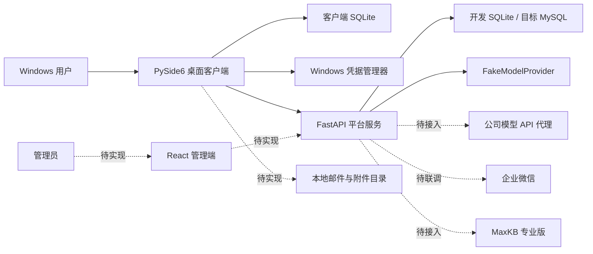

# 企业 AI 工作台（Codex 交接说明）

> 更新时间：2026-08-08（Asia/Shanghai）
>
> 当前版本：`0.1.0` / 开发原型
>
> 首发平台：Windows
>
> Git 分支：`main`，当前未配置远程仓库
>
> 重要说明：本 README 描述“代码实际完成状态”；`docs/design/` 描述目标架构，不代表全部功能已经实现。

这是一个面向企业内部员工的 AI 桌面工作台项目，最终目标包括 AI 对话、复杂办公 Agent、邮件、MaxKB、企业系统连接器、Prompt 下发、权限与额度、插件分发和客户端统一更新。

当前已完成的是第一个可运行技术闭环：

```text
开发环境直接登录
    → 创建服务端会话
    → AI 对话（Fake 模型）
    → Token 用量记录
    → 服务端审计
    → Prompt 按用户/部门/全员下发并同步到客户端
```

另一个 Codex 接手时，请先完整阅读本文件，再阅读 [设计文档目录](docs/design/README.md)，然后运行 `start.bat --check` 和测试套件。不要仅根据设计文档判断某个功能已经存在。

## 1. 当前完成度

| 模块 | 状态 | 当前事实 |
|---|---|---|
| Windows 桌面外壳 | 已完成原型 | PySide6 主界面、导航、对话输入、登录窗口和视觉主题可运行 |
| 开发环境登录 | 已完成 | 默认不显示二维码，点击“登录”后调用开发批准接口并建立真实的平台会话 |
| 真实企业微信扫码协议 | 代码骨架已完成，未现场联调 | 已有 `qrConnect`、随机 state、回调、成员身份获取代码；缺公司凭据和公网 HTTPS 回调验证 |
| 会话与 10 天闲置策略 | 已完成基础实现 | 服务端判断会话闲置；客户端凭据写入 Windows 凭据管理器 |
| AI 对话 | 开发闭环完成 | UI 已调用平台 API，但模型仍是 `FakeModelProvider`；主界面当前使用非流式请求 |
| SSE 流式接口 | API 与测试已完成 | 服务端有 typed SSE 事件，桌面主界面尚未切换为流式渲染 |
| 用量记录 | 已完成基础实现 | 服务端记录输入/输出/总 Token；客户端保存用量镜像，目前 Fake 模型为估算值 |
| 审计 | 已完成基础实现 | 登录、会话、对话和模型请求有审计；尚无 React 审计页面 |
| Prompt 下发 | 已完成基础实现 | 服务端创建/分配，客户端同步并缓存；支持全员、用户、部门 |
| 管理后台 API | 部分完成 | 具备 Prompt 和审计接口；用户、RBAC、额度策略、模型目录等管理接口未完成 |
| React 管理端 | 未开始 | 技术栈已确定为 React，但仓库中还没有前端工程 |
| MySQL 正式环境 | 未接入 | 模型和迁移按兼容方向设计；当前未安装 MySQL 驱动，也未连接公司 MySQL 验证 |
| 公司模型代理 | 未接入 | 配置字段存在，但实际仍调用 Fake Provider；需要公司 API 契约 |
| 邮件模块 | 仅完成设计 | 已调研 `SmartMail-Assistant`，尚未提取或迁移代码 |
| MaxKB | 仅完成设计 | 尚未连接公司 MaxKB 专业版 API |
| Agent / MCP / Skill / 插件 | 仅完成设计 | 尚未实现本地执行进程、权限沙箱或 OpenCode 适配 |
| 自动更新、签名、安装包 | 未开始 | 当前仅源码启动，不是可分发客户端 |

## 2. 已确认的产品与技术决策

- 首期只做 Windows 客户端。
- Python 正式基线选择 3.13；源码当前同时支持 Python 3.12，最近一次验证使用 3.12.8。
- 客户端采用 PySide6。
- 平台服务采用 FastAPI + SQLAlchemy + Alembic。
- 管理端采用 React，但尚未创建工程。
- 客户端结构化数据全部保存在本地 SQLite。
- 服务端开发阶段使用 SQLite，正式环境使用公司统一 MySQL。
- 邮件正文和附件未来保存在客户端本地文件夹，索引与状态进入 SQLite。
- 客户端不保存模型供应商、MaxKB、邮箱或生产数据库长期密钥。
- Prompt 同时支持客户端本地保存、服务端按用户保存和服务端下发。
- Prompt、会话、邮件等保存时间最终需要做成可配置策略。
- 当前开发阶段关闭企微扫码 UI，使用“登录”按钮直接进入；底层仍复用认证事务和审计链路。
- 正式企微登录启用后，默认 10 天未活动需要重新认证。
- `SmartMail-Assistant` 是用户自有代码，可以在后续邮件模块中复用和修改。
- 邮件首期范围以现有 `mail_tools` 功能为上限，但应按风险分阶段开放。
- 所有模型最终应通过公司内部模型 API 代理平台调用；代理平台本身不属于本项目。

更完整的决策背景见：[开发启动决策与待确认项](docs/想法+20260808-021159.md)。

## 3. 当前运行架构



当前是模块化单体，不要在 MVP 阶段提前拆微服务。模型、企微、MaxKB、邮件和 Agent 应通过明确适配器边界接入。

## 4. 仓库结构

```text
AI-DeskTop/
├─ ai_desktop/                 # PySide6 客户端
│  ├─ app.py                   # QApplication 与窗口控制器
│  ├─ login_window.py          # 开发直接登录 / 真实企微登录窗口
│  ├─ main_window.py           # 工作台主界面与对话交互
│  ├─ application.py           # 客户端用例协调层
│  ├─ platform_client.py       # 同步 HTTP/SSE 平台 SDK
│  ├─ local_store.py           # 客户端 SQLite schema 与仓储
│  ├─ credentials.py           # Windows 凭据管理器封装
│  ├─ settings.py              # 客户端路径与环境配置
│  ├─ theme.py                 # Qt 样式表
│  ├─ widgets.py               # 复用组件
│  └─ icons.py                 # 内置 SVG 图标
├─ platform_api/               # FastAPI 平台服务
│  ├─ main.py                  # 路由、依赖和应用入口
│  ├─ services.py              # 认证、Prompt、对话和审计业务逻辑
│  ├─ wecom.py                 # 企业微信服务端适配器
│  ├─ models.py                # SQLAlchemy 服务端模型
│  ├─ schemas.py               # Pydantic API 模型
│  ├─ database.py              # 数据库引擎与 session
│  └─ config.py                # 服务端环境变量配置
├─ migrations/                 # Alembic 迁移
│  └─ versions/20260808_0001_initial_schema.py
├─ tests/                      # API、客户端数据层与 Qt smoke tests
├─ scripts/
│  ├─ launch_platform.py       # start.bat 使用的隐藏 API 启动器
│  ├─ render_login_window.py   # 登录页视觉截图
│  └─ render_main_window.py    # 主界面视觉截图
├─ docs/design/                # 16 份目标设计文档
├─ artifacts/                  # 已提交的界面验收截图
├─ runtime-data/               # 本地服务端 DB、PID、日志；已忽略，禁止提交
├─ start.bat                   # Windows 一键启动器 v0.2
├─ main.py                     # 桌面客户端源码入口
├─ pyproject.toml              # 项目、依赖与工具配置
├─ requirements.txt            # 运行时依赖
├─ alembic.ini                 # 数据库迁移配置
└─ .env.example                # 配置项示例，不含真实密钥
```

## 5. 在新 Codex 环境中恢复开发

### 5.1 最推荐的交接方式

如果仍在同一台电脑上，不需要复制项目。让新的 Codex 直接打开：

```text
AI-Desktop-Workbench
```

必须保留 `.git`，这样新的 Codex 可以查看历史、比较改动和安全回退。当前没有远程仓库，不要假设可以 `git pull`。

如果要移动到另一台电脑，推荐先创建 Git bundle，而不是直接复制缓存和运行数据：

```powershell
cd AI-Desktop-Workbench
git status
git bundle create AI-DeskTop.bundle --all
```

在目标电脑恢复：

```powershell
git clone AI-DeskTop.bundle AI-DeskTop
cd AI-DeskTop
```

不要迁移以下内容：

- `.venv/`
- `.pytest_cache/`、`.pytest-tmp/`、`.mypy_cache/`、`.ruff_cache/`
- `runtime-data/`
- `.env`
- 任何 `*.db`、证书、密钥和真实邮件数据
- Windows 凭据管理器中的本机会话 Token

新的环境第一次启动时会重新创建本地数据库；开发登录按钮可以重新生成会话。

### 5.2 创建隔离 Python 环境

```powershell
cd AI-Desktop-Workbench
python -m venv .venv
.\.venv\Scripts\Activate.ps1
python -m pip install --upgrade pip
python -m pip install -e ".[dev]"
```

如果只想运行，不执行测试和静态检查：

```powershell
python -m pip install -r requirements.txt
```

`start.bat` 会优先使用 `.venv\Scripts\python.exe`；不存在 `.venv` 时才使用 PATH 中第一个 Python。

## 6. 启动方式

### 6.1 一键启动

双击 [start.bat](start.bat)，或者在 CMD/PowerShell 中运行：

```bat
start.bat
```

启动器会：

1. 检查 Python 3.12/3.13；
2. 检查运行依赖；
3. 执行 `alembic upgrade head`；
4. 复用现有 8765 API，或后台启动新的 API；
5. 健康检查通过后启动桌面客户端；
6. 客户端退出后，只停止本次启动器创建的 API 进程。

启动器第一行应显示：

```text
Enterprise AI Workbench Launcher v0.2
```

只检查环境和迁移：

```bat
start.bat --check
```

完整启动并验证 API 后自动关闭，不打开客户端：

```bat
start.bat --smoke
```

API 日志位于：

```text
runtime-data/platform-api.stdout.log
runtime-data/platform-api.stderr.log
```

### 6.2 手动启动

终端一：

```powershell
$env:AIW_ENABLE_FAKE_WECOM = 'true'
$env:AIW_DATABASE_URL = 'sqlite:///runtime-data/platform.db'
python -m alembic upgrade head
python -m platform_api.main
```

终端二：

```powershell
$env:AIW_API_BASE_URL = 'http://127.0.0.1:8765'
python main.py
```

开发模式操作顺序：

1. 登录窗口不显示二维码；
2. 点击“登录”；
3. 进入主工作台；
4. 在对话框发送消息；
5. Fake 模型返回结果，同时产生消息、用量和审计数据。

API 文档：`http://127.0.0.1:8765/docs`。

## 7. 验证命令与当前基线

```powershell
$env:QT_QPA_PLATFORM = 'offscreen'
python -m pytest --basetemp .pytest-tmp
ruff check .
mypy ai_desktop platform_api scripts\launch_platform.py
start.bat --check
start.bat --smoke
```

最近一次验证结果：

- Pytest：`16 passed`
- Ruff：通过
- Mypy：`21 source files` 无问题
- Alembic：`20260808_0001 (head)`
- 启动器：`--check` 和 `--smoke` 均通过
- `--smoke` 结束后 8765 端口已释放

本机全局 Python 环境会出现一条 `RequestsDependencyWarning`，来自系统已有 `requests/urllib3/chardet` 版本组合，不是本项目代码失败。迁移后使用干净 `.venv`，不要复制全局环境。

## 8. 配置项

仓库不会自动读取 `.env`。`.env.example` 只是字段示例；配置需要由 PowerShell、部署系统或未来的 Secret Manager 注入。

| 变量 | 默认/当前用途 | 实现状态 |
|---|---|---|
| `AIW_ENVIRONMENT` | `development` | 已读取 |
| `AIW_DATABASE_URL` | `sqlite:///runtime-data/platform.db` | 已使用 |
| `AIW_API_BASE_URL` | `http://127.0.0.1:8765` | 客户端已使用 |
| `AIW_ENABLE_FAKE_WECOM` | `true` | 已使用；`start.bat` 强制开发模式 |
| `AIW_SESSION_IDLE_DAYS` | `10` | 已使用 |
| `AIW_SESSION_ABSOLUTE_DAYS` | `0`，表示未启用绝对期限 | 已使用 |
| `AIW_AUTH_TRANSACTION_TTL_SECONDS` | `300` | 已使用 |
| `AIW_PROMPT_RETENTION_DAYS` | `180` | 已读取，但完整清理任务未实现 |
| `AIW_WECOM_CORP_ID` | 空 | 真实企微代码使用 |
| `AIW_WECOM_AGENT_ID` | 空 | 真实企微代码使用 |
| `AIW_WECOM_SECRET` | 空 | 仅真实企微本地联调使用，禁止提交 |
| `AIW_WECOM_SECRET_REF` | 空 | 仅配置占位，Secret Manager 解析尚未实现 |
| `AIW_WECOM_CALLBACK_URL` | 空 | 真实企微代码使用，必须为可访问 HTTPS URL |
| `AIW_MODEL_PROXY_BASE_URL` | 空 | 仅配置占位，模型代理调用尚未实现 |
| `AIW_MODEL_PROXY_CREDENTIAL_REF` | 空 | 仅配置占位，凭据解析尚未实现 |
| `AIW_LOCAL_DATA_ROOT` | `%LOCALAPPDATA%\CompanyAIWorkbench` | 客户端已使用 |
| `AIW_REQUEST_TIMEOUT_SECONDS` | `30` | 客户端已使用 |

注意：`start.bat` 是固定的本地开发启动器，会设置 Fake WeCom、本地 SQLite 和 `127.0.0.1:8765`。真实企微、MySQL 或其他环境请使用手动启动或另建环境启动脚本，不要直接修改开发默认值后误提交密钥。

## 9. 数据与凭据位置

### 9.1 客户端

默认根目录：

```text
%LOCALAPPDATA%\CompanyAIWorkbench\
├─ client.db
├─ mail\
└─ artifacts\
```

客户端 SQLite 当前表：

- `schema_migrations`
- `app_settings`
- `local_profile`
- `auth_metadata`
- `conversations`
- `messages`
- `prompt_cache`
- `usage_cache`
- `sync_outbox`

Bearer Token 不进入 SQLite。`auth_metadata` 只保存凭据引用，实际 Token 通过 `keyring` 写入 Windows 凭据管理器，服务名为 `CompanyAIWorkbench`。

### 9.2 服务端开发数据

```text
runtime-data/platform.db
runtime-data/platform-api.pid
runtime-data/platform-api.stdout.log
runtime-data/platform-api.stderr.log
```

服务端当前模型：

- `User`
- `WeComAuthTransaction`
- `UserSession`
- `Conversation`
- `Message`
- `UsageRecord`
- `AuditEvent`
- `PromptPackage`
- `PromptAssignment`

所有 `runtime-data/`、数据库、`.env`、证书和密钥都已在 `.gitignore` 中排除。不要为了调试方便移除这些规则。

## 10. 当前 API

| 方法 | 路径 | 用途 |
|---|---|---|
| GET | `/health/live` | 存活检查 |
| GET | `/health/ready` | 数据库就绪检查 |
| POST | `/api/v1/auth/wecom/transactions` | 创建登录事务 |
| POST | `/api/v1/auth/wecom/transactions/poll` | 客户端轮询登录状态 |
| POST | `/api/v1/dev/auth/wecom/transactions/{id}/approve` | 开发环境直接批准登录 |
| GET | `/api/v1/auth/wecom/callback` | 真实企微 OAuth 回调 |
| POST | `/api/v1/auth/token` | 一次性交换码换平台 Token |
| GET | `/api/v1/me` | 当前用户 |
| POST | `/api/v1/conversations` | 创建对话 |
| POST | `/api/v1/conversations/{id}/messages` | 非流式消息请求 |
| POST | `/api/v1/conversations/{id}/responses` | typed SSE 流式响应 |
| GET | `/api/v1/usage/me/summary` | 当前用户用量汇总 |
| POST | `/api/v1/admin/prompts` | 管理员创建 Prompt |
| POST | `/api/v1/admin/prompts/{id}/assignments` | 分配 Prompt |
| GET | `/api/v1/client/prompts` | 客户端拉取有效 Prompt |
| GET | `/api/v1/audit/me` | 当前用户审计事件 |
| GET | `/api/v1/admin/audit/events` | 管理员查询审计事件 |

目前没有稳定的 OpenAPI 客户端生成流程，也没有 API 版本兼容测试。新增接口时应保持 `/api/v1`，并补充 Pydantic schema、权限检查、审计和回归测试。

## 11. 关键安全约束

- 不把真实 Secret、Token、邮箱密码、数据库密码写入代码、README、测试或截图。
- 不把模型供应商密钥下发到桌面客户端。
- 真实企业微信 Secret 只能位于服务端；生产环境的 Secret Manager 解析仍需实现。
- 服务端数据库只保存平台访问 Token 的 SHA-256 哈希，不保存明文 Token。
- 客户端 Token 进入 Windows 凭据管理器，SQLite 只保存引用。
- 审计事件不要记录完整用户 Prompt、邮件正文、附件正文或密钥。
- 客户端属于不可信环境，权限、额度和功能授权必须由服务端再次判断。
- Agent、文件覆盖、删除、邮件发送和企业系统写操作未来必须有显式确认与可恢复机制。
- 任何本地文件上传到外部域名前，都需要明确展示目标数据边界并获得授权。

## 12. 已知技术债与容易误判的地方

1. `FakeModelProvider` 不是公司模型代理；不要在此基础上声称模型接入完成。
2. SSE API 已存在，但桌面主界面仍调用同步 `send_message()`。
3. React 管理端不存在，只有平台 API 和 UI/UX 设计文档。
4. `AIW_WECOM_SECRET_REF` 尚无 Secret Manager resolver；生产环境不能只填引用就运行。
5. MySQL 驱动未加入依赖，迁移只在 SQLite 实际验证。
6. `Database.create_schema()` 仍会在 FastAPI lifespan 中执行 `create_all()`；正式环境应统一为受控 Alembic 迁移策略。
7. 没有 logout、服务端主动撤销、设备管理和完整 RBAC 管理界面。
8. 客户端本地 schema 目前是内嵌 SQL，不是 Alembic；需要独立的客户端迁移机制。
9. 对话列表、历史恢复、删除与留存清理 UI 尚未实现。
10. Prompt 下发有基础缓存，但缺少签名、冲突处理、灰度、回滚和完整变量渲染。
11. 额度目前只是记录与展示原型，尚未实现策略拒绝、预警和并发限流。
12. 当前没有 CI、安装包、代码签名、自动更新、崩溃上报和生产日志接入。
13. 真实企微代码由 MockTransport 测试覆盖，但没有使用公司真实 CorpID/AgentID/回调域联调。
14. `docs/design/` 中部分内容是目标设计，可能比当前代码领先多个阶段。

## 13. 推荐的下一阶段开发顺序

### P0：把第一个闭环从 Fake 变为真实可试用

1. 获取公司模型代理 API 契约：Base URL、鉴权、模型目录、流式格式、错误、Token 用量和限流。
2. 抽象 `ModelProvider` 协议，保留 Fake，新增公司代理实现和契约测试。
3. 桌面主界面切换到 SSE 流式渲染，补取消、超时、重试和失败恢复。
4. 完成对话列表、历史加载、标题、删除/归档和留存设置。
5. 补充服务端配额检查，在模型调用前拒绝超额请求，而不是只做事后记录。

### P0：最小 React 管理端

1. 创建独立 `admin_web/` React 工程。
2. 首批页面：登录态、用户、Prompt、用量、审计。
3. 服务端补用户列表、状态、角色/权限、配额策略和模型目录 API。
4. 所有管理操作增加管理员鉴权、审计、错误状态和空状态。

### P0：数据库与会话工程化

1. 确认公司 MySQL 版本、驱动和连接规范。
2. 在集成环境执行 Alembic upgrade/downgrade 验证。
3. 移除生产环境 `create_all()`，建立迁移发布流程。
4. 增加 logout、会话撤销、设备列表、主动禁用和 Token 轮换。

### P1：邮件模块

按 [邮件模块与 mail_tools 复用设计](docs/design/16-邮件模块与mail_tools复用设计.md) 从 `SmartMail-Assistant` 提取邮件领域能力。推荐顺序：

1. 账户配置与凭据安全；
2. 本地同步、邮件列表、搜索和附件落盘；
3. AI 摘要、分类和草稿；
4. 人工确认后发送；
5. 规则、批处理和审计。

不要直接复制旧 UI、全局状态或明文凭据处理方式；优先提取协议、解析、存储和测试能力。

### P1/P2：MaxKB、Agent、插件和更新

- MaxKB：先确认专业版 API 版本、鉴权、建库、上传、任务状态和问答接口。
- Agent：先实现受控工作区、最小工具协议、任务状态机和人工审批，再评估 OpenCode 适配。
- 插件：定义 manifest、签名、权限声明、版本、灰度和撤回。
- 更新：Windows 安装器、公司代码签名证书、更新源、回滚和强制升级策略。

## 14. 下一阶段仍需用户或公司提供的信息

- 公司模型代理 API 文档和测试凭据。
- 真实企微 CorpID、AgentID、Secret 管理方式和公网 HTTPS 回调域；仅在准备真实联调时提供。
- 公司 MySQL 版本、连接驱动、字符集、TLS 和迁移规范。
- 管理员角色、部门权限和额度分配规则。
- MaxKB 专业版地址、版本、API 文档和测试 Token。
- 邮件测试账户、协议类型和允许的首期操作范围。
- 客户端正式名称、Logo、公司视觉规范和签名证书计划。
- 数据留存默认值、审计查看权限和敏感数据分类规则。

## 15. 设计文档导航

完整目录：[docs/design/README.md](docs/design/README.md)

重点文档：

- [产品需求规格](docs/design/01-产品需求规格.md)
- [总体系统架构](docs/design/02-总体系统架构.md)
- [桌面客户端详细设计](docs/design/03-桌面客户端详细设计.md)
- [管理后台详细设计](docs/design/04-管理后台详细设计.md)
- [身份、会话与权限设计](docs/design/05-身份会话与权限设计.md)
- [模型接入、计量与配额设计](docs/design/06-模型接入计量与配额设计.md)
- [Agent、MCP、Skill 与插件设计](docs/design/07-Agent与插件运行时设计.md)
- [数据架构与数据库设计](docs/design/09-数据架构与数据库设计.md)
- [API 与事件协议设计](docs/design/10-API与事件协议设计.md)
- [安全、隐私与审计设计](docs/design/11-安全隐私与审计设计.md)
- [测试、评测与验收设计](docs/design/14-测试评测与验收设计.md)
- [实施路线、风险与 ADR](docs/design/15-实施路线风险与ADR.md)
- [邮件模块与 mail_tools 复用设计](docs/design/16-邮件模块与mail_tools复用设计.md)

当前界面截图：

- [开发登录窗口](artifacts/login-window.png)
- [桌面主界面](artifacts/main-window.png)

## 16. 给新 Codex 的建议开场指令

可以把下面内容作为新任务的第一条消息：

```text
请先完整阅读仓库根目录 README.md 和 docs/design/README.md，再查看 git log、git status 和现有测试。

这是企业 AI 工作台项目，当前可运行闭环是：开发直接登录 → Fake AI 对话 → 用量记录 → 审计 → Prompt 下发。不要把目标设计误认为已实现功能。

首先运行：
1. start.bat --check
2. start.bat --smoke
3. pytest、ruff、mypy

保持现有安全边界：不提交密钥和 runtime-data，不把长期凭据放入客户端，不删除用户现有改动。开发前先说明你准备推进的最小端到端增量，并在完成后更新 README 的完成度和测试基线。
```

## 17. 文档维护规则

- 根 README 是“当前代码事实”的权威入口。
- `docs/design/` 是目标架构与详细方案，不得用来替代实现状态记录。
- 每完成一个端到端增量，都要更新第 1、7、12、13 节。
- 每新增配置项，都要同步 `.env.example` 和第 8 节。
- 每新增数据库表或迁移，都要同步第 9 节。
- 每新增或修改 API，都要同步第 10 节并补测试。
- 提交前至少执行 `ruff check .`、Mypy、Pytest 和相关启动 smoke test。
- 不在文档、测试、日志样例或截图中留下真实公司数据和密钥。

---

## 许可证

本项目采用 [MIT 许可证](LICENSE)。

## 第三方与上游声明

本项目包含或依赖第三方组件，其版权与许可证归各自作者所有，
详见仓库内的依赖清单与相关声明文件。若本项目基于其他开源项目二次开发，
已在正文中注明上游项目与所基于的版本，本项目为**非官方**衍生作品。

## 现状与限制

- 本项目为个人开发项目，按“现状”提供，不附带任何明示或暗示的担保。
- README 与代码注释中记录的验证结论仅针对当时的具体环境与版本，不代表在其他环境下同样成立。
- 涉及本地凭据的部分统一使用系统凭据库或环境变量，仓库内不含真实密钥；
  示例配置仅使用占位符。
