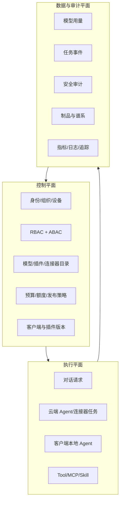
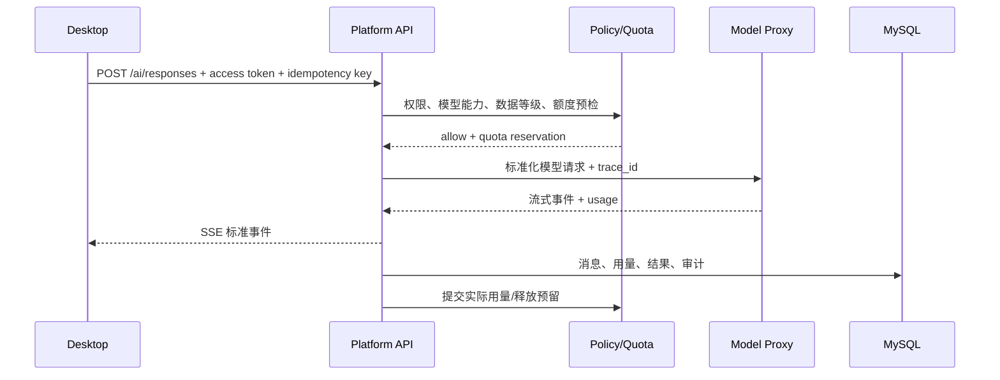
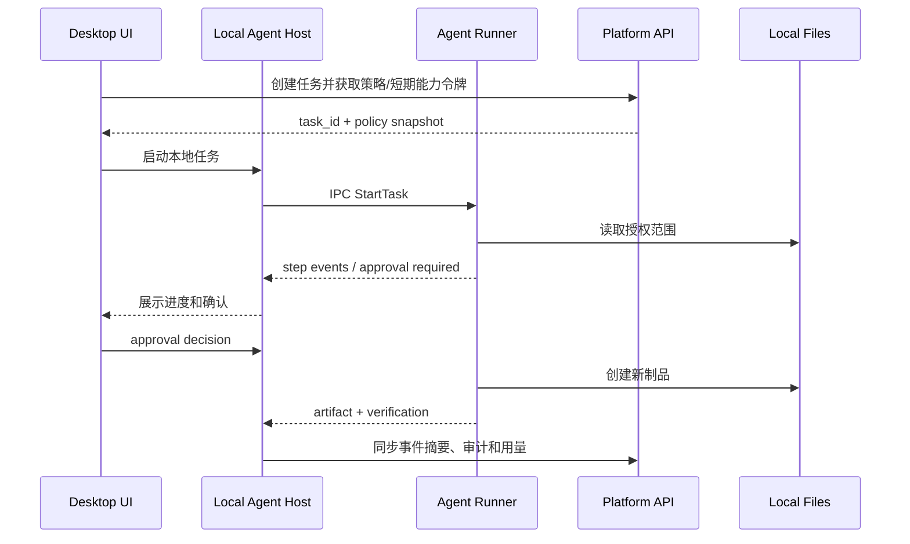
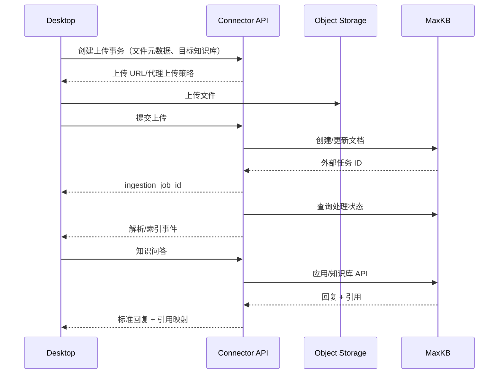
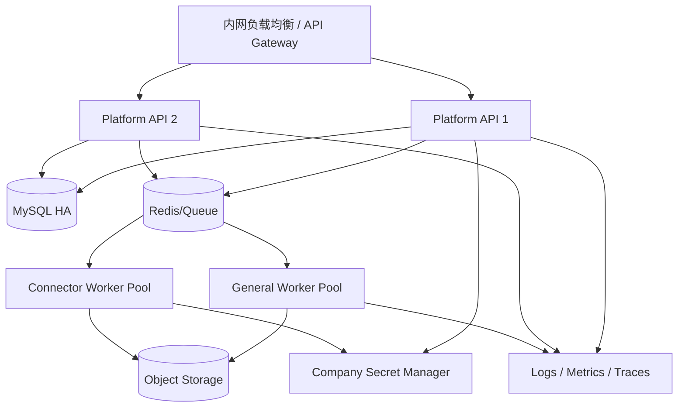

# 02 总体系统架构

> 状态：draft  
> 关联：[产品需求规格](01-产品需求规格.md)、[桌面客户端](03-桌面客户端详细设计.md)、[管理后台](04-管理后台详细设计.md)

## 1. 架构目标

总体架构需要同时满足六类矛盾：

- 桌面端需要本地文件能力，但客户端环境不可完全信任；
- 员工希望灵活使用模型，企业需要权限、预算和数据边界；
- Agent 需要多步骤自治，高风险动作仍必须由人或策略控制；
- 模块需要持续增加，但插件不能破坏主程序稳定性；
- 开发期希望 SQLite 简单，生产后台必须稳定运行在 MySQL；
- 需要快速上线，又不能把所有功能一次性拆成微服务。

## 2. 架构风格

### 2.1 客户端：分层桌面应用 + 进程隔离

- Qt/PySide6 UI 主进程；
- 本地 Agent Runner 独立进程；
- 高风险插件可独立子进程；
- 领域逻辑与 Qt Widget 分离；
- 服务端 SDK、Repository、凭据库和文件守卫作为基础设施适配器。

### 2.2 服务端：模块化单体 + 异步工作进程

- 一个主 API 部署单元，内部按领域模块划分；
- 一个或多个异步 Worker 部署单元；
- 连接器按风险和负载可在独立 Worker 池运行；
- MySQL 保存权威业务数据；
- Redis/公司队列承担缓存、短期状态、分布式锁和任务；
- 对象存储保存附件、插件包、更新包、导出和制品。

### 2.3 集成：端口与适配器

外部系统均通过适配器：

```text
领域用例
  └─ Port（稳定接口）
       ├─ CompanyModelProxyAdapter
       ├─ MaxKBAdapter
       ├─ WeComIdentityAdapter
       ├─ MailAdapter
       ├─ InternalApiAdapter
       ├─ ReadOnlyDatasetAdapter
       └─ OpenCodeAgentAdapter
```

领域层不能直接依赖某供应商 SDK 的响应对象。

## 3. 三平面架构



控制平面下发短期策略快照，但关键请求必须在服务端再次判定。客户端策略缓存只用于 UI 提示、离线限制和快速拒绝。

## 4. 逻辑组件

### 4.1 桌面客户端

| 组件 | 职责 | 不负责 |
|---|---|---|
| Desktop Shell | 窗口、导航、托盘、通知、快捷键 | 业务权限权威判定 |
| Identity Client | 登录事务、令牌刷新、登出、设备信息 | 保存企业微信密钥 |
| Conversation UI | 会话、流式显示、附件、引用、反馈 | 直接调用供应商 API |
| Task Center | 计划、步骤、审批、恢复、制品 | 绕过执行器操作文件 |
| Policy Cache | 缓存模型/插件/文件策略 | 成为最终授权源 |
| Local Repository | SQLite 缓存、草稿、断点、事件 | 保存后台权威组织和权限 |
| Credential Vault | 封装 Windows Credential Manager | 在 SQLite 明文保存 Token |
| Mail Workspace Plugin | 邮件同步、解析、搜索、线程、草稿和邮件页面 | 自建第二套身份、模型、审批和更新系统 |
| Headless Mail Engine | IMAP/Graph/服务端邮件适配与本地邮件领域用例 | 依赖具体 Qt Widget 或直接绕过策略发送 |
| Local Agent Host | 管理 Runner 生命周期与 IPC | 在 UI 线程执行长任务 |
| File Workspace Guard | 路径解析、范围、文件操作授权 | 允许模糊或未解析路径 |
| Updater | 检查、下载、校验、切换、回滚 | 信任未签名包 |

### 4.2 服务端

| 模块 | 数据所有权 | 关键职责 |
|---|---|---|
| Identity | user、department、device、session | 企业微信映射、会话、设备、组织同步 |
| Authorization | role、policy、grant | RBAC/ABAC、数据范围、策略决策 |
| Model Catalog | model、capability、route | 逻辑模型、能力、路由和数据等级 |
| AI Access | request、stream、provider result | 预检、代理调用、流式转发、追踪 |
| Quota | budget、quota、reservation、usage | 额度预占、提交、释放、告警和对账 |
| Conversation | conversation、message、attachment | 会话、消息、引用、反馈 |
| Agent | task、step、approval、tool_call、artifact | 状态机、任务事件、审批和云端执行 |
| Plugin | plugin、version、entitlement、rollout | 包、签名、兼容、授权和发布 |
| Connector | connector、binding、credential_ref | MaxKB、邮件和内部系统适配 |
| Audit | audit_event、export_job | 追加审计、搜索、导出和留存 |
| Updater | client_release、channel、assignment | 客户端版本和发布策略 |
| Notification | notification、preference | 站内、企业微信或邮件通知 |

### 4.3 外部依赖

- 企业微信：登录与组织身份来源之一；
- 公司模型 API 代理：模型供应商密钥、上游路由和模型调用；
- MaxKB 专业版：知识库、文档解析、RAG 和知识问答；
- 企业邮件：邮件读取、草稿和发送；
- 内部 API/数据服务：业务数据和工作流；
- MySQL：后台权威数据；
- Redis/队列：短时数据和异步工作；
- 对象存储：附件、制品、导出、插件和更新包；
- 监控/日志/追踪平台：可观测性。

### 4.4 邮件模块边界

邮件采用“官方插件 + Headless Mail Engine + 可选服务端连接器”结构。现有 SmartMail-Assistant 作为能力来源，提取协议、解析、同步、存储和邮件领域逻辑，不整体嵌入其独立主窗口。

| 模式 | 执行位置 | 适用场景 | 服务端保存 |
|---|---|---|---|
| Local Mirror | 桌面邮件插件 | 腾讯企业邮箱/标准 IMAP、隐私和离线优先 | 绑定、策略、健康、审计摘要 |
| Server Connector | 连接器 Worker | 企微应用邮箱、集中调度、跨设备治理 | 按批准策略保存元数据/短期内容 |

两种模式实现同一 Mail Port。企业微信扫码登录只解决工作台身份，不自动获得邮箱访问权。企微应用邮箱是应用级资源，不等于成员个人邮箱。模型调用、配额、DLP、审批和审计统一进入平台链路。详细设计见 [邮件模块与 mail_tools 复用设计](16-邮件模块与mail_tools复用设计.md)。

## 5. 关键调用链

### 5.1 AI 对话



关键点：

- 客户端请求逻辑模型而非供应商模型；
- 服务端对附件和工具进行独立授权；
- 流式中断仍要终结请求记录；
- 未知实际用量不得伪装为准确值。

### 5.2 本地 Agent



本地执行器不得仅凭模型输出直接执行；每个调用必须经过本地工具注册表和文件守卫。

### 5.3 MaxKB 上传与问答



## 6. 部署拓扑

### 6.1 MVP 推荐拓扑



开发环境可以单实例，但集成测试环境必须使用与生产相同的大类组件和 MySQL 方言。

### 6.2 网络区域

建议至少划分：

- Client Zone：公司终端；
- Access Zone：负载均衡、WAF/API Gateway；
- Application Zone：API 和 Worker；
- Integration Zone：连接器出站代理/跳板；
- Data Zone：MySQL、Redis、对象存储和审计存储；
- External/Partner Zone：外部模型供应商（由公司代理访问）。

连接器采用目标域名/IP 白名单，禁止通用出站网络。

## 7. 数据所有权与一致性

### 7.1 权威数据源

| 数据 | 权威源 | 客户端缓存 |
|---|---|---|
| 用户与部门 | 企业微信/公司身份源，经后台同步 | 显示快照 |
| 角色与策略 | 管理后台 | 短期快照 |
| 模型目录与额度 | 管理后台 | 可用模型和用量摘要 |
| 会话与消息 | 管理后台（离线草稿除外） | 最近会话和草稿 |
| 本地任务细事件 | 客户端 SQLite | 服务端同步摘要/审计 |
| 云端任务 | 管理后台 | 展示缓存 |
| 本地文件正文 | 用户文件系统 | 不复制，除非任务需要 |
| MaxKB 文档与向量 | MaxKB | 元数据和状态 |
| 制品文件 | 本地或对象存储 | 本地路径/缓存 |
| 审计 | 独立服务端存储 | 不作为权威缓存 |

### 7.2 一致性策略

- 权限、账户禁用、插件撤回采用短 TTL + 请求时强校验；
- 用量使用“预留 → 实际提交/释放”保证并发额度；
- 会话与任务采用乐观版本号避免覆盖；
- 外部连接器用外部资源 ID + 版本/ETag 做幂等；
- 审计与业务提交使用 outbox 或可靠事件，避免业务成功而审计完全丢失；
- 客户端离线事件使用本地单调序号，同步后服务端去重。

## 8. 伸缩与拆分触发条件

V1 不主动微服务化。出现以下条件再拆分：

- AI 流式连接数显著高于其他 API，需要独立伸缩；
- 连接器需要独立网络区或更严格凭据隔离；
- 审计写入量影响主业务事务；
- 文件/OCR 任务 CPU、内存或时长影响通用 Worker；
- 某模块发布节奏或团队所有权需要独立部署；
- 数据法规要求独立存储或访问控制。

推荐拆分顺序：AI Access → Connector Workers → Audit Pipeline → Agent Orchestrator。身份和授权在早期保持统一，避免分布式权限不一致。

## 9. 故障域与降级

| 故障 | 用户表现 | 降级 |
|---|---|---|
| 模型代理不可用 | 对话无法生成 | 保留草稿，显示状态，不影响本地文件浏览 |
| 单一模型不可用 | 请求失败/超时 | 路由到被批准的兼容模型，明确告知 |
| MaxKB 不可用 | 知识库操作失败 | 保留待上传任务，不影响普通对话 |
| Redis/队列不可用 | 长任务无法创建 | 拒绝新任务，已有本地任务继续受控执行 |
| MySQL 不可用 | 权威操作失败 | 客户端进入受限模式，不允许高风险离线操作 |
| 客户端执行器崩溃 | 当前本地任务中断 | UI 保持，重启 Runner，从已提交事件恢复 |
| 插件崩溃 | 单插件不可用 | 熔断插件，不影响主界面和其他插件 |
| 更新失败 | 启动失败风险 | 自动回滚上一健康版本 |

## 10. 技术选型基线

| 层 | 基线 | 说明 |
|---|---|---|
| Desktop | Python 3.12、PySide6 6.x | 公司支持版本需锁定 |
| Desktop DB | SQLite + SQLAlchemy/Alembic | 缓存和任务断点 |
| Backend API | Python + FastAPI 类 ASGI 框架 | 具体版本在验证后锁定 |
| Backend ORM | SQLAlchemy 2.x + Alembic | SQLite/MySQL 方言隔离 |
| Database | MySQL | 版本由公司平台决定 |
| Queue/Cache | Redis + 任务队列 | 任务库通过接口隔离 |
| Object Storage | S3 兼容/公司对象存储 | 大文件和制品 |
| Admin Web | React 或 Vue | 依据团队能力确定 |
| Observability | OpenTelemetry 兼容 | 对接公司平台 |

## 11. 架构约束

- 客户端不得直接访问生产 MySQL；
- 客户端不得获得供应商长期 API Key；
- 模型代理平台不属于本项目，本项目不得重复实现其供应商密钥和上游接入管理；
- 任何插件不能修改主程序文件或绕过插件主机；
- 业务写操作不得由自然语言直接转为数据库更新；
- 所有高风险本地操作必须有解析后的绝对路径；
- 外部接口字段不得泄漏进入领域层；
- 所有写 API 必须定义幂等、授权、审计和失败语义。

## 12. 架构验证清单

- 企业微信扫码登录真实闭环；
- 公司模型代理的流式、工具、usage 和错误行为；
- PySide6 打包、代码签名、更新和回滚；
- 本地 Runner 进程终止与恢复；
- OpenCode Server/SDK 在 Windows 和公司模型代理下的行为；
- MaxKB 专业版建库、上传、状态、问答和权限 API；
- SQLite/MySQL 迁移一致性；
- 插件签名、撤回和权限升级；
- 额度并发预留与断流结算；
- 连接器出站白名单和源系统权限透传。
