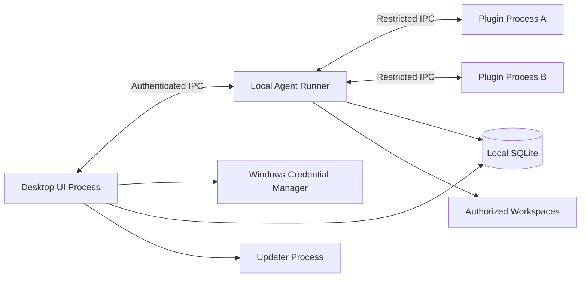
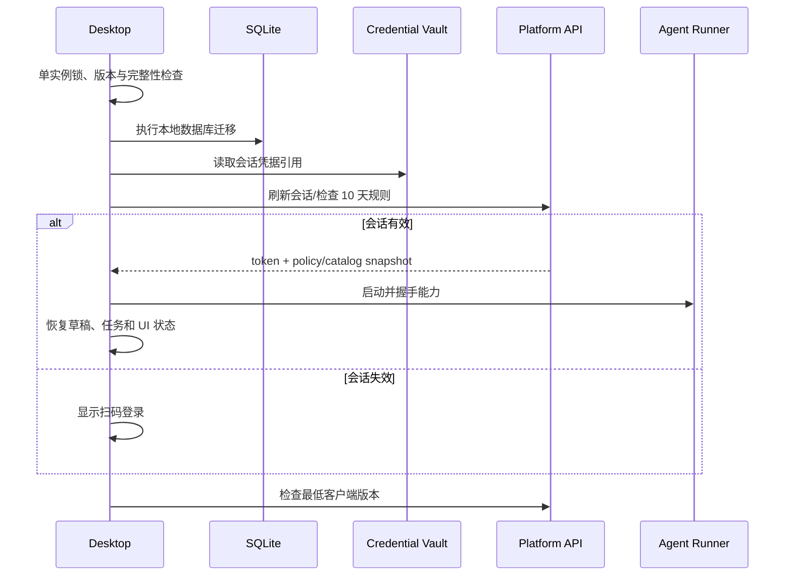
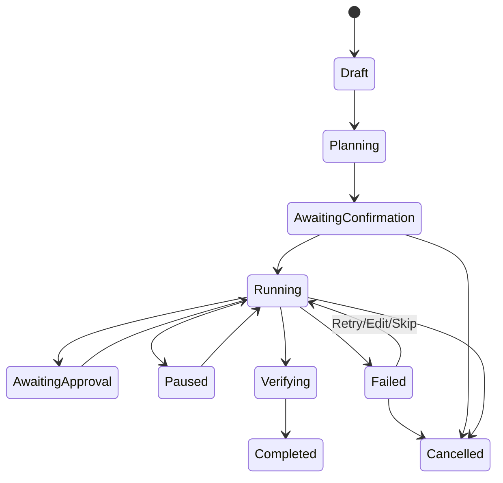

# 03 桌面客户端详细设计

> 状态：draft  
> 技术基线：Python 3.12 + PySide6 6.x  
> 当前原型：[主窗口](../../ai_desktop/main_window.py)、[截图](../../artifacts/main-window.png)

## 1. 设计目标

- 提供稳定、响应迅速、符合企业办公习惯的 Windows 原生桌面体验；
- 将 UI 与长时间、高风险、本地文件执行隔离；
- 登录、模型、插件和策略以后台为权威；
- 在断网、崩溃、升级和任务失败时保护草稿、进度与制品；
- 支持模块持续扩展，但不允许插件直接污染主进程。

## 2. 进程模型



### 2.1 UI 主进程

负责：

- 窗口、导航、页面和本地交互；
- 登录与 API 客户端；
- 策略/目录缓存；
- 对话流显示；
- 任务事件展示和用户确认；
- 通知、托盘、快捷键和更新协调。

禁止：

- 在 UI 线程执行网络阻塞、模型调用、文档解析和批量文件操作；
- 直接执行模型生成的 Shell/SQL/Python；
- 直接加载未经信任的第三方 Python 模块。

### 2.2 Local Agent Runner

负责：

- 计划执行、工具分派和步骤状态机；
- 文件范围校验；
- 文档处理和本地制品生成；
- MCP 客户端生命周期；
- OpenCode 或其他执行引擎适配；
- 事件落盘、恢复和资源限制。

Runner 使用当前用户权限运行，但仍要主动施加路径、命令、网络和工具限制。若公司安全要求更高，可评估 Windows Job Object、AppContainer、受控容器或 EDR 联动。

### 2.3 Updater

独立进程负责：

- 等待主程序退出；
- 验证包哈希与签名；
- 原子切换版本目录；
- 启动新版本并等待健康确认；
- 失败回滚；
- 写入不可伪造的更新日志。

## 3. 客户端分层

```text
ai_desktop/
├─ presentation/
│  ├─ shell/              主窗口、导航、托盘
│  ├─ chat/               对话页面和 ViewModel
│  ├─ tasks/              任务中心和审批
│  ├─ artifacts/          文件与制品
│  ├─ knowledge/          MaxKB 页面
│  ├─ mail/               邮件页面
│  ├─ enterprise_apps/    企业连接器入口
│  ├─ plugins/            插件中心
│  └─ settings/           设置与诊断
├─ application/
│  ├─ commands/           写用例
│  ├─ queries/            读用例
│  ├─ services/           会话、任务、更新协调
│  └─ dto/                UI/领域边界 DTO
├─ domain/
│  ├─ identity/
│  ├─ conversation/
│  ├─ agent/
│  ├─ artifact/
│  ├─ mail/               邮件账户、消息、线程、草稿领域
│  ├─ policy/
│  └─ plugin/
├─ infrastructure/
│  ├─ api/                后台 API/SSE 客户端
│  ├─ persistence/        SQLite Repository
│  ├─ credentials/        Windows Credential Manager
│  ├─ ipc/                Runner 通信
│  ├─ filesystem/         路径与文件实现
│  ├─ mail/               IMAP/Graph/服务端 Mail Port 适配
│  └─ updates/            更新客户端
└─ bootstrap/             配置、依赖注入、日志、迁移
```

当前原型文件将在正式实现阶段按上述边界拆分；原型不是最终目录结构。

## 4. UI 线程与并发

- Qt UI 只能在主线程更新；
- HTTP/SSE 使用异步网络层或专用线程桥接 Qt Signal；
- CPU 密集文档处理放 Runner；
- 每个长任务均有取消令牌；
- 关闭窗口时不强杀任务，先请求检查点和安全终止；
- 事件以不可变 DTO 传给 UI，避免跨线程共享可变对象；
- 每个网络请求都支持超时、取消、重试策略和 trace_id。

## 5. 应用启动流程



启动失败必须落入可诊断页面，而不是白屏。页面至少提供：重试、离线受限进入、导出诊断、退出。

## 6. 单实例与深链

- 使用用户级单实例锁；
- 第二实例将命令通过本地 IPC 发送到现有实例；
- 支持的深链必须采用严格 Schema，例如 `aiworkbench://auth/callback?transaction=...`；
- 深链只携带一次性事务 ID，不携带长期 Token；
- 未知命令、过长参数和非本机发起事务全部拒绝；
- 登录也可以使用客户端轮询，避免深链依赖成为单点。

## 7. 本地配置

### 7.1 配置层级

从低到高：

1. 安装包默认配置；
2. 公司设备/组策略配置；
3. 服务端策略；
4. 用户偏好（仅允许覆盖可个性化字段）；
5. 任务级临时选择。

### 7.2 配置分类

- 非敏感：语言、主题、窗口大小、下载目录、通知偏好；
- 策略：允许模块、文件范围、模型、MCP、更新渠道；
- 敏感引用：凭据库键名、设备私钥引用；
- 运行时：服务端 URL、API 版本、代理、证书固定策略。

服务端 URL 等部署配置不可由普通用户随意改为公网地址。

## 8. 本地 SQLite

### 8.1 建议表

| 表 | 主要字段 | 用途 |
|---|---|---|
| local_profile | user_id、display_name、last_sync_at | 用户展示快照 |
| local_setting | key、value_json、updated_at | 用户偏好 |
| auth_metadata | device_id、credential_ref、expires_at | 凭据引用，不存 Token |
| policy_snapshot | version、payload_json、expires_at | 短期策略快照 |
| conversation_cache | id、title、updated_at、sync_state | 最近会话 |
| message_cache | id、conversation_id、role、content_ref | 消息缓存 |
| draft | id、surface、content_json、updated_at | 未发送草稿 |
| local_task | id、server_task_id、state、checkpoint | 本地任务摘要 |
| local_task_event | task_id、seq、type、payload、created_at | 恢复事件 |
| artifact_ref | id、task_id、path、hash、status | 本地制品 |
| workspace_grant | id、root_path、mode、expires_at | 文件工作区授权 |
| plugin_state | plugin_id、version、state、hash | 插件安装状态 |
| sync_outbox | id、type、payload、attempts | 待同步事件 |

邮件官方插件使用独立的 mail_ 前缀 Schema，核心表包括 mail_accounts、mail_folders、mail_messages、mail_attachments、mail_threads、mail_drafts、mail_send_attempts、mail_sync_failures 和 mail_operation_log。邮件正文、EML 和附件是否落盘由后台策略决定；文件不写 SQLite BLOB。完整字段和迁移边界见 [邮件模块与 mail_tools 复用设计](16-邮件模块与mail_tools复用设计.md)。

### 8.2 数据库规则

- 启用 WAL 并设置合理 busy timeout；
- UI 和 Runner 使用独立连接，不跨线程共享 Session；
- 迁移前备份数据库，迁移失败保留原文件；
- 大文件和完整附件不写 BLOB，只保存受控路径或对象引用；
- 敏感缓存按数据等级控制是否落盘；
- 退出并不默认删除全部缓存，保留策略由后台下发；
- 远程撤销后删除会话凭据，并按策略清理敏感缓存。

## 9. 凭据存储

| 凭据 | 存放位置 | 客户端可见性 |
|---|---|---|
| 平台刷新会话 | Windows Credential Manager | 仅凭据适配器 |
| 平台访问令牌 | 内存，短期 | API 客户端 |
| 设备私钥 | Windows 安全存储/证书库 | 仅签名操作 |
| 邮箱 OAuth | 优先服务端；本地模式进入凭据库 | 邮件适配器 |
| 邮箱客户端专用密码 | 仅在管理员允许的 Local Mirror 模式进入凭据库 | 邮件适配器，不进入 SQLite |
| 企微应用邮箱 Secret | 服务端 Secret Manager | 普通客户端不可见 |
| MaxKB 系统 Key | 服务端密钥管理 | 客户端不可见 |
| 模型供应商 Key | 公司模型代理 | 客户端不可见 |
| MCP 凭据 | 服务端短期令牌或凭据库引用 | 指定 MCP 进程 |

凭据不得进入日志、崩溃转储、剪贴板和错误弹窗。

邮箱授权事务与企业微信扫码登录事务彼此独立。模块被撤回、用户离职或设备丢失时，客户端停止同步/发送并按策略删除凭据；邮件镜像、索引、草稿和附件的保留或清理由独立的数据保留策略决定。

## 10. API 客户端

### 10.1 通用能力

- 统一 Base URL、API 版本和 User-Agent；
- 自动附加 access token、device_id、client_version 和 traceparent；
- 401 时只允许一次受控刷新，避免刷新风暴；
- 403 显示策略原因，不无限重试；
- 409/412 显示版本冲突并提供刷新；
- 429 使用服务端 Retry-After；
- 5xx 采用有限指数退避，写请求需要幂等键；
- 支持公司代理和企业 CA；
- 证书错误不能提供“忽略并继续”。

### 10.2 SSE 流处理

- 按事件类型解析，不假设所有流片段都是文本；
- 事件包含 request_id、sequence、type 和 payload；
- 序号缺失触发补偿查询或标记结果不完整；
- 停止生成发送 cancel，随后等待 final/cancelled；
- 断线重连携带 Last-Event-ID（若服务端支持）；
- 流结束后拉取权威消息和 usage，修正本地显示。

## 11. 对话页面设计

### 11.1 ViewModel 状态

```text
ConversationState
├─ conversation_id
├─ title
├─ messages[]
├─ selected_logical_model
├─ attachments[]
├─ granted_tools[]
├─ data_boundary
├─ streaming_state
├─ usage_preview
├─ error
└─ draft
```

### 11.2 消息类型

- user_text；
- assistant_text；
- reasoning_summary（按策略显示）；
- tool_call；
- tool_result_summary；
- citation；
- attachment；
- approval_request；
- artifact；
- error/retry；
- system_notice。

消息列表使用虚拟化或分段加载，避免长会话创建大量 Widget 导致卡顿。

## 12. 任务中心

### 12.1 本地任务状态



### 12.2 事件持久化

每个事件包含：

- task_id；
- local sequence；
- server sequence（若有）；
- event_type；
- step_id；
- timestamp；
- payload；
- payload_hash；
- sync_state。

状态由事件归并得到，避免只保存一个容易损坏的最终状态字段。

## 13. 文件工作区守卫

### 13.1 路径校验

操作前：

1. 获取用户授权的根目录；
2. 解析绝对规范路径；
3. 解析符号链接、联接点和大小写；
4. 验证最终路径仍在授权根目录；
5. 检查文件类型、大小、数据等级和策略；
6. 生成可读操作描述；
7. 根据动作风险决定是否确认。

禁止仅通过字符串前缀判断路径。

### 13.2 动作风险

| 动作 | 默认风险 | 默认策略 |
|---|---|---|
| 列目录/读文件 | 低/中 | 工作区内可按任务授权 |
| 创建新文件 | 中 | 显示目标路径，任务内允许 |
| 覆盖文件 | 高 | 每次或批次明确确认，先备份 |
| 移动/重命名 | 中/高 | 显示源与目标 |
| 删除 | 高 | 优先回收站，显示数量与路径 |
| 上传 | 高 | 显示目的系统和数据边界 |
| 执行文件/脚本 | 极高 | 默认禁止或管理员白名单 |

### 13.3 制品验证

- 文件存在且大小合理；
- 扩展名与内容类型一致；
- Word/Excel/PPT/PDF 可被相应解析器重新打开；
- 页数、工作表、幻灯片数等满足任务约束；
- 输出哈希和来源写入 artifact_ref；
- 病毒扫描/DLP（若公司提供）；
- 用户预览后才进入正式目录或业务提交。

## 14. 插件主机

- 插件包解压到版本化只读目录；
- 启动前验证签名、哈希、发布者、撤回状态和兼容版本；
- 通过受限 IPC 暴露明确能力，不给主程序对象引用；
- 环境变量只包含插件声明且已授权的值；
- 网络通过本项目代理或白名单；
- 插件崩溃计数触发熔断；
- 卸载前检查运行任务和数据清理策略；
- 插件升级允许并存旧版本，运行中任务绑定旧版本直到结束。

## 15. 离线与断网模式

允许：

- 打开已缓存的非敏感会话摘要；
- 编辑草稿；
- 查看本地制品；
- 继续不需要新权限、未过策略有效期的低风险本地任务（可由公司策略禁用）。

禁止：

- 新模型调用；
- 新的企业数据访问；
- 使用已过期策略执行危险操作；
- 安装/升级插件；
- 假定账户仍有效的业务写入。

网络恢复后先刷新会话和策略，再同步 outbox。

## 16. 错误与恢复体验

| 场景 | 用户可用动作 |
|---|---|
| 登录二维码过期 | 刷新二维码、检查网络、退出 |
| 会话过期 | 重新扫码，保留本地草稿 |
| 模型超时 | 重试、换兼容模型、保留输入 |
| 配额不足 | 查看用量、申请额度、使用低成本模型 |
| Runner 崩溃 | 重启 Runner、从检查点恢复、导出诊断 |
| 文件被占用 | 重试、另存为、跳过、手动关闭占用程序 |
| 权限被撤回 | 停止相应能力、解释原因、保留安全制品 |
| 插件失败 | 重启插件、禁用、回滚、上报 |
| 更新失败 | 自动回滚、导出更新日志、稍后重试 |

## 17. 客户端更新

### 17.1 目录模型

```text
AI-Workbench/
├─ launcher.exe
├─ versions/
│  ├─ 1.2.3/
│  └─ 1.2.4/
├─ current -> versions/1.2.4
├─ data/                  用户数据，不随版本删除
└─ update-state.json
```

Windows 上具体实现可以使用版本指针文件而非符号链接，以适应终端策略。

### 17.2 健康检查

新版本启动后需要确认：

- 主进程完成初始化；
- 本地数据库迁移成功；
- Runner 可握手；
- 核心 Qt 组件可加载；
- 能读取旧版本必要配置；
- 在限定时间内写入 healthy 标志。

失败自动恢复上一版本；数据库迁移必须设计兼容窗口或可恢复备份。

## 18. 日志与诊断

日志类型：

- app.log：启动、页面和一般错误；
- network.log：请求元数据、状态和 trace_id，不含敏感正文；
- runner.log：任务与工具摘要；
- updater.log：版本、签名、安装和回滚；
- crash dump：按公司策略生成并脱敏。

“导出诊断包”应：

- 默认移除 Token、Cookie、邮件、Prompt 和文档正文；
- 列出将包含的文件；
- 由用户确认保存位置；
- 生成清单和哈希；
- 不自动上传第三方。

## 19. 打包与签名

- 使用锁定依赖和可重复构建；
- 评估 Qt 官方 `pyside6-deploy`/Nuitka 路径；
- 输出 Windows 安装包或与公司软件分发兼容的包；
- EXE、DLL、安装包和更新清单进行公司代码签名；
- 构建生成 SBOM；
- 删除不使用的 Qt 模块，特别关注 WebEngine 体积；
- 正式商用前完成 PySide6/Qt 许可证评审。

## 20. 客户端验收要点

- 1440×900 和公司最低分辨率无主要裁切；
- 125%、150%、200% DPI 可用；
- 断网/重连、登录过期、Runner 崩溃、更新回滚可恢复；
- 工作区越界、联接点绕过和批量删除被拦截；
- Token 不出现在 SQLite、日志和诊断包；
- 长会话和大任务 UI 保持响应；
- 插件崩溃不影响主进程；
- 客户端最低版本策略可以服务端强制执行。
