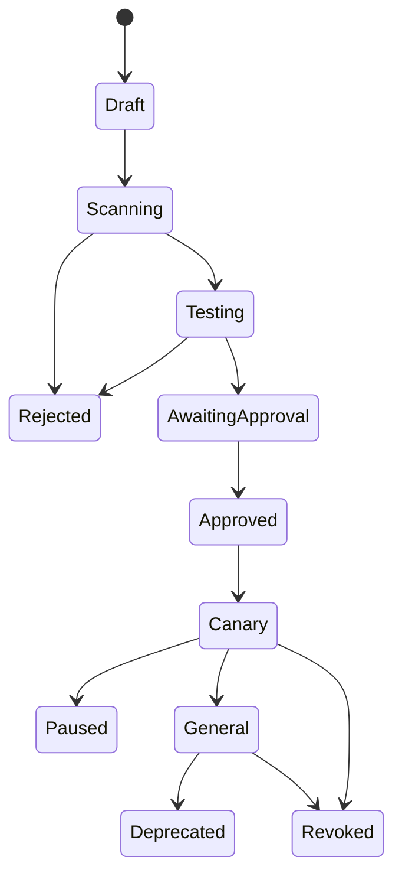

# 04 管理后台详细设计

> 状态：draft  
> 范围：服务端 API、异步 Worker、管理后台 Web  
> 关联：[总体架构](02-总体系统架构.md)、[API 与事件](10-API与事件协议设计.md)

## 1. 设计目标

- 管理账户、权限、模型、额度、插件、连接器、审计和客户端版本；
- 为桌面端提供统一、稳定、可版本化的业务 API；
- 在不重复建设公司模型代理的前提下完成用户级策略和计量；
- 用模块化单体降低早期分布式复杂度；
- 为未来独立拆分 AI Access、Agent、Connector 和 Audit 保留边界。

## 2. 部署单元

| 单元 | 职责 | 是否无状态 |
|---|---|---:|
| platform-api | REST/SSE、鉴权、查询、命令入口 | 是，除连接状态 |
| general-worker | 通知、导出、同步、普通后台任务 | 是 |
| connector-worker | MaxKB、邮件、内部系统调用 | 是 |
| agent-worker | 云端 Agent/文档处理（后续） | 是 |
| admin-web | 管理后台静态资源 | 是 |
| scheduler | 定时同步、对账、清理、健康检查 | 单活/选主 |

MVP 可合并部分 Worker，但队列和职责应从代码结构上区分。

## 3. 模块化单体结构

```text
server/
├─ app/
│  ├─ identity/
│  │  ├─ domain/
│  │  ├─ application/
│  │  ├─ infrastructure/
│  │  └─ api/
│  ├─ authorization/
│  ├─ model_catalog/
│  ├─ ai_access/
│  ├─ quota/
│  ├─ conversation/
│  ├─ agent/
│  ├─ plugin/
│  ├─ connector/
│  ├─ audit/
│  ├─ updater/
│  └─ notification/
├─ shared/
│  ├─ database/
│  ├─ events/
│  ├─ auth/
│  ├─ observability/
│  ├─ errors/
│  └─ clock/
├─ bootstrap/
├─ migrations/
└─ tests/
```

### 3.1 模块规则

- 模块 API 不直接暴露 ORM Entity；
- 模块不能直接写其他模块的数据表；
- 跨模块读取优先通过应用服务或只读投影；
- 跨模块副作用使用领域事件/outbox；
- 共享层只放通用技术能力，不堆放业务逻辑；
- 每个表标注 owner module；
- 每个模块有独立单元测试、契约测试和迁移责任。

## 4. 请求处理管线

```mermaid
flowchart LR
    Request["HTTP/SSE Request"] --> Trace["Trace/Request ID"]
    Trace --> Authn["Authentication"]
    Authn --> Device["Device/Client Version"]
    Device --> Authz["Authorization Policy"]
    Authz --> Rate["Rate Limit/Quota Precheck"]
    Rate --> Validate["Schema/Business Validation"]
    Validate --> UseCase["Application Use Case"]
    UseCase --> Tx["Transaction + Outbox"]
    Tx --> Audit["Audit Projection"]
    Audit --> Response["Response"]
```



错误发生在任一层都必须返回稳定错误码和 trace_id；不得将 Python 堆栈、数据库语句和第三方密钥返回客户端。

## 5. Identity 模块

职责：

- 企业微信登录事务与身份映射；
- 用户、部门、组织成员状态；
- 设备注册、状态和风险标签；
- 访问/刷新会话；
- 组织增量与全量同步；
- 账户禁用和会话撤销事件。

主要服务：

- `CreateLoginTransaction`
- `CompleteWeComCallback`
- `ExchangeLoginGrant`
- `RefreshSession`
- `RevokeSession`
- `SyncOrganization`
- `DisableUser`

## 6. Authorization 模块

职责：

- 角色、权限、策略和资源 Grant；
- 部门、项目、数据等级、设备和网络属性；
- 统一 `PolicyDecision`；
- 决策解释和审计；
- 紧急撤销和策略版本。

接口示意：

```python
decision = policy_service.evaluate(
    subject=user_context,
    action="connector.dataset.query",
    resource=dataset_context,
    environment=request_context,
)
```

返回 `allow/deny/require_approval`、原因码、命中策略、约束和有效期。

## 7. Model Catalog 模块

### 7.1 领域对象

- LogicalModel；
- ProviderModel；
- ModelCapability；
- RoutePolicy；
- DataBoundary；
- PriceRule；
- ModelHealth；
- ModelAssignment。

### 7.2 管理流程

1. 管理员登记实际模型及公司代理 ID；
2. 配置能力、上下文、工具、数据边界和计量规则；
3. 创建面向用户的逻辑模型；
4. 将实际模型按优先级/条件加入路由；
5. 配置用户或部门可见范围；
6. 通过测试请求验证；
7. 发布目录版本；
8. 客户端获得新目录快照。

发布前必须验证同一逻辑模型下的候选模型在所需能力上兼容。

## 8. AI Access 模块

### 8.1 职责边界

负责：

- 认证用户到逻辑模型的访问；
- 能力和数据等级匹配；
- 额度预留；
- 标准请求转公司模型代理；
- SSE 事件标准化；
- 工具声明过滤；
- 用量提交和审计；
- 限流、超时、重试和降级。

不负责：

- 保存外部供应商 Key；
- 重新实现公司模型代理的供应商路由平台；
- 假装所有供应商协议完全一致；
- 在无策略约束下执行工具。

### 8.2 请求状态

`created → authorized → quota_reserved → upstream_started → streaming → completed/failed/cancelled → usage_committed`

终态后仍未结算的请求由补偿任务处理。

## 9. Quota 模块

### 9.1 预算层级

- 公司总预算；
- 部门预算；
- 项目/成本中心预算；
- 用户额度；
- 特定模型/功能额度；
- 临时例外额度。

### 9.2 并发控制

请求前创建 Reservation：

- 根据输入长度、最大输出和任务类型估计预留；
- 原子检查可用额度；
- 完成后以实际 usage 提交；
- 失败/取消释放未用额度；
- 预留超时由定时任务回收；
- 同一 request_id 重试返回同一 Reservation。

## 10. Conversation 模块

- 会话元数据；
- 消息与内容块；
- 附件引用；
- 引用来源；
- 分支/父消息；
- 反馈；
- 归档、删除和保留策略；
- 对话到任务的关联。

消息正文是否服务端持久化、保存多久、是否允许用户删除，需要按数据分类和公司制度配置。

## 11. Agent 模块

职责：

- 创建任务和计划；
- 管理步骤状态和依赖；
- 接收本地 Runner 事件；
- 编排云端工具/连接器；
- 管理审批；
- 记录制品元数据；
- 超时、取消、补偿和恢复；
- 提供任务事件流。

服务端不能信任客户端声称的“操作已被批准”。审批令牌必须由服务端签发，绑定 task、step、action、resource、user、expiry 和 nonce。

## 12. Plugin 模块

### 12.1 管理对象

- Plugin；
- PluginVersion；
- PackageArtifact；
- Signature；
- PermissionDeclaration；
- CompatibilityRule；
- Entitlement；
- Rollout；
- Revocation；
- InstallTelemetry。

### 12.2 发布工作流



Revoked 在服务端立即生效；客户端下一次策略刷新卸载或禁用本地包。

## 13. Connector 模块

### 13.1 核心对象

- ConnectorDefinition；
- ConnectorInstance；
- CredentialRef；
- ResourceBinding；
- UserMapping；
- HealthCheck；
- ConnectorJob；
- RatePolicy。

### 13.2 执行规则

- 凭据由 Worker 在执行时从密钥管理取出；
- API 层只提交 credential_ref；
- 出站目标白名单；
- 每实例独立限流和熔断；
- 标准化外部错误，保留 provider_error_ref 供管理员诊断；
- 高风险连接器使用独立 Worker 池和网络区域。

邮件连接器额外管理：本地镜像/服务端模式、允许账户类型、OAuth scope、正文/附件落盘与模型数据边界、发送限额、外部联系人/DLP、紧急暂停同步/发送和客户端插件最低版本。企微应用邮箱 Secret 只存在服务端 Secret Manager，普通用户只能看到已分配资源。

## 14. Audit 模块

- 接受业务 outbox 事件；
- 转为统一 AuditEvent；
- 追加写入；
- 敏感字段脱敏/哈希；
- 支持按用户、动作、资源、trace_id、时间和风险检索；
- 导出任务异步执行；
- 导出本身产生审计；
- 普通业务管理员不能删除或修改审计历史。

## 15. Updater 模块

主要对象：

- ClientRelease；
- ReleaseArtifact；
- UpdateChannel；
- RolloutAssignment；
- MinimumVersionPolicy；
- DeviceUpdateState；
- RollbackDecision。

发布规则：

- 包、清单、哈希和签名齐全；
- 安全扫描通过；
- 与后台 API、Runner 和插件兼容；
- 先内部测试，再 canary，再部门灰度，再全量；
- 失败率超过阈值自动暂停；
- 安全紧急版本可配置截止时间和强制更新。

## 16. 管理后台信息架构

```text
概览
├─ 运行状态
├─ 活跃/用量/成本
└─ 风险与待处理事项

组织与访问
├─ 用户与部门
├─ 角色与策略
├─ 设备与会话
└─ 临时权限/额度申请

AI 能力
├─ 逻辑模型
├─ 实际模型与路由
├─ 用量与预算
├─ Prompt/Skill（后续）
└─ 模型健康与评测

扩展能力
├─ 插件目录
├─ 插件发布
├─ 连接器
├─ MCP 注册表
└─ MaxKB 绑定

治理与运维
├─ 审计中心
├─ 客户端版本
├─ 任务与失败队列
├─ 通知
└─ 系统设置
```

## 17. 关键管理页面

### 17.1 概览

- 平台健康；
- 今日活跃、请求、Token、费用；
- 模型成功率和 P95 延迟；
- 运行中/失败任务；
- 连接器异常；
- 客户端旧版本；
- 高风险审计；
- 待审批插件/额度/操作。

不得为了“好看”展示无业务含义的虚假指标。

### 17.2 用户详情

- 企业微信身份、部门、状态；
- 角色、直接策略和继承策略；
- 模型、插件、连接器使用权；
- 额度与当期用量；
- 设备和会话；
- 最近高风险审计；
- 禁用、撤销会话和临时授权操作。

管理员查看用户内容正文需要单独权限和审计，默认只显示元数据。

### 17.3 策略编辑器

- 策略名称、说明、负责人、状态；
- Subject 条件；
- Action；
- Resource 条件；
- Environment 条件；
- Effect：allow/deny/approval；
- 约束：数据量、路径、模型、时间、网络；
- 测试控制台：输入上下文，显示决策和命中路径；
- 发布前影响分析：受影响用户和资源数量。

### 17.4 模型详情

- 逻辑/实际模型；
- 能力、上下文和参数；
- 数据边界；
- 路由和降级；
- 可见范围；
- 价格规则；
- 健康、延迟、错误和评测；
- 最近变更和发布记录。

### 17.5 插件版本详情

- Manifest；
- 权限差异；
- SBOM/扫描结果；
- 签名；
- 兼容矩阵；
- 发布环；
- 安装、崩溃和任务使用情况；
- 暂停、回滚和撤回。

### 17.6 邮件连接器与策略

- 连接器类型、部署模式、版本、owner 和 Runbook；
- OAuth/Secret 引用、scope、目标域和网络区；
- 部门/用户/邮箱域分配；
- 正文/附件落盘、保留、加密和模型数据边界；
- 单封/批量发送、外部联系人、DLP、限额和审批；
- 同步延迟、成功率、限流、最近错误和待对账发送；
- 暂停读取、暂停 AI 正文、暂停发送、撤销凭据和插件撤回；
- 管理员默认不能查看邮件正文，正文访问需要独立权限、原因和审计。

### 17.7 审计搜索

- 时间范围；
- 用户/部门/设备；
- action/resource；
- 风险等级；
- 模型/插件/连接器；
- trace_id/request_id/task_id；
- 结果；
- 导出和留存标记。

## 18. 后台任务

| 任务 | 触发 | 幂等键 | 失败处理 |
|---|---|---|---|
| 组织同步 | 定时/手动 | provider + cursor | 重试、告警、保留上次快照 |
| 用量对账 | 每日/月度 | period + source | 差异报告、人工确认 |
| MaxKB 状态同步 | 事件/轮询 | external_job_id | 退避、死信、人工重试 |
| 邮件同步健康汇总 | 客户端事件/周期 | binding + window | 标记延迟、告警，不集中复制正文 |
| 邮件发送对账 | 状态未知/周期 | send_attempt_id | 查询回执，禁止盲重发，人工确认 |
| 插件扫描 | 上传后 | package_hash | 拒绝发布 |
| 客户端发布统计 | 周期 | release + window | 失败率触发暂停 |
| 审计导出 | 人工 | export_request_id | 失败可重试、短期下载链接 |
| 数据清理 | 定时 | policy + partition | dry-run、审批、清理报告 |
| 额度预留回收 | 周期 | reservation_id | 原子状态迁移 |

## 19. 缓存与锁

适合缓存：

- 短期用户会话；
- 已发布模型目录；
- 策略编译结果；
- 插件/客户端发布清单；
- 连接器健康摘要；
- API 限流计数。

不适合仅存在缓存：

- 预算实际用量；
- 审计；
- 任务权威状态；
- 插件撤回记录；
- 用户禁用状态。

分布式锁仅用于协调，不替代数据库约束和幂等状态机。

## 20. 数据事务与 Outbox

一个业务命令在同一数据库事务中写入：

1. 业务表；
2. outbox_event；
3. 必要的请求幂等记录。

Publisher 将 outbox 事件送至队列/审计，成功后标记已发布。消费者按 event_id 去重。这样可避免“业务成功但审计或通知完全丢失”。

## 21. 健康检查

- `/health/live`：进程存活，不访问外部依赖；
- `/health/ready`：MySQL、关键配置和队列可用；
- `/health/dependencies`：管理员可见的外部依赖详情；
- Connector Health：单独状态和最近成功时间；
- Model Health：通过公司代理执行低成本探测，严格限频。

健康接口不得泄露版本漏洞、内网地址和凭据。

## 22. 后台验收

- 每个模块的数据所有权明确；
- 普通管理员、模型管理员、审计员权限互斥符合要求；
- 禁用用户和撤回插件在规定时间内生效；
- 额度并发不超卖；
- 所有关键管理变更有审批/审计和变更前后值；
- 队列重复消息不产生重复副作用；
- 连接器凭据不进入 API 日志；
- 审计导出具有权限、有效期和水印；
- 客户端灰度可以暂停和回滚。
