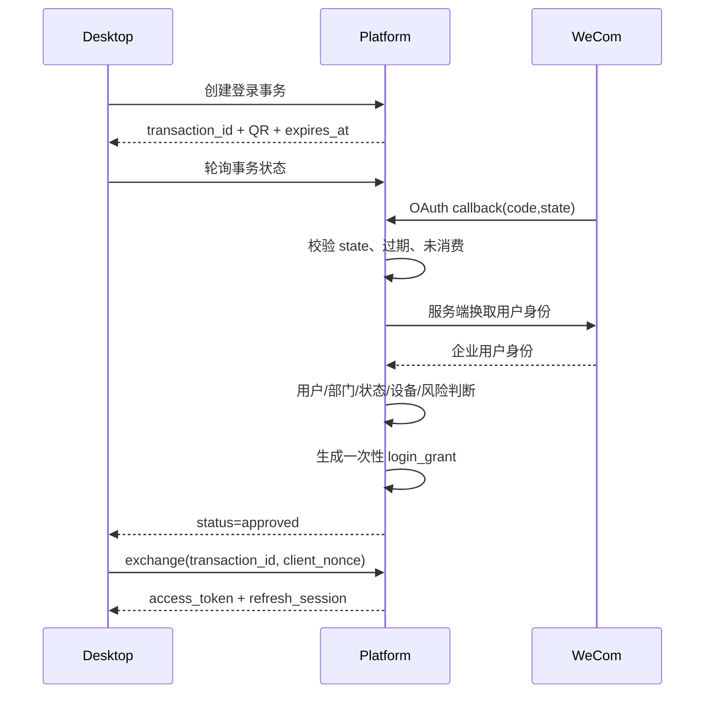

# 05 身份、会话与权限设计

> 状态：draft  
> 外部依赖：企业微信内部应用/公司统一身份平台（待现场确认）  
> 关联：[安全与审计](11-安全隐私与审计设计.md)

## 1. 目标

- 使用企业微信扫码完成用户身份认证；
- 账户、设备和会话可独立撤销；
- 服务端严格执行“连续 10 天无有效活动重新扫码”；
- 支持部门/角色授权与细粒度条件策略；
- 权限决策可解释、可测试、可审计；
- 不将企业微信应用密钥和长期平台凭据放入客户端。

## 2. 身份来源与本地账户

### 2.1 外部身份

企业微信提供外部身份标识和组织属性。具体使用企业内部应用网页登录、扫码组件或公司统一身份平台桥接，由阶段 0 联调决定。

### 2.2 平台用户

平台维护内部 `user_id`，外部身份保存为 `identity_binding`：

```text
User
├─ id (internal UUID)
├─ status: active/disabled/left/pending
├─ display_name
├─ primary_department_id
└─ identity_bindings[]
   ├─ provider: wecom
   ├─ provider_subject
   ├─ corp_id
   └─ status
```

业务表一律引用内部 `user_id`，不能把企业微信 userid 直接作为所有表主键。

## 3. 扫码登录协议

### 3.1 登录事务

客户端调用 `POST /auth/login-transactions`，提交：

- device_public_id；
- client_version；
- platform/os_version；
- 随机 client_nonce；
- 可选 deep_link callback capability。

后台创建：

- transaction_id；
- state（高熵随机）；
- server_nonce；
- expires_at（建议 2–5 分钟）；
- status=`pending`；
- 扫码 URL/二维码内容。

### 3.2 回调处理



### 3.3 安全要求

- state 与 transaction 绑定；
- code 只在后台换取身份；
- login_grant 一次性、短期、绑定 device/client_nonce；
- 已完成/拒绝/过期事务不能再次消费；
- 轮询接口不返回企业身份敏感信息；
- 限制创建事务和轮询频率；
- 回调域名严格配置；
- 登录结果在服务端重新检查用户状态和公司范围。

## 4. 令牌与会话

### 4.1 建议模型

- Access Token：5–15 分钟，服务端 API 使用；
- Refresh Session：服务端有状态，客户端保存不可读/受保护值；
- Login Grant：约 60 秒，一次性；
- Approval Token：短期、动作级、任务级；
- Connector Capability Token：短期、资源级，不暴露系统密钥。

具体时长由安全评审确定。

### 4.2 Refresh Session 字段

| 字段 | 说明 |
|---|---|
| id | 会话 ID |
| user_id | 用户 |
| device_id | 设备 |
| secret_hash | 刷新凭据哈希 |
| created_at | 创建时间 |
| last_activity_at | 最近有效活动 |
| absolute_expires_at | 绝对到期 |
| idle_expires_at | 闲置到期 |
| rotated_from_id | 轮换链 |
| revoked_at/reason | 撤销信息 |
| risk_state | 风险状态 |
| client_version | 最近客户端版本 |

### 4.3 刷新令牌轮换

- 每次刷新签发新的 secret，旧 secret 失效；
- 在极短重试窗口内允许同一请求幂等返回；
- 检测旧 secret 再次使用时视为可能重放，撤销整个会话链；
- secret 只保存哈希；
- 客户端以系统凭据库原子替换。

## 5. “10 天不登录”精确定义

建议业务定义：

> 用户连续 10 × 24 小时没有通过有效平台会话完成受保护客户端活动，Refresh Session 闲置过期；下次启动或刷新时必须重新进行企业微信扫码。

### 5.1 计入活动

- 成功刷新会话；
- 成功访问需要用户身份的核心 API；
- 可选择只将主动用户行为计入，后台心跳不计入。

建议不要让无用户操作的后台心跳无限延长会话。

### 5.2 不计入活动

- 登录页面轮询；
- 未认证健康检查；
- 自动更新检查；
- 失败/被拒绝请求；
- 无交互的常驻托盘心跳。

### 5.3 绝对期限

即使持续使用，也建议设置绝对期限（如 30/60/90 天，待公司决定），到期重新扫码，防止会话无限续期。

### 5.4 时间与并发

- 只使用服务端时间；
- `last_activity_at` 更新可节流，例如每 15 分钟最多一次；
- 到期判断与刷新在同一事务/原子操作中；
- 多设备分别计算闲置期限；
- 用户禁用、离职或设备撤销优先于期限。

## 6. 设备模型

### 6.1 Device 字段

- device_id（随机生成，不使用硬件序列号作主键）；
- user_id；
- device_name；
- os_name/os_version；
- client_version；
- app_install_id；
- public_key（可选）；
- managed_state；
- risk_state；
- first_seen_at/last_seen_at；
- revoked_at/reason。

### 6.2 设备指纹原则

- 不采集无必要的硬件隐私标识；
- 指纹仅作为风险信号，不作为唯一身份凭证；
- 重装系统/程序有明确重新注册流程；
- 管理后台向用户展示可理解的设备名称和最近活动；
- 可与公司 MDM/EDR 的设备合规状态集成。

## 7. 组织同步

### 7.1 同步数据

- 成员基本标识、显示名、状态；
- 部门、父部门和顺序；
- 成员部门关系；
- 可选岗位/标签（若公司授权并需要）；
- 不同步无业务需要的隐私字段。

### 7.2 同步策略

- 定时增量 + 每日/每周全量校验；
- 原始 provider cursor 单独保存；
- 删除采用软状态变化，不能因一次缺失立即物理删除；
- 离职/禁用事件高优先级撤销会话；
- 同步失败保留最后有效快照并告警；
- 部门删除前处理角色和策略引用。

## 8. RBAC 模型

### 8.1 基础角色

| 角色 | 主要权限 |
|---|---|
| Employee | 使用已授权模型、插件、知识库和任务 |
| DepartmentAdmin | 查看本部门用户、用量和部分分配 |
| ModelAdmin | 模型目录、路由、价格和健康 |
| PluginAdmin | 插件、MCP 和 Skill 发布 |
| ConnectorAdmin | 连接器实例、凭据引用和资源映射 |
| SecurityAuditor | 只读审计和安全报告 |
| ReleaseAdmin | 客户端版本与灰度 |
| PlatformAdmin | 平台配置，但不默认读取业务内容 |

### 8.2 权限命名

使用 `resource.action`：

```text
conversation.create
conversation.read_own
agent.task.execute
agent.task.approve
artifact.download
model.catalog.manage
quota.department.manage
plugin.version.publish
connector.instance.manage
audit.event.search
client.release.rollout
```

禁止使用含义模糊的 `admin=true`。

## 9. ABAC 模型

### 9.1 属性

Subject：

- user_id、department_ids、roles、employment_status；
- project_ids、cost_center；
- training/compliance flags。

Resource：

- owner、department、classification；
- model data_boundary；
- dataset scope；
- plugin risk_level；
- file sensitivity。

Action：

- read/create/update/delete/export/send/execute/approve。

Environment：

- device managed/risk state；
- network zone；
- time；
- client version；
- request volume；
- current task/approval context。

### 9.2 决策结果

```json
{
  "decision": "require_approval",
  "reason_code": "EXPORT_ROW_LIMIT_EXCEEDED",
  "policy_ids": ["pol_finance_export_v3"],
  "constraints": {
    "max_rows": 5000,
    "mask_fields": ["id_number", "phone"]
  },
  "valid_until": "2026-08-08T02:00:00Z"
}
```

## 10. 策略优先级

建议：

1. 显式强制 Deny；
2. 账户/设备/版本硬限制；
3. 数据等级与模型边界；
4. 需要审批；
5. 显式 Allow；
6. 默认 Deny。

更具体的 Allow 不得覆盖合规强制 Deny。策略冲突必须在发布前检测，并在决策解释中显示。

## 11. 资源授权

插件、模型、知识库和数据集使用统一 Entitlement 思路：

```text
Entitlement
├─ subject_type: user/department/role/project
├─ subject_id
├─ resource_type
├─ resource_id
├─ actions[]
├─ constraints_json
├─ starts_at/expires_at
├─ source: direct/inherited/approval
└─ status
```

客户端获取的是归并后的有效授权视图，后台保留来源以便解释。

## 12. 审批模型

### 12.1 需要审批的示例

- 超额度临时使用；
- 导出大量敏感数据；
- 执行业务写操作；
- 自动或批量发送邮件；
- 使用高风险插件；
- 访问跨部门数据；
- 绕过最低版本（仅紧急情况）。

### 12.2 Approval 字段

- approval_id；
- requester、approver/approver_group；
- action、resource、constraints；
- task_id/step_id；
- request_reason；
- status；
- created/expires/decided_at；
- decision_reason；
- approval_token_hash；
- used_at。

批准只对具体动作和资源生效，不能生成长期万能授权。

## 13. 权限矩阵样例

| 操作 | 员工 | 部门管理员 | 模型管理员 | 审计员 | 平台管理员 |
|---|---:|---:|---:|---:|---:|
| 使用授权模型 | ✓ | ✓ | 按分配 | 按分配 | 按分配 |
| 查看本人用量 | ✓ | ✓ | ✓ | ✓ | ✓ |
| 查看部门用量 |  | 本部门 | 可选 | ✓ | ✓ |
| 修改模型路由 |  |  | ✓ | 只读审计 | 可委派 |
| 查看消息正文 | 本人 | 默认否 | 否 | 特批 | 默认否 |
| 搜索审计元数据 |  | 本部门有限 | 模型范围 | ✓ | 有限 |
| 发布插件 |  |  |  |  | 需 PluginAdmin |
| 撤销用户会话 | 本人设备 | 本部门有限 |  | 审计 | ✓ |

职责分离：平台管理员不自动拥有审计全文、模型管理和插件发布全部权限。

## 14. 策略缓存与撤销

- 策略编译结果带 version 和短 TTL；
- 重大撤销通过事件使缓存失效；
- 客户端策略快照带 expires_at；
- 高风险请求始终实时服务端判定；
- 撤销传播目标由安全评审设定，例如 P95 ≤ 60 秒；
- 缓存不可用时高风险操作 fail closed。

## 15. 管理操作安全

- 管理后台使用企业身份和更严格会话策略；
- 高权限角色建议 MFA/二次确认（若身份平台支持）；
- 敏感管理操作要求填写原因；
- 批量授权先显示影响范围；
- 角色和策略变更记录前后差异；
- 不允许管理员删除自己的最后一个平台管理权限导致系统失管；
- Break-glass 账户离线保管、限时、双人审批、全程告警。

## 16. 失败场景

| 场景 | 处理 |
|---|---|
| 企业微信回调重复 | 事务幂等，返回已完成状态 |
| 登录事务过期 | 拒绝并要求刷新二维码 |
| 用户不在允许企业 | 拒绝，不创建平台会话 |
| 用户刚离职但同步延迟 | 登录时实时/准实时检查或风险拒绝 |
| Refresh 重放 | 撤销会话链并通知用户/管理员 |
| 设备时间错误 | 使用服务端时间 |
| 策略服务不可用 | 低风险可用短期缓存；高风险拒绝 |
| 管理员误撤销 | 用户重新扫码；审计保留，不能恢复原 Token |

## 17. 验收测试

- state/nonce 篡改、回调重放、事务重复消费被拒绝；
- 闲置达到边界前后行为准确；
- 无操作托盘心跳不能无限续期；
- 多设备会话独立，全部撤销生效；
- 离职用户在目标时限内失效；
- RBAC/ABAC 冲突按优先级决策；
- 策略测试控制台结果与实际 API 一致；
- 审批令牌不能跨任务、跨资源或重复使用；
- 客户端 SQLite 和日志中不存在明文刷新凭据。
