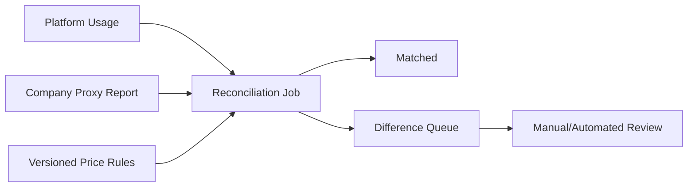

# 06 模型接入、计量与配额设计

> 状态：draft  
> 上游：公司内部模型 API 代理平台  
> 原则：本项目负责用户级访问、策略和计量，不重复建设供应商代理平台

## 1. 目标

- 为客户端提供稳定的逻辑模型目录；
- 支持推理、多模态、OCR、Embedding、Rerank、语音等多类模型；
- 屏蔽供应商协议差异，但保留真实能力差异；
- 记录每次模型请求的用量、成本、性能和归属；
- 按用户、部门、项目、功能和模型实施预算、配额和限流；
- 模型故障时只在安全、能力和成本允许范围内降级。

## 2. 调用边界

```text
Desktop / Connector / Agent
    → AI Access Service
        - user/device authentication
        - model/data/tool authorization
        - quota reservation
        - request normalization
        - stream normalization
        - usage commit/audit
    → Company Model API Proxy
        - upstream provider credentials
        - provider connectivity
        - upstream routing and availability
    → External or self-hosted model
```

如果公司模型代理已经提供某些用户级能力，本项目通过接口复用，避免重复；但客户端仍只面向本项目的授权语义。

## 3. 模型分类

### 3.1 能力类型

| capability | 输入 | 输出 | 典型计量 |
|---|---|---|---|
| chat | text | text | input/output tokens |
| reasoning | text/files | text/structured | tokens/reasoning tokens |
| vision | text + image | text/structured | tokens/images |
| ocr | image/PDF | text/layout | pages/images |
| embedding | text/image | vector | input tokens/items |
| rerank | query + candidates | scores | items/tokens |
| speech_to_text | audio | text | audio seconds/minutes |
| text_to_speech | text | audio | characters/tokens/seconds |
| image_generation | text/image | image | images/resolution |
| video_generation | text/image/video | video | seconds/resolution |
| tool_calling | text + schemas | tool requests | tokens/calls |
| structured_output | text + schema | JSON | tokens |

模型能力必须经过真实测试登记，不能根据品牌或模型名称推断。

### 3.2 数据边界

每个实际模型登记：

- processing_location：公司内网/专有云/外部服务；
- provider；
- allowed_data_classifications；
- retention_statement_ref；
- training_usage_statement_ref；
- region；
- approved_by/approved_at；
- risk_notes。

客户端显示经过产品化的摘要，完整证据由后台管理员查看。

## 4. 领域模型

### 4.1 ProviderModel

```text
ProviderModel
├─ id
├─ provider_id
├─ upstream_model_id
├─ display_name
├─ status
├─ capabilities[]
├─ context_window
├─ max_output
├─ supported_inputs[]
├─ tool_calling_profile
├─ data_boundary_id
├─ pricing_rule_id
├─ timeout_profile
└─ health_profile
```

### 4.2 LogicalModel

```text
LogicalModel
├─ id
├─ code: deep-reasoning
├─ display_name: 深度推理
├─ description
├─ required_capabilities[]
├─ default_parameters
├─ allowed_use_cases[]
├─ route_policy_id
├─ visibility_policy_id
└─ catalog_version
```

用户和业务模块引用 `LogicalModel.code`。路由变化不应要求客户端更新。

### 4.3 RoutePolicy

路由条件可包含：

- 所需能力；
- 数据等级；
- 用户/部门/项目；
- 输入类型和估计上下文；
- 工具调用；
- 延迟/成本偏好；
- 上游健康；
- 时间与并发；
- 指定场景评测等级。

返回一个有序候选列表和降级规则。

## 5. 供应商接入

### 5.1 默认模式

阿里、Kimi、DeepSeek、小米、智谱及其他国内外模型原则上先由公司模型代理统一接入。本项目只维护公司代理的 Provider Adapter。

### 5.2 可选直连模式

只有在公司明确要求、模型代理暂不支持且安全评审通过时，服务端才增加供应商直连 Adapter：

- Key 存入公司密钥管理；
- 仅服务端可访问；
- 与公司代理模式使用相同逻辑模型和计量接口；
- 单独标记数据边界、供应商条款和出站目标；
- 可随时禁用；
- 客户端不提供任意 Base URL + Key 表单给普通用户。

### 5.3 能力验证矩阵

每个上游版本上线前填写：

| 项目 | 结果 |
|---|---|
| 流式文本 | pass/fail/notes |
| 多轮消息 |  |
| system/developer 指令 |  |
| 工具调用 |  |
| 并行工具 |  |
| JSON Schema |  |
| 图片输入 |  |
| 文件输入 |  |
| usage 字段 |  |
| 取消行为 |  |
| 超时与错误码 |  |
| 最大上下文 |  |
| 内容安全拒绝 |  |
| 中文质量基准 |  |

## 6. 标准请求

```json
{
  "request_id": "req_...",
  "logical_model": "deep-reasoning",
  "messages": [
    {
      "role": "user",
      "content": [
        {"type": "text", "text": "分析附件"},
        {"type": "file_ref", "file_id": "file_..."}
      ]
    }
  ],
  "tools": ["dataset.query"],
  "response_format": {"type": "text"},
  "task_context": {
    "module": "conversation",
    "project_id": null,
    "cost_center": "dept_sales"
  },
  "stream": true
}
```

服务端从身份上下文获取 user/device，不接受客户端伪造归属字段。

## 7. 标准流式事件

```text
response.created
response.route_selected
response.output_text.delta
response.reasoning_summary.delta
response.tool_call.created
response.tool_call.arguments.delta
response.tool_call.ready
response.tool_result.accepted
response.citation.created
response.usage.updated
response.completed
response.failed
response.cancelled
```

每个事件包含：

- `event_id`；
- `sequence`；
- `request_id`；
- `type`；
- `created_at`；
- `data`。

供应商特有事件可以记录在内部诊断中，但不得直接要求客户端理解。

## 8. 请求处理流程

### 8.1 预检

1. 验证用户、设备、会话和最低客户端版本；
2. 验证模块/插件 Entitlement；
3. 解析附件和工具；
4. 判定最高数据等级；
5. 选择满足能力与数据边界的实际模型候选；
6. 检查内容和大小限制；
7. 估算用量并预留额度；
8. 创建 request、audit 和 trace；
9. 发起上游调用。

### 8.2 结束处理

1. 标准化终态；
2. 保存消息/引用（按保留策略）；
3. 解析 usage；
4. 计算成本；
5. 提交或释放额度；
6. 记录实际路由与性能；
7. 发送完成事件；
8. 异步对账。

## 9. Usage 数据模型

### 9.1 UsageRecord

| 字段 | 说明 |
|---|---|
| request_id | 幂等归属 |
| user_id/department_id/project_id | 成本归属 |
| module/plugin_id/task_id | 使用场景 |
| logical_model/provider_model | 逻辑与实际模型 |
| input_tokens | 输入 Token |
| output_tokens | 输出 Token |
| cached_input_tokens | 缓存输入 |
| reasoning_tokens | 若上游提供 |
| images/pages/audio_seconds/video_seconds | 非 Token 单位 |
| tool_calls | 工具次数 |
| estimated | 是否估算 |
| source | upstream/proxy/estimator/reconciled |
| currency/unit_cost/total_cost | 成本 |
| occurred_at | 发生时间 |
| status | provisional/final/reconciled/disputed |

### 9.2 计量原则

- 使用高精度 decimal，不用浮点计算金额；
- 单价规则版本化，Usage 绑定发生时的规则版本；
- 原始 usage JSON 可脱敏后保存用于对账；
- 推理 Token、缓存 Token 是否计费由实际规则决定；
- OCR 页、图片和音视频时长不能强行折算成“Token”展示；
- 多币种保存原币种和公司报表币种及汇率来源；
- 估算与实际差异可追踪。

## 10. Token 估算

仅在上游没有 usage 或预检时使用：

- 估算器按实际模型 tokenizer/profile 版本化；
- 无精确 tokenizer 时使用保守系数；
- 图片、文件和工具 Schema 单独计入；
- 结果标记 estimated；
- 不用估算结果作为财务最终对账；
- 估算误差按模型监控，超过阈值更新 profile。

## 11. 配额模型

### 11.1 QuotaScope

```text
scope_type: company/department/project/user/module/model
scope_id
period: day/week/month/custom
metric: requests/input_tokens/output_tokens/cost/pages/images/seconds
soft_limit
hard_limit
warning_thresholds[]
overflow_action: deny/degrade/approval
starts_at/ends_at
```

### 11.2 额度归并

一个请求可能同时受公司、部门、项目、用户和模型限制。全部硬限制都必须通过；可用额度取最严格约束。

### 11.3 预留算法

```text
estimated_input = tokenizer(messages + tools + attachments)
reserved_output = min(request.max_output, logical_model.default_reserve)
reserved_cost = price(estimated_input, reserved_output, other_units)

atomic:
  assert remaining(scope_i) >= reserve for every hard scope
  create reservation(request_id, amounts, expires_at)
  increment reserved counters
```

实际完成后：

```text
commit actual usage
release reserve - actual
if actual > reserve:
  allow current response to complete according to policy
  record overage and prevent next request / alert
```

不要在流式输出中途因轻微超额硬切断，除非公司策略明确要求。

## 12. 限流与并发

维度：

- user requests/minute；
- user concurrent streams；
- department concurrent jobs；
- model route concurrency；
- connector/tool concurrency；
- file/pages per request；
- IP/device anomaly limits。

429 返回稳定 reason code 和 Retry-After。客户端不能无界自动重试。

## 13. 路由与降级

### 13.1 允许降级的条件

- 候选模型满足全部必需能力；
- 数据边界不降低；
- 成本不超过配置上限；
- 业务场景允许；
- 结构化输出/工具协议兼容；
- 用户未要求固定模型（若允许固定）。

### 13.2 禁止静默降级

- 从公司内模型切换到外部模型；
- 从支持视觉切换到文本模型；
- 从可用工具模型切换到不支持工具；
- 从经过业务评测模型切换到未评测模型；
- 成本大幅上升；
- 数据等级不允许。

客户端应显示“已使用备用模型”及原因，但不必暴露敏感上游配置。

## 14. 错误分类

| 类别 | 示例 | 是否重试 |
|---|---|---|
| AUTHORIZATION | 模型/数据无权限 | 否 |
| QUOTA | 额度不足 | 申请/降级，不自动重试 |
| INVALID_INPUT | 文件类型、上下文过大 | 修改输入 |
| UPSTREAM_RATE_LIMIT | 上游限流 | 按 Retry-After |
| UPSTREAM_TIMEOUT | 超时 | 有限重试/换候选 |
| UPSTREAM_UNAVAILABLE | 服务不可用 | 熔断/降级 |
| CONTENT_REJECTED | 内容安全拒绝 | 不自动改写绕过 |
| STREAM_INTERRUPTED | 流中断 | 恢复/重试，避免重复记账 |
| USAGE_PENDING | 用量未决 | 响应可完成，后台补偿 |

## 15. 内容与附件

- 附件先通过文件服务验证 MIME、大小、病毒/DLP 和数据等级；
- 模型只获得短期对象访问或服务端代理内容；
- 上游不支持原生文件时，由经过批准的预处理器提取；
- 预处理结果与原文件建立来源；
- Prompt 和附件不得在 debug 日志完整记录；
- 模型请求保留策略可按场景配置。

## 16. 工具调用

- 请求中的工具集合由服务端根据授权过滤；
- 工具 Schema 有版本和最大大小；
- 模型生成的 tool call 只是提议；
- Agent/Tool Gateway 再次执行权限判定；
- 高风险工具返回 `approval_required`；
- 工具结果经过大小、敏感数据和提示注入处理后回送模型；
- 记录工具名、版本、参数摘要、资源、结果和耗时。

## 17. 管理后台功能

- 逻辑模型列表和状态；
- 实际模型、能力、数据边界和协议测试；
- 路由策略图和候选顺序；
- 用户/部门可见范围；
- 价格规则和生效时间；
- 额度模板、例外和申请；
- 实时健康、延迟、错误、成本和用量；
- 评测结果；
- 用量对账差异；
- 停用、熔断和紧急切换。

## 18. 对账



差异维度：请求缺失、Token 不同、实际模型不同、重复请求、价格规则错误、币种/汇率差异。

## 19. 监控指标

- requests/s、concurrent streams；
- success/cancel/failure rate；
- first-token latency、total latency；
- input/output/other usage；
- cost by user/department/module/model；
- quota denied/degraded/approved；
- route selection/fallback；
- usage missing/estimated/reconciliation difference；
- upstream errors by provider_model；
- tool call and tool error rate。

## 20. 验收测试

- 能力不匹配请求被预检拒绝；
- L2/L3 数据不能路由到不允许的模型；
- 并发请求不会超卖额度；
- SSE 中断、取消和重试只记一次账；
- usage 缺失正确标为估算并进入对账；
- 降级模型满足能力和数据边界；
- 价格规则变更不重算历史用量；
- 逻辑模型路由变更不要求客户端更新；
- 工具集合不会包含用户无权限工具；
- 公司代理返回未知字段不会使客户端崩溃。
