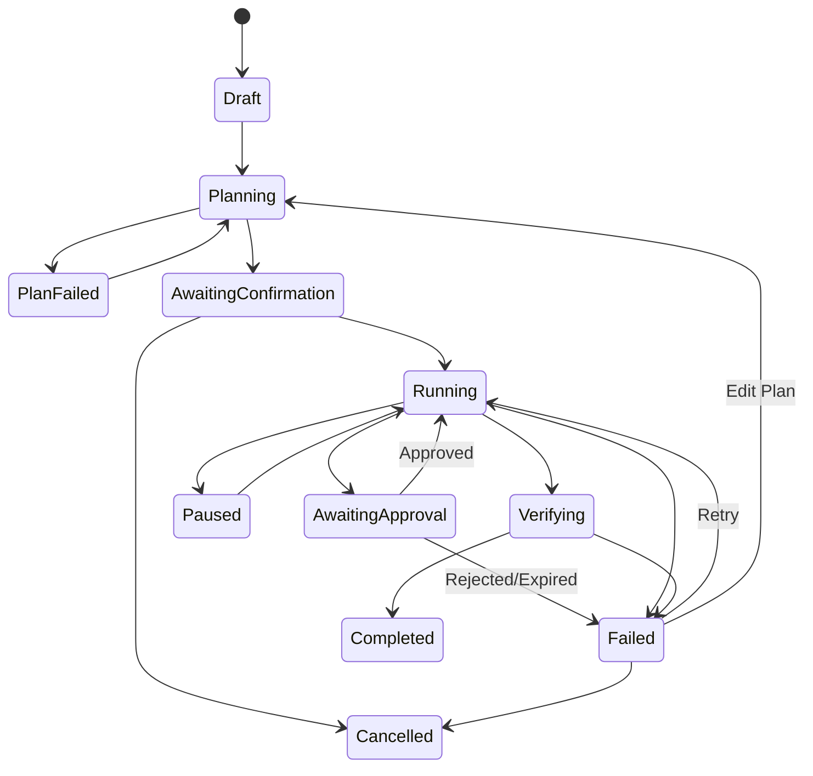

# 07 Agent、MCP、Skill 与插件运行时设计

> 状态：draft  
> 目标：让复杂任务可执行、可观察、可暂停、可审批、可恢复、可审计

## 1. 概念边界

| 概念 | 定义 | 版本绑定 |
|---|---|---:|
| Tool | 一个原子动作，如读取文件、查询数据集 | 是 |
| MCP Server | 通过 MCP 提供工具/资源/提示的进程或服务 | 是 |
| Skill | 任务方法包：说明、模板、允许工具、验证规则 | 是 |
| Workflow | 显式步骤、条件、审批和补偿 | 是 |
| Agent Engine | 负责规划与执行循环的引擎 | 是 |
| Plugin | 可安装的软件交付单元，可包含上述能力 | 是 |
| Connector | 服务端外部系统适配器 | 是 |

## 2. 设计原则

- 模型只能提出动作，执行由受控 Tool Gateway 决定；
- 默认只读和最小范围；
- 计划、工具、资源和数据去向对用户可见；
- 高风险动作需要新的服务端/本地授权，不继承宽泛聊天权限；
- 任务过程事件化，失败不丢失已完成进度；
- Tool、Skill、MCP、Plugin 和 Agent Engine 均锁定具体版本；
- OpenCode 可替换，不能让其内部格式成为平台数据模型；
- 工具输出一律视为不可信内容。

## 3. Agent 任务模型

### 3.1 Task

```text
Task
├─ id
├─ owner_user_id
├─ objective
├─ input_refs[]
├─ desired_outputs[]
├─ execution_location: local/cloud/hybrid
├─ agent_engine + version
├─ skill_refs[]
├─ policy_snapshot_version
├─ state
├─ risk_level
├─ created/started/completed_at
└─ version
```

### 3.2 Step

```text
Step
├─ id/task_id
├─ ordinal/dependencies[]
├─ title/description
├─ tool_ref
├─ input_template/inputs
├─ resource_scope
├─ risk_level
├─ approval_policy
├─ state/attempt
├─ checkpoint
└─ output_refs[]
```

### 3.3 状态机



终态：Completed、Cancelled。Failed 是可恢复状态，不自动视为终态。

## 4. 规划

### 4.1 Planner 输入

- 用户目标；
- 可用 Tool/Skill 列表；
- 文件和资源元数据；
- 业务/安全策略；
- 输出要求；
- 时间、成本、步数和上下文限制；
- 历史失败摘要（若重规划）。

### 4.2 Plan 输出要求

- 每一步可读标题和目的；
- 具体工具和版本；
- 输入来源、输出和资源范围；
- 风险等级和审批点；
- 预期完成条件；
- 失败/跳过/补偿策略；
- 预计模型和其他用量；
- 不允许隐藏步骤。

计划通过 Schema 校验和 Policy Analyzer 后才展示。

## 5. 执行循环

```text
while task not terminal:
    load next runnable step
    re-evaluate policy
    resolve exact resources
    if approval required:
        emit approval.required
        wait for scoped approval token
    invoke tool with timeout/cancel token
    validate result
    persist event + checkpoint
    decide next step / retry / replan
```

模型不能自行声称“用户已同意”。只有 UI/后台返回的审批令牌可改变状态。

## 6. Tool Registry

### 6.1 ToolDefinition

```yaml
id: file.read
version: 1.0.0
description: 读取授权工作区中的文件
input_schema: file-read.schema.json
output_schema: file-content.schema.json
execution_location: local
risk_level: medium
permissions:
  - filesystem.read
resource_resolver: workspace_path
timeout_seconds: 30
max_output_bytes: 10485760
idempotency: safe
audit_fields:
  - resolved_path_hash
  - size
```

### 6.2 工具执行结果

```json
{
  "status": "success",
  "summary": "读取 1 个工作簿，共 3 个工作表",
  "data_ref": "toolres_...",
  "artifacts": [],
  "warnings": [],
  "metrics": {"duration_ms": 241},
  "verification": {"schema_valid": true}
}
```

大型结果存入本地临时制品或对象存储，只将摘要和引用送入模型上下文。

## 7. 风险分级

| 等级 | 示例 | 默认控制 |
|---|---|---|
| R0 | 读取公开元数据 | 已授权任务内自动 |
| R1 | 读取用户选定文件 | 任务级确认 |
| R2 | 创建新文件、查询内部数据 | 展示范围，任务级确认/策略 |
| R3 | 覆盖、移动、上传、批量导出 | 动作级确认/审批 |
| R4 | 删除、发送邮件、业务写入、执行命令 | 默认拒绝或强审批 |
| R5 | 凭据、权限、系统配置、任意代码 | 非专用受控流程禁止 |

风险由工具基础等级 + 资源数据等级 + 数量 + 目标边界 + 用户/设备环境综合计算。

## 8. 文件工具

### 8.1 读取

- 解析最终绝对路径；
- 验证工作区；
- 检查扩展名、MIME、大小和数据等级；
- 以只读方式打开；
- 限制压缩包层数和解压大小；
- 记录哈希、大小和修改时间；
- 文档解析隔离，防止恶意文件。

### 8.2 写入

- 先写同目录或安全临时目录；
- flush/close 后验证；
- 新文件默认使用不冲突名称；
- 原子替换前创建备份；
- 失败清理临时文件但保留诊断；
- 写入结果包含最终路径和哈希。

### 8.3 删除

- 默认进入回收站；
- 显示精确路径、数量和总大小；
- 禁止以环境变量、根目录、Home、工作区根作为模糊递归目标；
- 递归删除要求独立高风险工具和审批；
- 删除后记录是否可恢复。

## 9. Shell 与代码执行

V1 建议默认关闭任意 Shell。若业务确实需要：

- 命令模板/可执行文件白名单；
- 禁止 Shell 拼接，优先参数数组；
- 明确 cwd；
- 最小环境变量；
- 清除供应商 Key 和刷新 Token；
- 超时、CPU、内存、输出和子进程限制；
- 网络默认关闭；
- 命令风险不能只靠字符串黑名单，必须结合上下文、路径、参数和目标；
- 执行前展示规范化命令和影响；
- 输出脱敏并限制长度。

Python 代码执行应使用专用受限运行时，不能在客户端主进程 `exec`。

## 10. MCP 设计

### 10.1 MCP 类型

- Local stdio：客户端启动受信任进程；
- Remote HTTP：通过后台/公司网络访问远程 MCP；
- Server-side MCP：只在连接器 Worker 中运行。

### 10.2 MCP Registry

| 字段 | 说明 |
|---|---|
| id/name/version | 唯一版本 |
| transport | stdio/remote/server-side |
| command/url | 启动或目标，不直接下发敏感值 |
| publisher/signature | 发布者和签名 |
| tools/resources/prompts | 能力清单 |
| permissions | 所需权限 |
| network_targets | 出站目标 |
| risk_level | 风险 |
| auth_mode | none/oauth/capability token |
| timeout/limits | 超时和资源 |
| compatible_clients | 兼容版本 |
| status/revocation | 状态 |

### 10.3 连接与授权

- 客户端只连接后台下发且当前授权的 MCP；
- 环境变量引用由凭据适配器在启动时注入；
- MCP 工具在暴露给模型前再次按策略过滤；
- 远程 OAuth 凭据与用户绑定并可撤销；
- MCP Server 名称不能决定权限，权限绑定稳定 ID；
- 工具列表变化视为权限差异，需要重新评审。

OpenCode 官方支持本地与远程 MCP，但本项目仍需在其外层强制公司注册表和权限策略，不能直接开放用户配置文件。

## 11. Skill 设计

### 11.1 Skill 包结构

```text
skill-package/
├─ skill.yaml
├─ SKILL.md
├─ schemas/
├─ templates/
├─ examples/
├─ validators/
└─ signature.json
```

### 11.2 Manifest

```yaml
id: com.company.monthly-business-review
version: 1.3.0
name: 月度经营分析
description: 从授权报表生成经营分析与 PPT 草稿
allowed_tools:
  - file.read@1
  - spreadsheet.inspect@2
  - spreadsheet.aggregate@1
  - presentation.create@2
required_inputs:
  - monthly_reports
outputs:
  - analysis_summary
  - presentation_file
approval_points:
  - artifact.publish
validators:
  - presentation.opens
  - source_citations.present
```

Skill 中的 Prompt 不能扩大工具权限。Skill 版本变更需要重新评测。

## 12. Plugin 设计

### 12.1 插件类型

- `ui-module`：受限 UI 扩展槽；
- `local-capability`：本地工具；
- `server-connector`：服务端连接器；
- `mcp-package`：MCP Server 配置与包；
- `skill-pack`：Skill 与模板；
- `hybrid`：多个部分的协调包。

### 12.2 Plugin Manifest

```yaml
manifest_version: 1
id: com.company.maxkb
name: MaxKB 知识库
version: 1.2.0
publisher: company-ai-team
type: hybrid
min_client_version: 1.4.0
server_api_range: ">=1.3,<2.0"
runner_api_range: ">=1.1,<2.0"
entrypoints:
  ui: knowledge.page
  connector: maxkb.v1
permissions:
  - knowledge.read
  - knowledge.write
  - file.upload.user_selected
network_targets:
  - maxkb.internal.example
data_classifications:
  max_input: L2
package_sha256: "..."
signature: "..."
```

### 12.3 安装

1. 获取后台授权和版本清单；
2. 下载到临时目录；
3. 验证 TLS、哈希、签名、发布者和撤回状态；
4. 检查兼容性和权限差异；
5. 安全扫描/解压；
6. 原子安装到版本目录；
7. 启动自检；
8. 更新本地状态；
9. 上报安装结果。

## 13. 插件隔离

- 进程隔离优先于线程隔离；
- IPC 只暴露版本化消息；
- 文件权限通过能力句柄/受控服务，不直接给全盘访问；
- 网络目标白名单；
- 不继承主进程完整环境；
- 不加载到主解释器；
- 设置进程、内存、CPU、超时和日志限额；
- 崩溃后指数退避，超过阈值禁用；
- 后台撤回时拒绝新调用并终止高风险运行。

## 14. OpenCode 适配

### 14.1 定位

OpenCode 作为 `AgentEngineAdapter` 的一种实现，用于代码/项目/文件任务。官方文档提供 headless server、OpenAPI/SDK 和 MCP 能力，可用于阶段 0 原型验证。

### 14.2 适配器接口

```text
AgentEngineAdapter
├─ start_session(context) -> EngineSession
├─ submit_goal(session, goal, tools)
├─ stream_events(session)
├─ approve(session, approval)
├─ cancel(session)
├─ checkpoint(session)
├─ restore(checkpoint)
└─ close(session)
```

平台 Task/Step/Event 不能直接使用 OpenCode Session/Event 作为持久化格式；Adapter 负责映射。

### 14.3 验证项

- Windows 生命周期与子进程清理；
- `opencode serve` 仅监听 127.0.0.1；
- 本地认证和随机端口；
- 公司模型代理协议；
- 取消、断流、恢复和会话事件；
- MCP 工具外层过滤；
- Prompt/文件路径泄漏；
- 版本升级契约；
- License 和供应链；
- 无 OpenCode 时的替代执行器。

### 14.4 安全外壳

即使 OpenCode 自身具有权限配置，本项目仍必须：

- 只向其暴露已过滤 Tool；
- 将文件操作代理到 File Workspace Guard；
- 不传平台刷新凭据；
- 绑定当前 task 和短期 capability token；
- 记录其请求的每个动作；
- 拒绝它直接修改插件/客户端配置；
- 版本锁定并提供 kill switch。

参考：

- [OpenCode Server](https://dev.opencode.ai/docs/server/)
- [OpenCode MCP](https://opencode.ai/v2/docs/mcp-servers)
- [OpenCode Agents/Permissions](https://opencode.ai/docs/agents/)

## 15. Prompt Injection 防护

### 15.1 不可信来源

- 邮件正文和附件；
- 网页；
- PDF/Office 文档；
- MaxKB 文档；
- 数据库文本字段；
- Tool/MCP 输出；
- 用户上传的 Skill/模板。

### 15.2 控制

- 将外部内容标记为 data，而非系统指令；
- 工具权限在模型外层执行；
- Tool 输出限制大小、类型和敏感字段；
- 检测“忽略规则、导出密钥、调用工具”等诱导信号作为风险提示，不能只依赖分类器；
- 高风险动作必须独立审批；
- 任务计划显示外部内容触发的新增动作；
- 不允许工具输出动态注册新工具；
- 网络和文件边界不因 Prompt 改变。

## 16. 审批协议

```json
{
  "approval_id": "apr_...",
  "task_id": "task_...",
  "step_id": "step_...",
  "action": "file.overwrite",
  "resources": [
    {"type": "file", "canonical_path_hash": "...", "display_path": "E:\\..."}
  ],
  "effect_summary": "覆盖 1 个现有 PPTX，原文件将备份",
  "data_destination": "local",
  "expires_at": "..."
}
```

批准返回一次性 token，资源或参数变化后旧批准失效。

## 17. 恢复与检查点

检查点包含：

- 任务和计划版本；
- 已完成步骤和输出引用；
- 当前步骤安全恢复点；
- Agent Engine checkpoint 引用；
- 工具版本；
- 文件输入哈希；
- 策略版本；
- 未完成审批；
- 重试计数。

恢复前重新检查：用户会话、插件/工具撤回、文件是否变化、策略是否过期、外部资源版本。变化时要求重规划或人工确认。

## 18. 多 Agent

MVP 不做开放式多 Agent。后续如引入：

- 父任务拥有总预算和总权限上限；
- 子 Agent 不能扩大权限；
- 子任务有明确输入/输出；
- 并发数和 Token 预算；
- 汇总 Agent 不直接执行高风险工具；
- 每个子 Agent 事件可追踪；
- 禁止无限递归创建子任务。

## 19. 观测指标

- task/step 成功率；
- planning/replanning 次数；
- approval requested/approved/rejected/expired；
- tool latency/error/timeout；
- runner/plugin crash；
- recovery success；
- artifact verification pass；
- prompt injection risk hit；
- per-skill quality/cost；
- OpenCode adapter version/error。

## 20. 验收测试

- 模型伪造“用户已批准”不能执行；
- 路径越界、联接点和批量删除被阻止；
- 插件签名无效、撤回或权限升级时拒绝；
- Tool 输出提示注入不能扩大权限；
- Runner 崩溃后 UI 存活并可恢复；
- 任务恢复时文件变化会被检测；
- OpenCode 不可用时不影响普通聊天；
- 同一审批不能重复、跨资源或过期使用；
- MCP 工具变化触发重新评审；
- 生成 Office/PDF 制品可重新打开并与任务来源关联。
