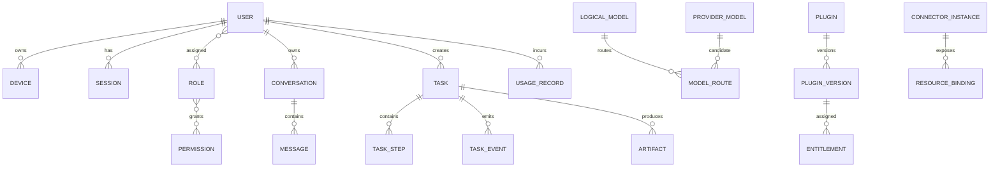

# 09 数据架构与数据库设计

> 状态：draft  
> 后台生产数据库：公司统一 MySQL  
> 客户端本地数据库：SQLite  
> ORM/迁移基线：SQLAlchemy 2.x + Alembic

## 1. 设计目标

- 明确 MySQL 权威数据与 SQLite 本地缓存的边界；
- 保持业务模型可迁移、可审计和可归档；
- 避免开发期 SQLite 掩盖生产 MySQL 差异；
- 大文件和敏感凭据不进入普通业务表；
- 支持幂等、任务事件、用量计量和审计的大规模增长；
- 所有表有 owner、生命周期和索引策略。

## 2. 数据存储分工

| 存储 | 数据 | 特征 |
|---|---|---|
| MySQL | 用户、权限、目录、用量、任务、配置、元数据 | 权威、事务 |
| Redis/Queue | 会话缓存、限流、锁、任务消息 | 短期、可重建 |
| Object Storage | 附件、制品、插件、更新包、导出 | 大对象、版本化 |
| Audit Store | 审计事件/归档 | 追加、长留存 |
| Client SQLite | 草稿、缓存、断点、任务事件、制品引用 | 单用户、本地 |
| Windows Credential Manager | 客户端会话 secret | 敏感、小对象 |
| Company Secret Manager | 上游和连接器密钥 | 服务端敏感数据 |

## 3. 通用数据库约定

### 3.1 ID

MVP 建议使用应用生成的 UUID 字符串：

- MySQL `CHAR(36)`；
- SQLite `TEXT`；
- 避免客户端和服务端离线创建时依赖自增 ID；
- 主要查询同时使用业务索引和时间索引；
- 大规模后可评估 UUID 二进制优化，但需要专门迁移 ADR。

### 3.2 时间

- 后台统一 UTC；
- MySQL 使用支持微秒的时间类型；
- API 使用 ISO 8601 UTC，如 `2026-08-07T17:14:00.123Z`；
- 客户端展示用户时区；
- 业务周期额外保存 timezone，不能只按 UTC 月份结算。

### 3.3 字符集

- MySQL `utf8mb4`；
- 排序规则由公司版本确定，用户名搜索与唯一 code 分开处理；
- code/id 使用大小写明确的二进制或统一小写约束；
- Emoji 和多语言内容必须测试。

### 3.4 通用字段

业务配置表通常包含：

- `id`；
- `created_at/created_by`；
- `updated_at/updated_by`；
- `version`（乐观锁）；
- `status`；
- `deleted_at`（仅适用软删除实体）。

审计/事件表不允许普通更新和软删除模式。

### 3.5 JSON

- JSON 只用于变化频繁的附加属性、约束和外部原始摘要；
- 核心查询字段必须独立列；
- JSON Schema 版本化；
- MySQL/SQLite 对 JSON 查询差异大，核心业务不要依赖方言特有 JSON 查询；
- 大型原始响应进入对象存储或受限诊断存储。

## 4. 领域关系总览

## 5. Identity 表

### 5.1 users

| 字段 | 类型/约束 | 说明 |
|---|---|---|
| id | char(36) PK | 内部用户 ID |
| display_name | varchar(128) | 展示名 |
| primary_department_id | char(36) nullable | 主部门 |
| status | varchar(32) index | active/disabled/left/pending |
| employee_no_hash | varchar(128) nullable | 若需要，优先哈希/脱敏 |
| last_identity_sync_at | datetime | 同步时间 |
| created_at/updated_at | datetime |  |
| version | bigint | 乐观锁 |

索引：`status`、`primary_department_id`、`updated_at`。

### 5.2 identity_bindings

- id；
- user_id FK；
- provider；
- tenant/corp_id；
- provider_subject；
- status；
- provider_attributes_json（最小化）；
- last_verified_at。

唯一：`provider + tenant + provider_subject`。

### 5.3 departments / user_departments

departments：id、external_id、name、parent_id、path、status、sort_order、sync_version。

user_departments：user_id、department_id、is_primary、source。

树查询可保存 materialized path，但路径更新必须事务化并有测试。

### 5.4 devices

- id；
- user_id；
- app_install_id；
- name；
- os_name/os_version；
- client_version；
- managed_state/risk_state；
- public_key；
- first_seen_at/last_seen_at；
- revoked_at/reason。

唯一：`user_id + app_install_id`（具体重装语义待验证）。

### 5.5 sessions

- id；
- user_id/device_id；
- secret_hash；
- created_at；
- last_activity_at；
- idle_expires_at；
- absolute_expires_at；
- rotated_from_id；
- revoked_at/reason；
- risk_state；
- client_version。

索引：`secret_hash` 唯一、`user_id + revoked_at`、`idle_expires_at`。

secret_hash 使用适合高熵随机 token 的 HMAC/哈希策略，密钥与数据库分离。

## 6. Authorization 表

### 6.1 roles / permissions / role_permissions

- roles：id、code unique、name、scope_type、system_builtin、status；
- permissions：id、code unique、resource、action、description；
- role_permissions：role_id、permission_id、constraints_json。

### 6.2 subject_roles

- subject_type：user/department/group；
- subject_id；
- role_id；
- starts_at/expires_at；
- source；
- granted_by；
- reason。

唯一/索引应覆盖有效角色查询。

### 6.3 policies

- id/code/name；
- effect；
- subject_expr_json；
- action_patterns_json；
- resource_expr_json；
- environment_expr_json；
- constraints_json；
- priority；
- status；
- policy_version；
- published_at。

发布后版本不可原地覆盖，创建新版本或保存 revision 表。

### 6.4 entitlements

- subject_type/id；
- resource_type/id；
- actions_json；
- constraints_json；
- source；
- starts_at/expires_at；
- status。

索引：`subject_type + subject_id + status`、`resource_type + resource_id`。

## 7. 模型与配额表

### 7.1 provider_models

- id/provider_id/upstream_model_id；
- display_name/status；
- capabilities_json；
- context_window/max_output；
- data_boundary_id；
- pricing_rule_id；
- config_ref（不含密钥）；
- health_state；
- validated_at/validation_version。

唯一：`provider_id + upstream_model_id + environment`。

### 7.2 logical_models

- id/code unique/display_name；
- required_capabilities_json；
- default_parameters_json；
- route_policy_id；
- visibility_policy_id；
- catalog_version；
- status。

### 7.3 model_routes

- logical_model_id；
- provider_model_id；
- priority；
- conditions_json；
- fallback_allowed；
- starts_at/ends_at；
- status。

### 7.4 pricing_rules

- id/version；
- currency；
- metric_prices_json；
- exchange_rate_ref；
- effective_from/to；
- source_ref；
- status。

历史 Usage 永久绑定 pricing_rule_id/version。

### 7.5 quota_rules

- id；
- scope_type/id；
- metric；
- period/timezone；
- soft_limit/hard_limit（decimal）；
- warning_thresholds_json；
- overflow_action；
- starts_at/ends_at；
- status。

### 7.6 quota_reservations

- id/request_id unique；
- quota_rule_id；
- reserved_amount decimal；
- actual_amount decimal nullable；
- status reserved/committed/released/expired；
- expires_at；
- created_at/settled_at。

并发更新使用行锁、原子计数或经验证的配额算法。

### 7.7 usage_records

- id/request_id；
- user/department/project/cost_center；
- module/plugin/task；
- logical_model/provider_model；
- 多类用量列；
- estimated/source；
- pricing_rule_id；
- currency/total_cost decimal；
- status；
- occurred_at；
- reconciliation_batch_id。

索引：时间分区查询、用户、部门、模型、request_id。达到规模后按月分区/归档，由 DBA 和压测决定。

## 8. Conversation 表

### 8.1 conversations

- id/owner_user_id；
- title；
- state active/archived/deleted；
- default_logical_model_id；
- classification；
- retention_policy_id；
- last_message_at；
- created/updated/deleted_at；
- version。

### 8.2 messages

- id/conversation_id；
- parent_message_id；
- role；
- status streaming/completed/failed/cancelled；
- content_json 或 encrypted_content_ref；
- model_request_id；
- created_at；
- sequence；
- version。

唯一：`conversation_id + sequence`。

正文保留模式支持：

- full：保存完整内容；
- redacted：保存脱敏内容；
- metadata_only：仅保存元数据和哈希；
- ephemeral：短期后删除。

### 8.3 attachments / citations / feedback

attachments：object_ref、filename、mime、size、hash、classification、scan_state、retention。

citations：message_id、source_type、source_ref、title、locator_json、snippet_ref、authorization_context。

feedback：message_id、user_id、rating、reason_code、comment（可选）、created_at。

## 9. Agent 表

### 9.1 tasks

- id/owner_user_id；
- objective；
- state/risk_level；
- execution_location；
- agent_engine/version；
- plan_version；
- policy_snapshot_version；
- input_refs_json/output_requirements_json；
- created/started/completed_at；
- version。

### 9.2 task_steps

- id/task_id；
- ordinal；
- dependencies_json；
- title/description；
- tool_id/tool_version；
- resource_scope_json；
- risk_level/approval_policy；
- state/attempt；
- checkpoint_ref；
- started/completed_at；
- version。

### 9.3 task_events

- id/task_id；
- sequence bigint；
- source local/cloud/connector；
- source_sequence；
- type；
- step_id；
- payload_json/payload_ref；
- payload_hash；
- occurred_at/received_at。

唯一：`task_id + sequence`、`task_id + source + source_sequence`。

事件追加，不更新历史 payload。

### 9.4 approvals

- id/task_id/step_id；
- requester/approver；
- action/resource_digest；
- effect_summary；
- status；
- reason/decision_reason；
- token_hash；
- created/expires/decided/used_at。

### 9.5 tool_calls

- id/task_id/step_id；
- tool_id/version；
- arguments_ref/arguments_digest；
- resolved_resources_json；
- risk/decision_id/approval_id；
- status；
- result_ref/result_digest；
- duration_ms；
- created/completed_at。

### 9.6 artifacts

- id/task_id/step_id；
- owner_user_id；
- type；
- storage_location local/object；
- object_ref/path_display；
- filename/mime/size/hash；
- source_refs_json；
- verification_state/report_ref；
- version；
- classification；
- retention_policy_id；
- created_at。

## 10. Plugin 表

### 10.1 plugins

- id/code unique/name/type；
- publisher_id；
- status；
- current_stable_version_id；
- risk_level；
- created/updated_at。

### 10.2 plugin_versions

- id/plugin_id/version；
- manifest_json/manifest_version；
- package_object_ref/hash/size；
- signature/signer；
- permissions_json/network_targets_json；
- min_client_version/server_api_range/runner_api_range；
- scan_state/test_state/approval_state；
- status/revoked_at/reason；
- published_at。

唯一：`plugin_id + version`。

### 10.3 plugin_rollouts / install_states

rollouts：plugin_version_id、channel、target_rule_json、percentage、status、start/end。

install_states：device_id、plugin_id/version、state、error_code、reported_at。

## 11. Connector 表

### 11.1 connector_definitions / connector_instances

definition：code/version/capabilities/config_schema/risk/handler。

instance：definition_id/name/environment/base_url、credential_ref、network_policy_id、status、health_state、last_health_at。

base_url 视为敏感配置，只向授权管理员显示；不得包含凭据。

### 11.2 resource_bindings / user_bindings

resource_bindings：instance_id、resource_type、platform_resource_id、external_resource_id、permissions、sync_state、external_version。

user_bindings：instance_id、user_id、external_user_id、auth_mode、status、last_verified_at。

### 11.3 connector_jobs

- id/instance_id；
- action；
- user_id/task_id；
- idempotency_key；
- request_ref；
- external_job_id；
- state/attempt；
- result_ref/error_code；
- next_retry_at；
- created/updated/completed_at。

### 11.4 邮件连接器扩展表

mailbox_bindings：user_id、connector_instance_id、external_account_hash、provider、mode、credential_ref、status、last_verified_at。只保存凭据引用。

mail_connector_policies：subject scope、允许 provider/mode/action、正文/附件落盘规则、模型数据边界、保留期、DLP、发送限额与审批配置。

mail_sync_health：binding_id、client/plugin version、last_success_at、lag、error_code、checkpoint_digest。不得上传完整邮件正文作为健康数据。

mail_send_records：draft/client reference、draft_version、content_digest、idempotency_key、confirmation/approval reference、recipient domain summary、state、provider_receipt_ref、reconciliation_state。正文和附件默认只存哈希/摘要。

mail_ai_usage_links：mail_task_ref、AI request_id、purpose、data_scope_digest、usage_record_id，用于从邮件功能追踪到模型用量和数据边界。

## 12. 更新与发布表

client_releases：version、channel、manifest、package refs/hash/signature、min_server_api、status、published_at。

release_rollouts：release_id、target_rule、percentage、deadline、force、status、metrics。

device_update_states：device_id、from/to_version、state、error_code、started/completed_at、rollback_version。

## 13. 审计与可靠事件

### 13.1 audit_events

- id；
- occurred_at；
- actor_type/id；
- session_id/device_id；
- action；
- resource_type/id；
- result；
- risk_level；
- reason_code；
- trace_id/request_id/task_id；
- source_ip/network_zone；
- metadata_json（脱敏）；
- before_digest/after_digest；
- retention_class。

索引按时间 + actor/action/resource/risk/trace 设计。大规模后迁移到专用审计存储。

### 13.2 outbox_events

- id aggregate_type/id；
- event_type；
- payload_json；
- occurred_at；
- published_at；
- attempts/next_attempt_at；
- status。

消费者按 event_id 去重。

### 13.3 idempotency_records

- key + user/client scope；
- request_hash；
- status；
- response_ref/status_code；
- created/expires_at。

同 key 不同 request_hash 返回冲突，不重新执行。

## 14. 客户端 SQLite Schema

客户端表详见[桌面客户端详细设计](03-桌面客户端详细设计.md)。补充规则：

- 与后台表不共享迁移；
- 只保存当前用户数据；
- sync_outbox 有重试和最大保留；
- `credential_ref` 只引用系统凭据库；
- policy_snapshot 过期后禁止高风险离线操作；
- local_task_event 使用 `(task_id, seq)` 唯一；
- 文件路径可保存展示值，但审计同步使用哈希/范围摘要；
- 退出登录按策略清理会话缓存、草稿和制品引用。

邮件官方插件补充使用 mail_accounts、mail_folders、mail_messages、mail_attachments、mail_threads、mail_drafts、mail_send_attempts、mail_sync_failures 和 mail_operation_log 等表。邮件插件 Schema 与 mail_tools 原 Schema 需要专门迁移器，不直接复制自增 ID；跨边界使用 UUID/稳定外部键。正文禁止落盘时，FTS 和本地检索必须明确降级，不能把正文偷偷写入索引。

## 15. SQLite 与 MySQL 差异控制

- CI 必须在 MySQL 执行迁移、集成测试和并发测试；
- 不依赖 SQLite 宽松类型；
- 布尔、时间、JSON、唯一索引和 NULL 语义明确；
- 不用 SQLite 测试替代 MySQL 锁/隔离测试；
- 索引长度和 `utf8mb4` 约束提前验证；
- 大小写/排序规则用专门用例测试；
- 生产迁移先在生产规模副本演练。

SQLAlchemy 官方为 SQLite 和 MySQL 提供不同 Dialect，方言隔离不代表行为完全相同。

## 16. 迁移策略

### 16.1 迁移规则

- 每个 Schema 变更有 Alembic revision；
- 迁移不可依赖在线下载；
- 发布包与所需数据库 revision 绑定；
- 破坏性变更采用 expand → migrate → contract；
- 长表变更评估锁表和在线 DDL；
- 数据回填可断点、幂等和限速；
- 迁移失败有恢复方案，不能默认 `down` 可无损回滚。

### 16.2 客户端迁移

- 启动前复制/备份 SQLite；
- 成功后记录 schema_version；
- 失败进入恢复页面；
- 新旧客户端在更新回滚窗口内兼容同一客户端数据版本，或保留可恢复备份。

## 17. 数据保留

以下为策略框架，不是最终期限：

| 数据 | 建议策略 |
|---|---|
| 登录会话 | 撤销后保留安全元数据，secret hash 按策略清理 |
| 会话正文 | full/redacted/metadata/ephemeral 可配置 |
| 模型用量 | 按财务/运营要求保存 |
| 任务事件 | 任务期 + 审计期；大 payload 归档 |
| 制品 | 用户/项目保留策略 |
| 审计 | 安全制度要求，通常长于业务正文 |
| 临时上传 | 短期过期清理 |
| 插件/更新包 | 保留支持期和回滚版本 |
| 客户端缓存 | 设备策略和用户退出规则 |
| 本地邮件镜像/EML/附件 | 按邮箱、部门、设备和数据等级策略；与草稿/AI 派生结果分开 |
| 邮件发送摘要 | 满足审计与事故追查；正文默认只保存哈希 |

清理任务先 dry-run 生成数量/大小/策略报告；高敏批量清理需审批和审计。

## 18. 备份与恢复

- MySQL 按公司 RPO/RTO 备份；
- 对象存储开启版本/生命周期（若公司支持）；
- 密钥管理独立备份与恢复流程；
- 审计备份与业务备份权限分离；
- 定期恢复演练，不只验证备份任务成功；
- 恢复后处理队列重复、外部连接器状态和额度对账；
- 客户端本地制品由用户/公司终端备份策略决定，平台不假定其必然可恢复。

## 19. 数据访问安全

- 服务账户按模块/用途分离；
- API 与 Worker 不使用 DBA 账号；
- 生产禁止开发人员共享账号；
- 敏感列应用层加密/令牌化由安全评审决定；
- 查询日志不含 secret 和正文；
- 管理后台正文访问单独权限；
- 数据导出进入对象存储短期链接并加水印/审计；
- 非生产环境使用脱敏或合成数据。

## 20. 数据验收

- 所有表有 owner 和生命周期；
- 重复请求不产生重复任务、发送、用量或连接器副作用；
- MySQL 全量迁移可在目标版本执行；
- SQLite 与 MySQL 关键行为测试通过；
- Token/Key 不出现在普通表、日志和导出；
- 删除/留存策略可 dry-run 并可审计；
- 任务事件能恢复一致状态；
- 用量和价格规则可追溯到版本；
- 外部资源 ID 变化/删除可对账；
- 备份恢复演练满足批准的 RPO/RTO。

参考：[SQLAlchemy 2.0 Dialects](https://docs.sqlalchemy.org/en/20/dialects/)
