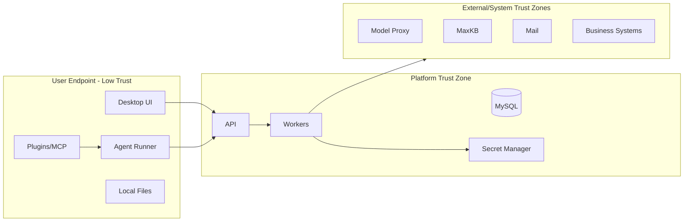

# 11 安全、隐私与审计设计

> 状态：draft  
> 原则：零信任客户端、服务端授权、最小权限、显式数据边界、全链路审计

## 1. 安全目标

- 凭据、身份、企业数据和本地文件不被越权访问或外传；
- 模型和外部内容不能绕过程序级权限；
- 管理、插件、更新和连接器供应链可验证；
- 关键操作可追溯到用户、设备、任务、工具和资源；
- 发生事故时可以快速禁用模型、插件、连接器、用户和客户端版本；
- 安全控制失败时，高风险能力 fail closed。

## 2. 资产

### 2.1 高价值资产

- 企业微信身份和平台会话；
- 模型代理、MaxKB、邮箱和内部系统凭据；
- 员工本地文件；
- 会话、邮件和知识库内容；
- 经营、客户、财务和员工数据；
- Agent 工具和业务写能力；
- 插件、客户端更新和代码签名私钥；
- 审计日志；
- 模型用量、预算和成本数据。

### 2.2 信任边界

## 3. 主要威胁

| 威胁 | 示例 | 主要控制 |
|---|---|---|
| 身份伪造 | 盗用刷新会话、伪造设备 | 扫码、轮换、设备会话、撤销、重放检测 |
| 权限提升 | 插件调用未授权系统 | 服务端策略、短期能力令牌、工具网关 |
| 数据泄漏 | 本地文件发往未批准模型 | 数据分级、边界矩阵、上传确认、DLP |
| Prompt Injection | 邮件诱导 Agent 外传文件 | 不可信内容隔离、程序级权限、审批 |
| 供应链 | 恶意插件/更新包 | 签名、SBOM、扫描、灰度、撤回 |
| SSRF | 连接器访问内网元数据服务 | URL/IP 白名单、重定向校验、网络隔离 |
| SQL 风险 | 模型生成破坏性查询 | 语义层、只读视图、AST、限额 |
| 审计篡改 | 管理员删除行为记录 | 追加存储、职责分离、哈希/归档 |
| 重复副作用 | 重试导致重复发送邮件 | 幂等键、状态机、回执验证 |
| DoS/成本攻击 | 大文件/无限 Agent/高 Token | 限流、预算、步数/时长/资源限制 |

## 4. 数据分类与处理矩阵

最终规则与公司标准对齐。设计占位：

| 数据等级 | 外部模型 | 公司自建模型 | 本地处理 | 日志正文 |
|---|---|---|---|---|
| L0 公开 | 经批准可用 | 可用 | 可用 | 可按策略 |
| L1 内部 | 仅批准供应商/场景 | 可用 | 可用 | 默认不记录完整正文 |
| L2 敏感 | 默认禁止或脱敏审批 | 指定模型 | 受控 | 禁止完整正文 |
| L3 高敏 | 禁止 | 专用隔离流程 | 最小化、审批 | 禁止 |

模型、MaxKB、邮件、连接器实例和对象存储桶均标记最大允许等级。

## 5. 身份与会话安全

- 企业微信应用 Secret 只在服务端；
- OAuth state/nonce、短期事务、一次性 grant；
- Access Token 短期；
- Refresh Secret 轮换和重放检测；
- 客户端存 Windows Credential Manager；
- 管理后台高权限使用更强会话策略；
- 10 天闲置和绝对期限服务端执行；
- 禁用、离职、风险设备和最低版本立即/快速撤销；
- 登录、刷新、撤销和异常产生审计。

## 6. 授权与最小权限

- 默认 Deny；
- RBAC 提供基线，ABAC 收紧具体资源和环境；
- 客户端授权提示不代替服务端决策；
- 能力令牌绑定 user/device/task/action/resource/expiry/nonce；
- 插件、MCP、模型和连接器都有独立 Entitlement；
- 源系统权限与平台权限取交集；
- 管理职责分离；
- Break-glass 限时、双人审批、全程告警。

## 7. 密钥管理

### 7.1 服务端

- 公司 Secret Manager/KMS；
- 数据库只保存 credential_ref；
- Worker 按身份和用途最小权限读取；
- 缓存在内存的密钥有短 TTL；
- 定期轮换并支持双 Key 过渡；
- 访问密钥本身也产生安全日志；
- 禁止把 Secret 放队列、URL、异常和追踪属性。

### 7.2 客户端

- Windows Credential Manager/证书库；
- SQLite 只保存引用；
- 不允许插件直接读取凭据库；
- 诊断包、崩溃转储和剪贴板过滤；
- 登出/撤销清理对应凭据；
- 不提供“显示完整 Token”。

## 8. 传输与网络

- 公司批准 TLS 版本和密码套件；
- 企业 CA 正确安装；
- 证书错误不允许用户忽略；
- 服务间身份认证采用公司标准；
- 管理后台、用户 API、连接器 Worker 按网络区隔离；
- 外部出站集中代理和白名单；
- DNS、代理和重定向均纳入 SSRF 控制；
- 不在 URL query 传 Token。

是否使用证书固定需结合公司代理、证书轮换和运维能力评估，不能草率实现硬编码 pin。

## 9. 本地文件安全

- 用户明确选择目录/文件；
- 规范化绝对路径、解析联接点；
- 文件类型/大小/层级限制；
- 压缩炸弹和恶意 Office/PDF 隔离解析；
- 覆盖前备份，删除优先回收站；
- 批量操作显示范围；
- 上传显示目的地；
- 高敏路径策略阻止；
- 本地临时文件权限和清理；
- 文件哈希支持来源和完整性，不把哈希当作内容保密措施。

## 10. Prompt Injection 与 Agent 安全

### 10.1 核心原则

LLM 不是权限执行器。模型输出无论多么确信，都必须经过 Tool Gateway、资源解析、策略和审批。

### 10.2 控制层

1. 输入标记：区分系统规则、用户要求和外部数据；
2. 工具最小集：只提供当前任务所需工具；
3. 参数验证：Schema、长度、枚举、路径和目标；
4. 策略决策：调用时实时判定；
5. 审批：高风险操作绑定摘要；
6. 输出过滤：Tool 输出脱敏、限长、标记不可信；
7. 网络/文件沙箱：Prompt 无法修改；
8. 事件审计：保留决策和动作证据。

### 10.3 禁止做法

- 只用“不要泄漏数据”的系统 Prompt；
- 只用危险命令字符串黑名单；
- 让模型自行判断是否已经获得用户授权；
- 将所有 MCP 工具无差别暴露；
- 直接执行文档/邮件中的操作指令；
- 在错误后自动扩大权限重试。

## 11. 插件和供应链

### 11.1 发布控制

- 可信发布者；
- Manifest 权限和网络目标；
- 依赖锁定；
- SBOM；
- SAST、依赖、恶意软件和许可证扫描；
- 签名；
- 测试；
- 人工审批；
- canary；
- 撤回。

### 11.2 运行控制

- 独立进程；
- 只读安装目录；
- 最小环境；
- 限制文件/网络/资源；
- IPC 鉴权；
- 版本握手；
- 崩溃熔断；
- 后台 kill switch。

### 11.3 更新供应链

- 构建机隔离和最小权限；
- 代码签名私钥在 HSM/受控服务；
- 构建产物哈希和 provenance；
- 制品库不可匿名覆盖同版本；
- 更新清单签名；
- 客户端校验签名、哈希和目标版本；
- 防降级攻击：只允许策略批准的回滚版本。

## 12. 连接器安全

- 目标白名单和网络隔离；
- 凭据引用；
- 用户权限透传/等价校验；
- 响应脱敏；
- 只读优先；
- 写操作 prepare/approve/execute；
- 连接器级限流、熔断和紧急停用；
- MaxKB、邮件、数据库分别有独立风险策略；
- 外部版本升级先契约测试。

### 12.1 邮件专项控制

- 企业微信扫码登录与邮箱 OAuth/客户端专用密码分别授权，禁止身份混用；
- 企微应用邮箱 Secret 只在服务端 Secret Manager，普通客户端不可见；
- 本地 SQLite/MySQL 只保存 credential_ref，不保存明文邮箱密码、refresh token 或应用 Secret；
- HTML 邮件采用标签/属性/协议白名单，禁用脚本、表单、iframe、对象、外部图片/CSS 和危险链接；
- MIME、文件名、声明 MIME、探测 MIME、大小、压缩结构、宏和恶意软件分别校验；
- 邮件头、正文、附件、链接、OCR 和抽取结果一律作为不可信内容；
- “送模型、上传 MaxKB、导出、转发、打开附件、写本地文件”是不同的数据动作，分别判定；
- 本地镜像默认只读，不把本地删除/已读/星标隐式同步到服务器；
- 发送确认绑定 draft_version、收件人、主题、正文、附件和发送账户摘要；
- 发送使用幂等状态机，响应丢失时先对账，禁止自动盲目重试；
- 管理后台默认只见邮件元数据和哈希，查看正文需要专门权限、原因、二次认证和审计；
- 后台可紧急暂停邮件同步、AI 正文调用或发送，并撤销连接器/插件授权。

本地 EML、附件和 SQLite 需要单独评估静态加密、受管设备磁盘加密、远程清理和备份边界。使用系统凭据库只保护 secret，不自动保护邮件正文。

## 13. API 安全

- Schema 和业务双重校验；
- 参数化查询；
- 写操作幂等；
- 对象级授权，防 IDOR；
- 分页和导出限额；
- 上传 MIME/内容/大小扫描；
- 管理 API 严格权限和原因字段；
- 错误不泄漏内部实现；
- 限流和异常检测；
- OpenAPI/调试端点生产受限；
- Cookie 管理后台实施 CSRF，桌面 Bearer API 不混用 Cookie。

## 14. 日志安全

### 14.1 默认允许记录

- request_id/trace_id；
- 用户/设备不透明 ID；
- endpoint、状态、耗时；
- 模型/工具/插件 ID 和版本；
- 用量；
- 错误码；
- 文件类型、大小、哈希（按策略）。

### 14.2 默认禁止记录

- Access/Refresh Token；
- Authorization/Cookie；
- API Key/邮箱密码；
- 完整 Prompt 和模型回复；
- 邮件正文；
- 文档正文；
- 完整身份证/手机号等 PII；
- 完整本地敏感路径（可显示给用户但日志脱敏/哈希）。

### 14.3 脱敏

- 结构化日志中按字段分类；
- 日志 SDK 中央过滤；
- 对异常对象和第三方响应二次清洗；
- 单元测试验证 Secret 不会序列化；
- 采样不能绕过敏感规则。

## 15. 审计设计

### 15.1 必审事件

- 登录、刷新、失败、登出和撤销；
- 用户/角色/策略/授权变化；
- 模型目录、路由、价格和额度变化；
- AI 请求元数据、路由、用量和结果；
- 文件读取/创建/覆盖/删除/上传；
- Tool/MCP/Skill/插件调用；
- 审批请求和决定；
- MaxKB、邮件、内部系统和数据库访问；
- 插件安装、发布、撤回；
- 客户端更新和回滚；
- 审计查询与导出；
- 密钥读取/轮换管理事件。

### 15.2 Audit Event

至少包含：谁、何时、哪个设备/会话、做什么、对哪个资源、为什么、使用哪个模型/工具/插件、决策、结果、trace_id、风险等级。

### 15.3 完整性

- 追加写；
- 业务事务 outbox；
- 审计存储权限独立；
- 高价值事件可使用批次哈希链/签名；
- 定期归档到不可变/受控存储（若公司提供）；
- 时间源同步；
- 审计导出带清单、哈希、水印和过期。

## 16. 隐私设计

- 数据最小化；
- 明确使用目的；
- 个人知识库、邮件和会话默认本人可见；
- 管理员默认看元数据，不看正文；
- 用户可查看本人设备、会话和用量；
- 删除请求与法定/安全留存冲突时明确说明；
- 非生产使用脱敏/合成数据；
- 第三方模型和 MaxKB 的处理边界在 UI 可见；
- 个人文件上传前明确目的地和保留。

## 17. DLP 与内容安全

可对接公司 DLP：

- 上传前扫描；
- 模型请求前分类/脱敏；
- 大规模导出；
- 外部邮箱收件人；
- 剪贴板/下载（若终端能力允许）；
- 制品发布。

DLP 决策：allow、mask、warn、approval、deny。DLP 故障时 L2/L3 高风险出站默认拒绝。

内容安全拒绝不能通过自动改写反复尝试绕过上游规则。

## 18. 恶意文件

- MIME 与扩展名交叉验证；
- 杀毒/沙箱；
- Office 宏默认不执行；
- PDF/图片解析库隔离和更新；
- 压缩层数、条目数和解压大小限制；
- XML 外部实体关闭；
- 文件名路径穿越过滤；
- 解析超时和资源限制；
- 原文件与提取文本分别标记来源。

## 19. 安全 Kill Switch

后台可快速：

- 禁用某实际/逻辑模型；
- 禁止某数据等级出站；
- 撤回插件/Skill/MCP；
- 停用连接器实例或动作；
- 禁止本地 Shell/文件写；
- 强制客户端最低版本；
- 撤销用户/部门/全部会话；
- 暂停邮件发送和业务写工具；
- 切换系统只读模式。

Kill switch 操作本身需高权限、原因、告警和审计，但紧急路径不能依赖复杂多阶段审批导致无法止损。

## 20. 安全事件响应

1. 发现：告警、用户报告、审计、EDR；
2. 分级：凭据、数据、插件、模型、连接器；
3. 遏制：撤销会话/插件/连接器/版本；
4. 保全：日志、事件、哈希和时间线；
5. 清除：轮换密钥、修复、更新；
6. 恢复：灰度恢复服务；
7. 复盘：根因、影响、检测缺口和行动项。

客户端支持导出脱敏诊断，但不得自动将本地数据发到未授权地址。

## 21. 安全测试清单

- OAuth state/nonce、重放和事务劫持；
- Access/Refresh Token 窃取与轮换；
- IDOR、角色提升和策略冲突；
- 文件路径穿越、联接点、压缩炸弹；
- Prompt Injection 和工具越权；
- MCP/插件签名、依赖和环境泄漏；
- SSRF、重定向、DNS 重绑定；
- SQL 注入和只读绕过；
- 重复发送/重复写入；
- 日志和诊断包 Secret 扫描；
- 更新包替换、回滚和降级攻击；
- 大文件/长上下文/无限循环 DoS；
- 审计丢失、篡改和未授权导出；
- DLP 故障时 fail-closed。

## 22. 安全上线门槛

- 威胁模型评审完成；
- 企业微信、模型代理和 MaxKB 凭据方案批准；
- P0 安全测试无未接受的高危问题；
- 插件/更新签名链完成；
- Kill switch 演练；
- 会话撤销传播达到目标；
- 日志/诊断 Secret 检测通过；
- 数据等级与模型/连接器矩阵批准；
- 审计查询和事故时间线演练通过；
- 安全负责人签署风险接受。
