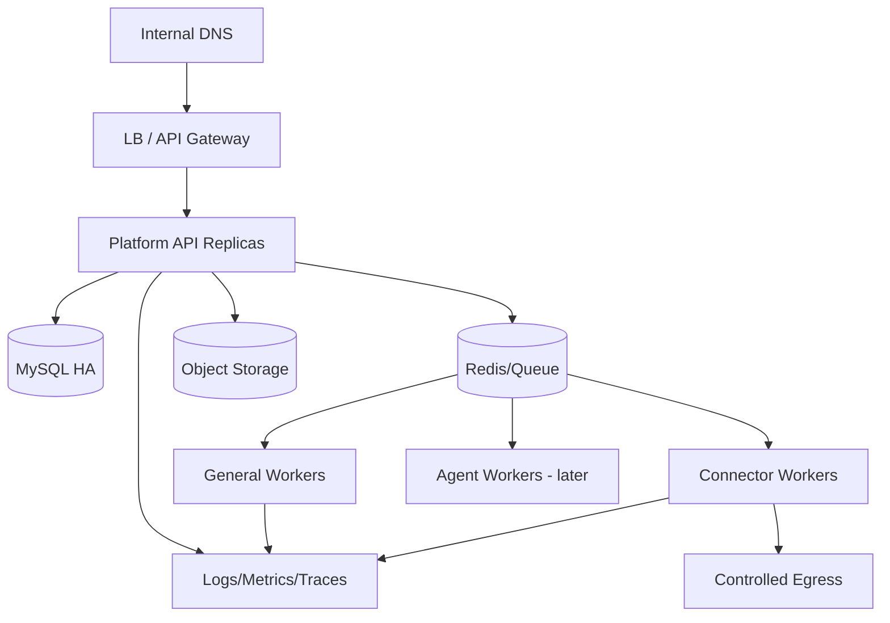
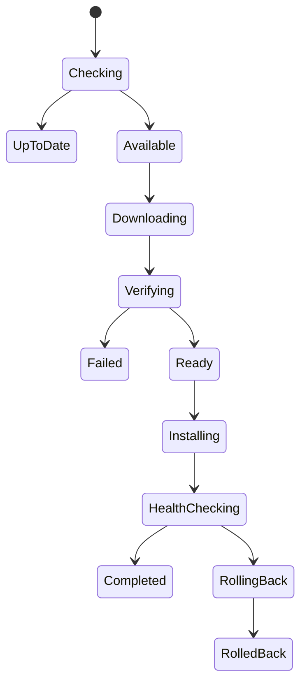

# 13 部署、升级与运维设计

> 状态：draft  
> 范围：后台基础设施、客户端构建发布、插件发布、可观测性和灾备

## 1. 环境

| 环境 | 目的 | 数据 |
|---|---|---|
| local | 单人开发 | 合成数据、SQLite/本地依赖 |
| dev | 团队集成 | 合成数据、MySQL |
| test | 功能/接口/自动化 | 脱敏或合成 |
| staging | 生产同构、发布演练 | 脱敏、真实连接器沙箱 |
| production | 正式服务 | 正式数据 |

禁止把生产 Secret 复制到非生产。staging 应尽可能使用与生产相同的大类组件、网络和证书策略。

## 2. 服务端部署拓扑



## 3. 配置管理

### 3.1 配置类型

- 构建配置：版本、功能编译开关；
- 环境配置：数据库、队列、对象存储、域名；
- Secret：数据库密码、签名、连接器 Key；
- 业务配置：模型、配额、插件、策略；
- Feature Flag：阶段性功能开关。

### 3.2 规则

- 配置 Schema 版本化和启动校验；
- 缺少必需配置时拒绝 ready；
- Secret 只保存引用/注入，不提交 Git；
- 配置变更记录和审计；
- 高风险配置需要双人复核；
- 动态配置有安全默认值和回滚版本；
- 客户端正式环境 Base URL 不由普通用户修改。

## 4. CI 管线


签名阶段与普通 CI 执行器分离；未签名产物不能进入正式发布环。

## 5. 服务端发布

### 5.1 发布前

- 代码、依赖、许可证和 Secret 扫描；
- 单元、集成、契约、安全和性能门槛；
- MySQL 迁移演练；
- 配置差异；
- 回滚/前滚方案；
- 变更公告和负责人；
- 关键连接器兼容测试。

### 5.2 发布顺序

采用兼容窗口：

1. Expand 数据库；
2. 部署兼容旧客户端的新后台；
3. 灰度客户端/插件；
4. 观察；
5. Contract 数据库和移除旧 API（后续版本）。

### 5.3 灰度

- 内部研发；
- IT/安全测试组；
- 单个试点部门；
- 多部门；
- 全量。

自动暂停信号：错误率、登录失败、崩溃率、任务失败、用量异常、连接器失败和更新回滚率。

## 6. 数据库迁移

- 迁移脚本版本进入发布制品；
- staging 使用生产规模统计副本演练；
- 大表 DDL 评估锁；
- 数据回填独立 Worker、限速、可恢复；
- 备份/恢复点；
- 应用可兼容迁移中间态；
- 迁移状态纳入 ready；
- 不把“执行 down migration”作为唯一回滚方案。

## 7. 客户端构建

### 7.1 可重复构建

- 锁定 Python 和所有依赖；
- 固定 PySide6/Qt 版本；
- 使用隔离构建机；
- 资源、翻译和图标纳入清单；
- 输出 SBOM、版本信息、哈希和构建来源；
- 禁止同一版本号覆盖已有产物。

### 7.2 打包

评估 Qt 官方 `pyside6-deploy`（基于 Nuitka）以及公司已有软件分发要求。打包模式可选 standalone + 安装器，便于版本目录切换和回滚；onefile 需要特别评估启动、杀软和更新行为。

### 7.3 Windows 签名

- 主 EXE、Updater、Runner、插件二进制、安装包签名；
- 时间戳服务；
- 证书/HSM 访问最小化；
- 签名验证进入自动测试；
- 证书轮换与旧版本验证策略。

参考：[Qt `pyside6-deploy`](https://doc.qt.io/qtforpython-6/deployment/deployment-pyside6-deploy.html)

## 8. 客户端更新协议

### 8.1 更新清单

```json
{
  "release": "1.4.2",
  "channel": "stable",
  "minimum_server_api": "1.3",
  "runner_version": "1.2.0",
  "artifacts": [
    {
      "url": "short-lived-or-internal-url",
      "sha256": "...",
      "size": 123456789,
      "signature": "..."
    }
  ],
  "rollback_allowed_to": ["1.4.1"],
  "notes": "..."
}
```

清单本身签名。

### 8.2 更新状态机



### 8.3 强制更新

- 后台提供 deadline；
- deadline 前提醒并允许延迟；
- 安全关键版本到期后进入受限模式；
- 受限模式仍允许保存草稿、更新和诊断；
- 更新前检查运行任务并安全检查点；
- 不在未保存高风险任务中强制杀进程。

## 9. 插件发布运维

- 插件与客户端分开发布；
- 版本兼容矩阵；
- canary 安装；
- 崩溃/调用失败阈值；
- 回滚保留旧版本；
- 撤回立即禁止新调用；
- 运行中任务按风险选择终止或固定旧版本；
- 插件数据迁移独立；
- 不允许插件自动自更新绕过后台。

## 10. 可观测性

### 10.1 Trace

贯穿：

```text
Desktop action
→ Platform API
→ Policy/Quota
→ Model Proxy/Connector
→ Task/Tool
→ Usage/Audit
```

关键 ID：trace_id、request_id、conversation_id、task_id、tool_call_id、connector_job_id、device_id。

### 10.2 Metrics

服务：

- request rate/status/latency；
- MySQL pool/queries/locks；
- Redis/queue depth/age；
- Worker success/retry/dead-letter；
- object upload/download；
- CPU/memory/restarts。

业务：

- login success/failure；
- AI first token/total latency；
- model error/fallback；
- usage/cost/quota；
- task completion/recovery；
- connector health；
- plugin install/crash；
- client version/update success。

### 10.3 Logs

- 结构化 JSON；
- 与 trace 关联；
- 敏感字段中央过滤；
- 日志级别和采样；
- 不依赖全文日志完成计费/审计；
- 客户端本地日志轮转和大小上限。

## 11. SLO 建议

初始目标需阶段 0 校准：

| 能力 | SLI | 目标 |
|---|---|---|
| 身份/API | 成功请求可用性 | 99.9% 月度 |
| 策略判定 | P95 延迟 | ≤ 100 ms |
| AI Access 附加延迟 | P95 | ≤ 200 ms |
| 任务事件 | 创建到可见 P95 | ≤ 2 秒 |
| 撤销传播 | P95 | ≤ 60 秒 |
| 审计落地 | P95 | ≤ 60 秒，关键同步证据不丢 |
| 客户端更新 | 成功率 | ≥ 99%，灰度校准 |

模型自身响应时间和连接器 SLA单独统计，不混入平台附加延迟。

## 12. 告警

### 12.1 紧急

- 登录全局失败；
- 权限/审计服务不可用；
- MySQL 不可写；
- Secret 泄漏信号；
- 插件/更新签名失败；
- 大规模客户端崩溃/回滚；
- 高风险写工具异常增长；
- 审计管线积压超过安全阈值。

### 12.2 高优先级

- 模型代理成功率下降；
- Connector 熔断；
- 队列 age；
- 用量/成本异常；
- 额度预留未结算；
- 组织同步失败；
- MaxKB 处理失败率上升。

告警必须有 owner、Runbook、去重和恢复通知。

## 13. Runbook 清单

- 企业微信登录失败；
- 会话撤销延迟；
- MySQL 故障/只读；
- Redis/队列积压；
- 模型代理故障/路由降级；
- 用量对账差异；
- MaxKB 连接器故障；
- 邮件重复发送风险；
- 插件紧急撤回；
- 客户端更新失败/回滚；
- 审计管线积压；
- Secret 泄漏和轮换；
- 数据清理误配置。

每个 Runbook 包含检测、确认、遏制、恢复、验证和升级联系人。

## 14. 容量规划

输入参数：

- 注册/日活/峰值在线用户；
- 每用户并发对话；
- 平均 SSE 时长；
- 每日任务和步骤；
- 平均附件大小和保留；
- 每请求审计事件数；
- MaxKB/邮件/数据查询并发；
- 客户端版本分布。

重点压测：长连接、额度原子预留、任务事件写入、审计索引、对象存储上传、连接器限流。

## 15. 备份与灾备

### 15.1 分类

- MySQL：全量 + 增量/binlog；
- 对象存储：版本/复制/生命周期；
- 审计：独立备份或不可变归档；
- 配置：版本库/配置平台；
- Secret：公司密钥管理灾备；
- 签名服务：高安全恢复流程。

### 15.2 RPO/RTO

由公司确定分级：身份/授权/审计最高，聊天正文和缓存可以不同。文档必须记录每类数据的 RPO/RTO，不用一个数字覆盖全部。

### 15.3 恢复演练

- 恢复 MySQL 到隔离环境；
- 验证对象引用；
- 重放/去重 outbox；
- 处理额度和连接器未决状态；
- 验证审计连续性；
- 客户端重新连接；
- 记录实际 RTO/RPO。

## 16. 数据清理运维

- 保留策略版本化；
- dry-run 统计；
- 分批/限速；
- 对象和元数据一致清理；
- 法务保全标记优先；
- 失败可重试；
- 生成清理报告和审计；
- 禁止直接执行无范围的递归删除脚本。

## 17. 上线清单

- 域名、证书、企业微信回调；
- MySQL、Redis、对象存储、Secret Manager；
- 模型代理访问与限额；
- MaxKB/邮件/内部系统网络；
- 数据等级/模型矩阵；
- 管理角色和 Break-glass；
- 日志、指标、追踪和告警；
- 备份和恢复演练；
- 客户端签名与分发；
- 更新灰度和回滚；
- 插件签名与撤回；
- 安全测试和风险接受；
- 用户帮助与支持流程。
