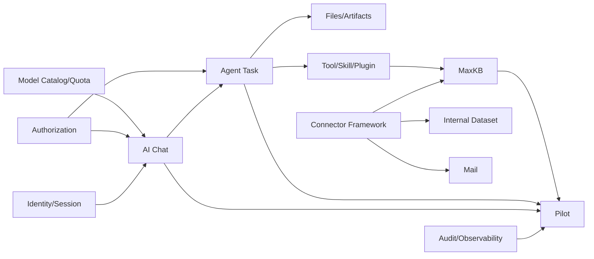

# 15 实施路线、风险与架构决策记录（ADR）

> 状态：draft  
> 注意：时间为工作量讨论区间，不是正式项目承诺；需根据团队人数、公司基础设施和接口成熟度重新排期

## 1. 实施原则

- 先验证最高风险外部接口和安全边界；
- 先完成三个端到端闭环，再铺开所有模块；
- 每阶段交付可运行、可观测、可撤回的增量；
- UI、后台、Agent 和连接器同步纵向切片，避免只搭骨架；
- 邮件发送、业务写入和开放式插件延后；
- 所有关键选择形成 ADR。

## 2. 阶段 0：发现与技术验证

建议区间：2–4 周，取决于公司接口与环境准备。

### 2.1 工作包

| 编号 | 工作包 | 输出 |
|---|---|---|
| SP-01 | 企业微信登录 Spike | 扫码闭环、回调、用户字段、10 天规则验证 |
| SP-02 | 模型代理 Spike | 流式、usage、工具、图片/文件、错误矩阵 |
| SP-03 | MaxKB Spike | 专业版 API 能力矩阵和最小上传问答 |
| SP-04 | PySide6 工程 Spike | 打包、签名、系统凭据、高 DPI、升级原型 |
| SP-05 | Agent Runner Spike | 进程 IPC、文件守卫、崩溃恢复 |
| SP-06 | OpenCode Spike | Server/SDK、Windows、模型代理、权限外壳 |
| SP-07 | 数据 Spike | MySQL 版本、迁移、Redis/对象存储 |
| SP-08 | 安全 Spike | 数据分级、Secret、DLP、终端/网络要求 |

### 2.2 退出条件

- 每个 Spike 有证据、限制、版本和建议；
- 所有 P0 外部依赖有可行路径或明确阻塞；
- ADR-001～ADR-010 经初审；
- MVP 范围和试点用户批准；
- 生产/测试环境责任人明确。

## 3. 阶段 1：平台底座

建议区间：4–8 周。

### 3.1 服务端

- 项目骨架、模块边界；
- MySQL/Alembic/Outbox；
- 企业微信身份、会话和设备；
- RBAC 基线；
- 模型目录和 AI Access；
- 用量记录和基础额度；
- 审计；
- Bootstrap 和客户端版本策略；
- 基础管理后台。

### 3.2 客户端

- 工程重构；
- 登录；
- 主 Shell；
- 对话流；
- 本地 SQLite/凭据库；
- 错误/诊断；
- 基础更新检查。

### 3.3 退出条件

- 登录→对话→用量→审计闭环；
- 用户/部门/模型授权可在后台管理；
- 10 天闲置和远程撤销验证；
- 流式中断和额度幂等通过。

## 4. 阶段 2：受控 Agent 与办公制品

建议区间：6–10 周，可与阶段 1 后半并行但不应绕过底座。

### 4.1 工作包

- Agent Task/Step/Event/Approval；
- Local Runner + IPC；
- 文件工作区守卫；
- Tool Registry；
- Excel 读取/清洗/汇总；
- PPT 生成/验证/预览；
- 任务中心和失败恢复；
- 制品中心；
- OpenCode Adapter（若 Spike 通过）；
- Skill v1。

### 4.2 退出条件

- 三份 Excel 到 PPT 闭环；
- Runner 崩溃恢复；
- 越界/覆盖/删除测试；
- 制品可打开、来源完整；
- 未授权动作率为 0。

## 5. 阶段 3：MaxKB 与插件底座

建议区间：4–8 周。

- MaxKB Connector；
- 知识库列表/建库（若 API 支持）；
- 上传/处理状态；
- 带引用问答；
- Plugin Manifest、签名和包；
- Entitlement；
- canary/撤回；
- MCP Registry 基础；
- 管理后台连接器/插件页面。

退出：第三个 MVP 闭环 + 插件撤回传播。

## 6. 阶段 4：内部系统样板与试点

建议区间：4–8 周。

- 一个真实内部只读 API/语义数据集；
- 指标目录；
- 自然语言查询计划；
- 来源/口径/时间展示；
- 数据范围；
- 试点部门发布；
- 培训、支持、指标和反馈；
- SLO/容量/灾备验证。

MVP 正式试点在此阶段退出。

## 7. 阶段 5：邮件与平台化

按业务优先级：

- M0 固化 SmartMail-Assistant 的版本、测试、依赖、许可证和真实能力矩阵；
- M1 提取无 Qt 的 Headless Mail Engine 与 Repository/Adapter Port；
- M2 交付官方邮件插件，完成本地只读同步、搜索、摘要和未发送草稿；
- M3 发送确认/审批、DLP、内容摘要绑定、幂等和结果对账；
- M4 按公司邮箱条件扩展 Microsoft Graph 服务端模式和企微应用邮箱连接器；
- 更多内部连接器；
- 连接器/插件 SDK；
- Skill 评测和发布门禁；
- 数据语义层扩展；
- 定时任务；
- 多执行引擎；
- 经验证后拆分高负载服务。

## 8. 推荐团队角色

| 角色 | 建议职责 |
|---|---|
| Product Owner | 场景、优先级、验收、试点 |
| Solution Architect | 总体边界、ADR、跨模块一致性 |
| Desktop Engineers | PySide6、Runner、更新、Windows |
| Backend Engineers | API、领域、数据库、任务、计量 |
| Admin Web Engineers | 管理后台、策略、运营 |
| AI/Agent Engineers | 模型适配、评测、Tool/Skill、OpenCode |
| Integration Engineers | 企业微信、MaxKB、邮件、内部系统 |
| Security Engineer | 威胁、权限、Secret、DLP、审计 |
| QA/Evaluation | 自动化、性能、安全、模型/制品评测 |
| SRE/DBA | MySQL、队列、监控、发布、灾备 |
| UX Designer | 桌面和后台交互、设计系统、可访问性 |

早期可以一人多角，但身份/权限、安全、数据库和客户端更新不能没有明确 owner。

## 9. 工作分解结构

```text
1. Product & Design
   1.1 PRD / user journeys
   1.2 desktop UI
   1.3 admin UI
   1.4 help/training

2. Platform Core
   2.1 identity/session/device
   2.2 authorization
   2.3 model catalog/access
   2.4 quota/usage
   2.5 audit/notification

3. Desktop
   3.1 shell/login/chat
   3.2 local data/credentials
   3.3 runner/files/artifacts
   3.4 plugins/update/diagnostics

4. Agent Platform
   4.1 task/event/approval
   4.2 tool registry
   4.3 MCP/Skill
   4.4 OpenCode adapter
   4.5 evaluation

5. Connectors
   5.1 MaxKB
   5.2 internal dataset
   5.3 mail

6. Admin
   6.1 organization/policy
   6.2 models/quota
   6.3 plugins/connectors
   6.4 audit/releases

7. Engineering Excellence
   7.1 CI/CD/signing
   7.2 observability/SLO
   7.3 security/privacy
   7.4 testing/performance/DR
```

## 10. 依赖关系



## 11. 风险登记册

| ID | 风险 | 概率 | 影响 | 缓解 | Owner |
|---|---|---:|---:|---|---|
| R-001 | 企业微信应用/回调权限不具备 | 中 | 高 | 阶段 0 验证，准备公司 SSO/OIDC 备选 | Identity |
| R-002 | 模型代理 usage/工具协议不完整 | 高 | 高 | 标准化适配、估算标记、对账、能力矩阵 | AI Platform |
| R-003 | MaxKB 专业版 API 不覆盖建库/权限 | 中 | 高 | 能力矩阵，跳转/后台代管/延期备选 | Connector |
| R-004 | PySide6 打包/更新/杀软问题 | 中 | 高 | 早期打包签名和灰度原型 | Desktop |
| R-005 | OpenCode 集成不稳定/权限边界不足 | 中 | 高 | Adapter、版本锁、外层工具网关、替代 Runner | Agent |
| R-006 | 插件体系过度设计 | 高 | 中 | MVP 只做官方插件和有限扩展点 | Architect |
| R-007 | 自然语言数据库查询越权/口径错误 | 高 | 极高 | 语义层、只读 API、行级权限、MVP 样板 | Data/Security |
| R-008 | Prompt Injection 导致工具误用 | 高 | 极高 | 程序级权限、最小工具、审批、测试 | Security |
| R-009 | Token/成本记账不准 | 中 | 高 | 预留、幂等、usage 来源、月度对账 | Quota |
| R-010 | Agent 任务失败导致用户不信任 | 高 | 高 | 事件、检查点、恢复动作、制品验证 | Agent/UX |
| R-011 | 客户端权限过大 | 中 | 极高 | 工作区守卫、进程隔离、策略、EDR | Desktop/Security |
| R-012 | 更新失败影响全员 | 中 | 极高 | canary、健康检查、回滚、暂停 | Release |
| R-013 | 管理员能看过多正文 | 中 | 高 | 元数据默认、正文特权、审计、职责分离 | Security |
| R-014 | SQLite 开发掩盖 MySQL 问题 | 高 | 高 | dev/test 早期 MySQL CI | Backend/DBA |
| R-015 | 邮件误发 | 中 | 极高 | 草稿优先、内容哈希确认、限速、审批 | Mail |
| R-016 | 审计量与成本快速增长 | 中 | 中 | 分级、归档、索引、专用存储演进 | SRE/Audit |
| R-017 | 第三方开源升级引入漏洞 | 中 | 高 | SBOM、锁定、扫描、升级契约和 kill switch | Security |
| R-018 | 本地 EML/附件/SQLite 未按数据等级保护 | 中 | 极高 | 受管设备磁盘加密、应用层加密评估、最小保留、远程清理 | Mail/Security |
| R-019 | mail_tools 代码归属或许可证不清 | 中 | 高 | 提取前完成所有权、LICENSE、依赖和内部复用审批 | Legal/Engineering |

## 12. ADR-001：V1 桌面框架采用 PySide6

状态：Proposed。

背景：核心能力使用 Python，需 Windows 原生 UI、本地文件、托盘和进程管理。

决定：V1 采用 PySide6 Qt Widgets；UI 与领域/Runner 分离。

后果：Python 集成直接、原生能力好；需要处理包体、UI 工程化、Qt 许可证、更新和 Web 内容。

替代：Tauri/React + Python sidecar；若 UI 复杂度或跨平台成为主需求，重新评估。

## 13. ADR-002：后台采用模块化单体

状态：Proposed。

决定：一个 API 代码库/部署单元，模块数据和应用接口隔离，Worker 独立伸缩。

后果：交易与开发简单；需代码评审严格防止跨模块耦合。达到明确触发条件再拆服务。

## 14. ADR-003：客户端不持有供应商长期密钥

状态：Proposed。

决定：模型供应商密钥由公司代理管理；MaxKB/连接器系统密钥在服务端 Secret Manager。

后果：安全和撤销更好；服务端成为必要在线依赖。

## 15. ADR-004：本地 Agent 独立进程

状态：Proposed。

决定：UI 主进程不执行长任务/任意工具；Runner 独立，插件可进一步隔离。

后果：稳定和安全更好；需要 IPC、版本握手、检查点和进程管理。

## 16. ADR-005：OpenCode 作为可替换 Adapter

状态：Proposed，取决于 Spike。

决定：不使用 OpenCode 内部 Session/Event 作为平台持久模型；通过 AgentEngineAdapter 映射。

后果：避免锁定；适配和契约测试成本增加。

## 17. ADR-006：RBAC + ABAC

状态：Proposed。

决定：角色提供基线，属性策略决定数据等级、设备、网络、资源和动作。

后果：能表达企业权限；需要策略解释、模拟、冲突检测和缓存撤销。

## 18. ADR-007：插件签名与进程隔离

状态：Proposed。

决定：Manifest、权限、签名、兼容、灰度和撤回；不直接导入主进程。

后果：扩展更安全；插件开发复杂度提高，MVP 只支持官方插件。

## 19. ADR-008：内部系统 API/语义层优先

状态：Proposed。

决定：正式 API → 语义层 → MCP → 服务端只读 DB；禁止客户端直连生产库和模型写 SQL。

后果：可信和治理更好；前期需要数据负责人维护指标目录。

## 20. ADR-009：MaxKB 作为外部知识平台

状态：Proposed，取决于专业版 API 验证。

决定：本项目保存映射、状态和审计，正文/分段/向量由 MaxKB 管理。

后果：避免重复建设；需要版本适配和权限一致性。

## 21. ADR-010：客户端更新支持签名、灰度和回滚

状态：Proposed。

决定：独立 Updater、版本目录、健康确认、后台发布环和最低版本。

后果：运维可靠；需要签名基础设施和兼容迁移。

## 22. ADR-011：生产后台 MySQL，客户端 SQLite

状态：Proposed。

决定：后台权威数据使用 MySQL；客户端 SQLite 仅缓存/草稿/断点。后台测试尽早使用 MySQL。

后果：符合公司标准；必须管理方言差异和两套独立 Schema。

## 23. ADR-012：REST + SSE

状态：Proposed。

决定：普通 API REST/JSON，模型和任务事件优先 SSE；必要的双向实时能力后续评估 WebSocket。

后果：企业代理兼容和实现简单；需要断线后的权威状态查询。

## 24. ADR-013：邮件采用官方插件与 Headless Mail Engine

状态：Proposed，等待公司邮箱与数据制度验证。

背景：SmartMail-Assistant 已具有本地只读 IMAP、Graph/企微读取、MIME、SQLite/EML/附件、邮件组织和受控 AI 能力，但它是独立 PySide6 应用，拥有自己的模型配置、数据库和窗口，不能直接成为平台架构边界。

决定：提取协议、解析、同步、存储和领域能力为 Headless Mail Engine；用 AI 工作台官方邮件插件重建界面；统一身份、模型、权限、审计、发布和发送审批由平台负责。支持 Local Mirror 与 Server Connector 两种模式，首期本地只读；企微应用邮箱优先服务端；首期不做 Agent 自动发送、批量发送和服务器删除。

后果：能复用成熟实现并保持平台一致治理；需要 Repository/Port 重构、双模式同步契约、独立邮件 Schema 迁移和更强发送状态机。代码复用前必须确认 mail_tools 所有权和许可证。

详细设计：[邮件模块与 mail_tools 复用设计](16-邮件模块与mail_tools复用设计.md)。

## 25. 待新增 ADR

- 管理后台选择 React 或 Vue；
- 任务队列实现；
- 对象存储和上传模式；
- 审计专用存储；
- 客户端打包器和安装器；
- 设备身份/MDM 集成；
- 会话正文保留模式；
- 各邮箱供应商的最终 OAuth/部署与数据保留方案；
- 数据语义层产品/自研边界；
- OpenCode 是否进入正式架构。

## 26. 项目治理

### 25.1 评审

- PRD 评审：业务、产品、技术、安全；
- 架构评审：客户端、后台、AI、数据、SRE；
- 数据评审：DBA、数据负责人、安全；
- API 评审：消费者与提供者；
- 发布评审：QA、安全、运维、产品；
- 插件/连接器评审：owner、安全、数据负责人。

### 25.2 变更控制

- P0 范围变化更新 PRD 和路线；
- 数据边界/权限变化必须安全评审；
- 外部接口变化更新契约矩阵；
- 破坏性架构变化写 ADR；
- 所有风险接受有 owner、期限和补偿控制。

## 27. Definition of Ready

一个开发 Story 开始前：

- 用户价值和范围明确；
- 需求 ID；
- UI/交互或 API 契约；
- 权限和数据等级；
- 失败/恢复；
- 审计和用量；
- 依赖/测试数据；
- 验收标准；
- 不存在未确认的高影响接口假设。

## 28. Definition of Done

- 代码和文档；
- 单元/集成/契约测试；
- 权限、安全和数据边界；
- 错误、恢复、日志、指标和 trace；
- 迁移/配置；
- UI 状态和可访问性；
- 性能基线；
- 发布/回滚；
- 用户/管理员帮助；
- 产品与技术验收证据。

## 29. 立即需要公司确认的事项

1. 企业微信应用类型、回调域名、通讯录权限；
2. 公司模型代理协议、usage、工具、多模态、错误和支持模型；
3. MaxKB 专业版版本与 API 文档；
4. MySQL、Redis、对象存储、Secret、日志和监控平台；
5. 首发 Windows/终端/MDM/软件分发要求；
6. 数据分级与各模型处理矩阵；
7. 首批试点部门和三个演示场景数据；
8. 首个内部系统的 API/指标负责人；
9. 邮箱系统、个人邮箱与企微应用邮箱用途、认证方式、发送网关和结果查询能力；
10. 会话、邮件、文档、用量和审计留存；
11. Qt/PySide6、OpenCode、MaxKB、mail_tools 及其第三方依赖的公司许可证/代码归属评审；
12. 代码签名证书和发布流程。

## 30. 建议下一步产物

在本设计集评审后，不直接全面编码，先形成：

- 《阶段 0 Spike 任务单》；
- 企业微信接口验证记录；
- 模型代理能力矩阵；
- MaxKB 专业版 API 矩阵；
- mail_tools 复用清单、测试基线、邮箱类型/认证/数据保留矩阵；
- 数据分级/模型矩阵；
- MVP 原型流程图与高保真 UI；
- 初版 OpenAPI；
- 初版数据库 ERD/迁移；
- 威胁模型评审记录；
- MVP 里程碑和资源排期。
