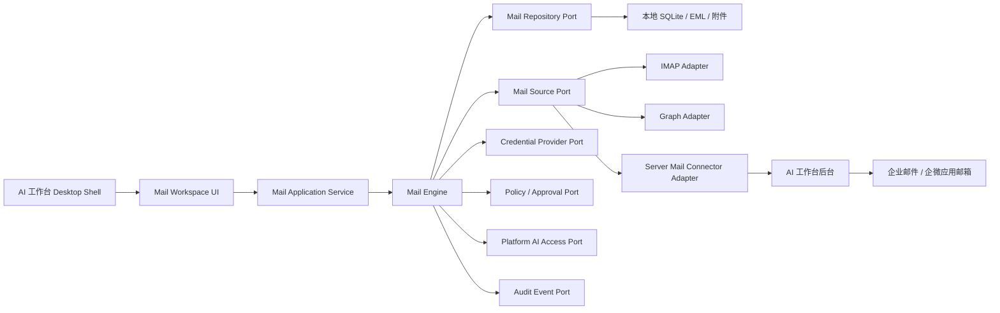
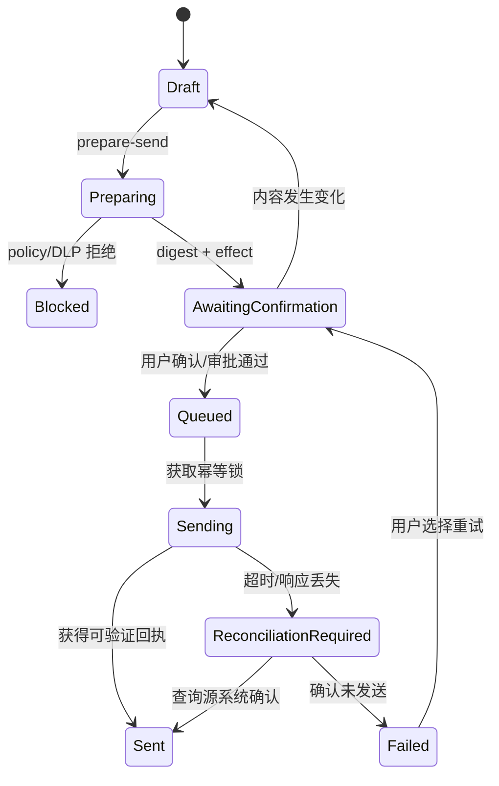

# 16 邮件模块与 mail_tools 复用设计

> 状态：draft / 基于现有代码的专项设计  
> 调研对象：SmartMail-Assistant  
> 调研日期：2026-08-08（Asia/Shanghai）  
> 关联：[产品需求规格](01-产品需求规格.md)、[总体系统架构](02-总体系统架构.md)、[桌面客户端](03-桌面客户端详细设计.md)、[企业连接器](08-企业连接器设计.md)、[API](10-API与事件协议设计.md)、[安全](11-安全隐私与审计设计.md)

## 1. 结论摘要

SmartMail-Assistant 已经具备一套可运行的本地优先邮件工作台，不应被当作示例代码重写，也不适合把其整个 PySide6 主窗口直接嵌入 AI 工作台。推荐将它演进为 AI 工作台的官方邮件插件和可复用邮件引擎：

1. 复用邮件协议、解析、增量同步、本地存储、搜索、组织、草稿、导出和受控 Agent 的实现经验；
2. AI 工作台 Desktop Shell 负责统一导航、企业微信身份、模块授权、模型访问、任务中心、更新和审计；
3. 邮箱凭据、本地邮件正文和附件默认留在用户设备，后台只保存绑定、策略、健康、任务与审计元数据；
4. 对需要集中治理或跨设备使用的邮箱，另提供服务端连接器模式，两种模式通过同一 Mail Port 对 UI 隐藏差异；
5. 企微应用邮箱属于管理员配置的应用级邮箱，不等于读取员工个人企业邮箱，不放在普通个人邮箱添加入口；
6. 所有 AI 调用改走公司模型代理和平台 AI Access，不沿用 mail_tools 的用户自配外部模型密钥作为企业默认路径；
7. 发送能力必须在现有“布尔确认”的基础上升级为 prepare-send、内容摘要、一次性确认令牌、幂等、DLP 和发送结果对账；
8. mail_tools 当前未发现 LICENSE 文件。正式复制或拆包前必须确认代码所有权、第三方依赖许可证和内部复用授权。

建议的交付单元名称为 **Mail Workspace 官方插件**，插件 ID 建议为 **com.company.aiworkbench.mail**。

## 2. 调研范围与证据边界

本次调研采用静态阅读，不修改 SmartMail-Assistant，不连接真实邮箱、企业微信、Microsoft、SMTP 或模型服务，也未重新执行其测试。结论来自以下内容：

- README、CHANGELOG、pyproject.toml；
- docs/智能邮件助手_设计文档.md、docs/智能邮件助手_界面设计文档.md、docs/V2开发与验收说明.md；
- smartmail/core、mail、integrations、organization、ai、ui 目录；
- tests 下的解析、数据库、规则、AI、安全、集成和 UI 测试用例。

项目自己的验收说明记录“当前离线自动化验收为 54 项”，本专项文档只把它当作被调研项目的自述，不能替代 AI 工作台仓库中的重新执行、依赖锁定、安全扫描和真实系统联调证据。

## 3. mail_tools 当前定位

### 3.1 技术画像

| 项目 | 当前情况 | 对 AI 工作台的意义 |
|---|---|---|
| 语言/运行时 | Python 3.10+ | 与桌面端 Python 技术栈一致 |
| UI | PySide6 / Qt Widgets | 可复用交互经验，Widget 不直接整体嵌入 |
| 本地数据库 | SQLite + FTS5 | 适合本地邮件索引和离线工作 |
| 凭据 | keyring，SQLite 只存 credential_ref | 可迁移到统一 Credential Vault |
| HTTP | httpx | 可通过平台 SDK 统一代理、证书、追踪和重试 |
| AI 编排 | LangGraph + 受控工具注册表 | 可复用计划/预览/确认理念 |
| 文档导出 | python-docx，另有 PDF/CSV/MD/EML | 可转成邮件插件制品能力 |
| 邮件协议 | 标准库 IMAP/SMTP/MIME；Graph、企微 HTTP API | 已具多适配器基础 |
| 版本 | 2.0.0 | 需重新建立工作台插件版本线 |

### 3.2 已支持的账户类型

| 类型 | 认证 | 当前读取方式 | 关键边界 |
|---|---|---|---|
| 腾讯企业邮箱 | 邮箱 + 客户端专用密码 | IMAP SSL，本地只读镜像 | 不删除、不移动、不改变服务器状态 |
| 标准 IMAP | 用户名/密码引用 | IMAP，默认 INBOX | 当前没有标准 IMAP OAuth 抽象 |
| Microsoft 365 / Exchange Online | OAuth 2.0 PKCE，refresh token 进凭据库 | Microsoft Graph，Mail.Read | 当前是读取适配器，不含 Graph 发送 |
| 企业微信应用邮箱 | CorpID + 应用 Secret | 企微应用邮箱 API | 是应用邮箱，不是成员个人收件箱 |
| SMTP 发件 | 邮箱凭据 | SMTP SSL 或 STARTTLS | 仅发送本地草稿，现有确认强度仍需升级 |

## 4. 能力盘点

### 4.1 邮件获取与解析

- IMAP 使用只读 select、UID 搜索和 BODY.PEEK[]，适合“服务器无副作用”的首期策略；
- 使用 UIDVALIDITY + last_uid 增量同步；UIDVALIDITY 变化时重置游标；
- 单封解析失败不阻塞后续邮件，安全游标停在首个失败 UID 之前以便重试；
- MIME 解析支持主题、地址、日期、纯文本、HTML、Message-ID、回复引用和附件；
- HTML 转文本会移除 script/style/noscript；详情展示再做标签和属性白名单；
- HTML 邮件不加载普通远程图片、样式、iframe、object、embed 或 form；只保留 mailto 链接；
- 账户内用文件夹、UIDVALIDITY、UID 去重，同时保存 content_hash 用于跨账户副本检查；
- Graph 将远程消息转换成统一 ParsedEmail；企微应用邮箱读取 EML 后复用 MIME 解析器。

### 4.2 本地数据与文件

- SQLite 保存账户引用、文件夹游标、邮件元数据/正文、附件元数据、分类、标签、规则、对话、Agent 运行、操作日志、线程、向量、草稿和日历事件；
- FTS5 索引主题、发件人和正文；
- 原始邮件按账户/文件夹/UIDVALIDITY/UID 保存为 EML；
- 附件文件名做 Windows 非法字符、保留名、路径穿越和长度处理；
- 附件与 EML 采用临时文件后原子替换；附件保存 SHA-256；
- 本地数据目录迁移要求空目标目录、空间预检、文件校验、SQLite 在线备份和 integrity_check；失败不切换旧目录；
- 当前 EML、附件和 SQLite 是普通本地文件，未看到应用层静态加密实现，不能把“使用 keyring”误解为“邮件正文已加密”。

### 4.3 邮件组织与办公能力

- 主分类、多个标签、手动分类锁定和规则历史；
- 发件人地址/完整域名动态分组；
- 本地已读、星标、回收站和可逆操作日志；
- 今天、近 7 天、附件、需要回复、等待回复、待办等视图；
- 邮件线程、联系人/发件人档案、重复副本检查；
- 本地草稿、回复引用、AI 回复建议；
- ICS 日历导出；
- PDF、Word、CSV、Markdown、EML 和分组批量导出；
- 本地特征哈希向量检索，当前不是语义嵌入模型，适合作为轻量离线检索基线。

### 4.4 AI 与 Agent 安全基线

mail_tools 中值得保留的不是独立模型配置，而是其受控执行模式：

- AI 先生成结构化计划，应用校验动作白名单、字段和作用范围；
- 模型只能缩小 UI 已授权范围，不能扩大账户或邮件范围；
- 批量写入强制确认，模型输出不能取消程序级确认；
- LangGraph Agent 仅有 6 个注册的只读元数据工具，最多观察 6 步；
- 工具不返回正文或附件内容，未知工具、未知参数、重复调用会被本地拒绝；
- 不提供任意 SQL、Shell、Python、服务器删除、直接发送、凭据修改或模型设置工具；
- 配方只复用指令模板，必须在当前范围重新规划和预览；
- 执行后验证本地分类、标签、分组、规则、摘要、草稿和文件后置条件；
- 外部 AI 正文调用受全局开关和目标域授权约束，附件内容固定关闭；
- AI 回复信息不足时返回澄清问题，结果只落为未发送草稿。

这些边界应迁移成 AI 工作台统一的 Policy Decision、Tool Gateway、Approval 和 Audit 机制，不能只保留在邮件专用 Prompt 中。

### 4.5 关键实现位置

| 能力 | mail_tools 位置 | 复用建议 |
|---|---|---|
| 账户领域模型 | smartmail/core/models.py | 迁移概念，改为稳定字符串/UUID 与版本化配置 |
| 凭据引用 | smartmail/core/credentials.py | 接入统一 CredentialProvider Port |
| SQLite Schema | smartmail/core/database.py | 拆 Repository，不直接复制单体 Database |
| EML/附件存储 | smartmail/core/storage.py | 可提取，增加加密、配额和恶意文件检查 |
| MIME 解析 | smartmail/mail/parser.py | 高价值可复用代码，补充模糊测试 |
| IMAP 只读客户端 | smartmail/mail/imap_client.py | 高价值可复用，保持只读默认 |
| IMAP 增量同步 | smartmail/mail/sync.py | 提取为可恢复 Sync Engine |
| Graph | smartmail/integrations/graph.py | 改为 Port Adapter，补 delta/分页游标和企业配置 |
| 企微应用邮箱 | smartmail/integrations/wecom.py | 移到管理员配置的服务端连接器候选 |
| SMTP | smartmail/integrations/smtp.py | 只复用协议封装，重做发送状态机 |
| 分类/分组/规则 | smartmail/organization | 可复用领域规则，去除对单体 DB 的耦合 |
| AI/Agent | smartmail/ai | 复用安全模式，模型调用改走平台 AI Access |
| 邮件 UI | smartmail/ui | 复用信息架构和组件需求，不整体嵌入主窗口 |
| 测试 | tests | 迁移为邮件引擎回归基线并新增企业场景 |

## 5. 不能直接照搬的部分

### 5.1 架构耦合

- Database 类集中约 1800 行数据访问，部分服务直接执行 connection SQL；
- UI 直接构造同步、导出、Graph、企微、规则和 RAG 服务；
- 多个适配器依赖具体 Database、StorageManager、CredentialStore，而不是 Port；
- 使用本地自增整数 ID，不适合插件、客户端和后台之间的离线/同步标识；
- 邮件 UI 与独立应用窗口、设置和主题紧密耦合。

因此，应先建立领域层和端口，再迁移代码；直接复制目录会把现有耦合带入 AI 工作台。

### 5.2 协议与同步缺口

- IMAP 当前默认聚焦 INBOX，服务器文件夹、已发送、草稿和状态双向同步不是完整实现；
- 普通 IMAP 主要是密码登录，没有企业统一 OAuth 适配层；
- Graph 当前按条数读取 inbox，未形成 delta token 增量同步与 webhook 方案；
- Graph 权限是 Mail.Read，没有 Graph 草稿/发送实现；
- 企微应用邮箱按时间窗获取并依靠本地去重，仍需确认生产游标、权限和限流行为；
- SMTP 成功返回后才更新本地状态，若服务器已接收但响应丢失，可能出现“未知是否已发送”；
- SMTP 草稿模型未覆盖 Bcc、附件、HTML/纯文本双体、Message-ID、幂等键和发送回执。

### 5.3 企业治理缺口

- 用户可自行配置模型地址和 API Key，不符合“统一调用公司模型代理”的默认架构；
- 邮件账户、模块和动作尚未接入企业微信身份、Entitlement、RBAC/ABAC；
- 本地日志不是后台不可抵赖审计；
- 没有管理员级连接器健康、强制策略、暂停发送、账户撤销和版本分配；
- 邮件正文/附件本地静态加密、终端合规、远程清理和保留期限待补；
- 附件打开前需要统一恶意软件、MIME 伪装、宏和数据外发策略；
- 代码仓库未发现 LICENSE，复用前需要完成代码来源和第三方许可证审查。

## 6. 目标形态：官方邮件插件 + 可替换邮件引擎

### 6.1 为什么不整体嵌入原窗口

整体嵌入会产生双主窗口、双设置中心、双模型配置、双任务系统、双更新链路和不一致的权限体验，也难以对邮件模块单独授权、灰度和撤回。目标应是复用领域能力，不复用应用壳。

### 6.2 为什么不完全重写

MIME、IMAP 游标、失败隔离、文件名安全、数据迁移、邮件线程和受控计划已经覆盖大量边界。完全重写会重新引入邮件协议和数据损坏风险，也会丢失现有测试资产。

### 6.3 目标组件



### 6.4 插件职责边界

| 邮件插件负责 | AI 工作台核心负责 |
|---|---|
| 邮件账户视图、同步、解析、搜索、线程、草稿 | 企业微信身份、设备、会话 |
| 邮件领域对象与本地 Repository | 模块 Entitlement、RBAC/ABAC |
| IMAP/Graph/本地连接器适配 | 公司模型代理访问、Token 计量和配额 |
| 邮件专用规则、摘要、回复用例 | 通用 Agent、Tool Gateway、Approval、Audit |
| 邮件页面和发送确认内容组件 | 插件签名、分配、更新、回滚、撤回 |
| 邮件特定错误与恢复建议 | 统一通知、诊断、可观测性和后台管理 |

## 7. 部署与凭据模式

### 7.1 两种数据模式

| 模式 | 邮件读取位置 | 凭据位置 | 正文/附件 | 优点 | 限制 |
|---|---|---|---|---|---|
| Local Mirror | 用户客户端 | Windows 凭据库/企业终端安全存储 | 默认仅本地 | 隐私、离线、复用 mail_tools 最快 | 跨设备差；终端需要持续在线 |
| Server Connector | 连接器 Worker | 公司 Secret Manager / OAuth Token Store | 按公司策略在服务端短期或索引化 | 集中治理、调度、跨设备 | 数据与密钥风险更高，建设量更大 |

UI、搜索、摘要和草稿用例必须依赖统一接口，不应知道底层模式。后台可按部门、账户类型和数据等级下发允许模式。

### 7.2 推荐首期组合

1. 腾讯企业邮箱和标准 IMAP：Local Mirror，只读同步；
2. Microsoft 365：优先评估企业批准的 OAuth/Graph，可先 Local Mirror，后扩展 Server Connector；
3. 企微应用邮箱：优先 Server Connector，由管理员管理应用 Secret 和成员授权；
4. 发送：首期仅用户发起的单封草稿发送，禁用批量发送和 Agent 自动发送；
5. 服务端默认不保存完整邮件正文和附件，只保存账户绑定、同步健康、AI/发送审计摘要；
6. 公司政策若要求服务端归档，以独立受控归档系统为准，不让 AI 工作台隐式成为邮件归档系统。

### 7.3 凭据规则

- SQLite/MySQL 只保存 credential_ref、provider、scope、owner 和状态，不保存明文密码、Secret、refresh token；
- 本地模式使用 Credential Vault；服务端模式使用公司 Secret Manager；
- OAuth refresh token 与登录会话 token 分离存储、分离撤销；
- 企业微信扫码登录不能替代邮箱授权，两者是不同身份与授权事务；
- 企微应用 Secret 只允许管理员创建服务端连接器实例，禁止下发到普通客户端；
- 凭据失效只暂停对应账户，不影响其他账户、聊天或 Agent 模块。

## 8. Mail Engine 端口设计

### 8.1 核心端口

| Port | 最小职责 |
|---|---|
| MailAccountRepository | 账户配置引用、状态、版本 |
| MailMessageRepository | 邮件 upsert、查询、FTS、线程、标签、草稿 |
| MailBlobStore | EML/附件原子写入、哈希、读取和删除策略 |
| MailSourceAdapter | discover/fetch/fetch_attachments/checkpoint/health |
| MailSendAdapter | prepare capability、send、查询结果/对账 |
| CredentialProvider | get/put/delete 短期或长期凭据引用 |
| PlatformPolicyClient | 模块、账户、动作、数据边界和审批判定 |
| PlatformAIClient | 摘要、分类、回复、抽取，统一 trace/usage |
| AuditSink | 追加结构化事件，支持离线 outbox |
| MalwareScanner | 附件保存/打开/上传前扫描 |

### 8.2 统一邮件标识

- 本地内部 ID 使用 UUID/ULID，不使用跨边界自增整数；
- 远程定位键由 connector_instance_id + mailbox_id + folder_id + remote_message_id 组成；
- IMAP 额外保存 UIDVALIDITY + UID；
- Message-ID 只用于线程和副本判断，不单独作为唯一键；
- content_hash 用于发现副本，不能自动跨账户合并或删除；
- 附件保存 SHA-256、大小、声明 MIME、探测 MIME 和扫描状态。

### 8.3 同步检查点

检查点由适配器版本化：

- IMAP：folder + uid_validity + last_safe_uid；
- Graph：delta_link/token 或经过验证的分页/时间检查点；
- 企微应用邮箱：API 支持的 cursor/时间窗 + 已处理 mail_id；
- Server Connector：server_cursor + event sequence。

任何解析失败都需要隔离记录 source_id、阶段、可重试性和脱敏错误。检查点不能越过未处理的强一致缺口；可接受最终一致的适配器必须记录缺口和补偿扫描策略。

## 9. 数据设计

### 9.1 客户端 SQLite

建议以 mail_ 前缀隔离插件 Schema：

| 表 | 关键字段 | 说明 |
|---|---|---|
| mail_accounts | id、provider、mode、credential_ref、config、state | 不存 secret |
| mail_folders | account_id、remote_id、checkpoint、sync_state | 版本化检查点 |
| mail_messages | account/folder、remote key、headers、body refs、hash、flags | 正文是否落盘受策略控制 |
| mail_attachments | message_id、name、size、mime、path、sha256、scan_state | 文件不写 BLOB |
| mail_threads | thread_key、latest_at、count | 线程索引 |
| mail_message_threads | message_id、thread_id | 多对一 |
| mail_categories / mail_tags | owner、name、color、source | 本地组织 |
| mail_rules / mail_rule_runs | conditions、actions、version、result | 受控规则 |
| mail_drafts | account、recipients、subject、body、attachments、version、state | 发送前版本冻结 |
| mail_send_attempts | draft_version、digest、idempotency_key、state、receipt | 防重复和对账 |
| mail_ai_results | message/scope、type、content_ref、model_trace | 派生结果 |
| mail_operation_log | action、scope、before/after refs、undo、state | 本地可逆操作 |
| mail_sync_failures | source_id、stage、retry、error_code | 失败隔离 |

FTS 只索引策略允许落盘的字段。正文禁止落盘时，搜索能力必须明确降级，不能悄悄把内容写入索引。

### 9.2 后台 MySQL

| 表/领域 | 保存内容 | 默认不保存 |
|---|---|---|
| mailbox_bindings | 用户、连接器、外部账户哈希、模式、状态 | 密码和 token |
| mail_connector_policies | 部门/用户、允许 provider/mode/action、保留策略 | 邮件正文 |
| mail_sync_health | 最近成功、延迟、错误码、客户端版本 | 原始 EML |
| mail_action_audits | 发起者、动作、对象摘要、风险、结果、trace | 正文全文 |
| mail_send_records | digest、收件人域摘要、审批、幂等、结果 | secret；正文默认仅哈希 |
| mail_ai_usage_links | 邮件任务 ID、模型 request_id、Token、用途 | 无审批的正文副本 |

完整正文、附件和收件人明文是否进入后台必须由公司数据分级、邮件制度和审计要求单独批准，不能因“正式环境用 MySQL”而默认集中复制。

### 9.3 保留与清理

- 本地邮件镜像、EML、附件、FTS、AI 摘要分别配置保留期；
- 停用账户默认保留本地镜像还是清理，由后台策略明确；
- 用户离职/设备丢失触发会话撤销、凭据删除和受管数据清理任务；
- 清理先 dry-run 展示数量、大小和范围；
- 本地删除与服务器删除是两个不同动作，首期只提供本地可恢复删除；
- 备份不能绕过保留和加密策略。

## 10. 模型与 Agent 集成

### 10.1 模型调用替换

mail_tools 的 OpenAI Compatible、Ollama、Azure OpenAI Provider 不作为企业正式入口。邮件插件调用 PlatformAIClient：

1. 提交 task_type、数据等级、内容范围、允许模型能力和幂等键；
2. 平台执行身份、Entitlement、配额、DLP、模型路由；
3. 公司模型代理完成上游调用；
4. 返回结果、引用、usage、request_id 和 policy decision；
5. 插件把派生结果写本地并同步最小审计事件。

若公司批准本地模型，可由模型目录声明 local route，而不是让插件拥有另一套不受管模型设置。

### 10.2 邮件 AI 能力

| 能力 | 输入默认边界 | 输出 | 是否可自动执行 |
|---|---|---|---|
| 单封摘要 | 正文；附件默认不含 | 摘要/要点 | 可生成派生内容 |
| 批量归纳 | 用户明确范围的正文 | Markdown/表格制品 | 需预览外发范围 |
| 分类/标签 | 元数据优先，必要时正文 | 建议或本地动作 | 批量写需确认/策略 |
| 待办抽取 | 正文 | 待办建议 | 创建企业任务需二次确认 |
| 回复建议 | 当前线程正文、用户补充事实 | 未发送草稿 | 不能自动发送 |
| 附件总结 | 用户选中的已扫描附件 | 摘要/引用 | 单独数据边界确认 |
| 邮件 Agent | 固定邮件工具集 | 计划/草稿/报告 | 高风险动作必须审批 |

### 10.3 不可信内容隔离

- 邮件头、正文、HTML、附件、链接、OCR 和模型抽取结果都标记为 untrusted_content；
- 邮件中的命令式文字不能成为系统/开发者指令；
- 邮件 Agent 默认只看到当前任务需要的工具；
- 工具参数由程序生成/校验，不允许邮件正文直接填充目标路径、URL、收件人或数据库查询；
- 从邮件触发本地文件、MCP、企业数据查询、上传和发送时必须经过新的策略判定；
- UI 明确区分“原邮件”“AI 提取”“用户指令”“平台风险提示”。

## 11. 发送安全状态机

现有 SMTPService 的 confirmed: bool 只能证明调用者传入了 true，不能证明用户确认的是当前版本，也不能处理响应丢失。目标状态机如下：



### 11.1 prepare-send 输出

- 冻结的 draft_version；
- From、To、Cc、Bcc；
- 主题和正文预览；
- 附件名、大小、SHA-256、来源和扫描状态；
- 外部联系人/外部域名；
- 敏感数据和 DLP 结果；
- AI 生成/改写标记；
- 发送账户和传输适配器；
- canonical content_digest；
- 风险等级、所需确认/审批和一次性 token；
- token 过期时间。

任一收件人、主题、正文、附件、发送账户或关键策略改变后，旧 token 立即失效。

### 11.2 execute-send 规则

- 请求必须带 idempotency_key、draft_version、content_digest、confirmation_token；
- 服务端或本地发送协调器原子占用幂等键；
- 单个 token 只能使用一次；
- 批量发送默认禁用；启用后按每封邮件生成独立记录、限速并支持停止；
- 网络超时不自动盲重试，先进入 reconciliation_required；
- 协议支持时查询 Sent/Message-ID/服务回执；不支持时提示“发送结果未知”，由用户选择查询、等待或人工确认；
- 审计保存哈希和收件人域摘要，是否保存明文由公司制度决定。

## 12. 桌面端 UI 设计

### 12.1 导航结构

邮件助手作为后台可分配模块出现在主侧栏：

```text
邮件助手
├─ 智能收件箱
├─ 未读 / 星标
├─ 需要回复 / 等待回复 / 待办
├─ 会话
├─ 分类与标签
├─ 草稿箱
├─ 本地回收站
└─ 账户与同步
```

未获得 Entitlement 时不加载邮件插件代码和本地数据库；被撤回时停止新任务、清除凭据并按策略保留/清理缓存。

### 12.2 主页面

推荐保留 mail_tools 已验证的三栏逻辑，但服从工作台 Shell：

- 左栏：账户、视图、分类/标签、同步状态；
- 中栏：搜索、筛选、邮件列表和批量本地操作；
- 右栏：安全渲染的邮件详情、附件、摘要、待办和回复；
- 顶部：当前数据模式、只读状态、最近同步、同步按钮；
- 右侧或任务中心：AI 计划、步骤、确认、结果和恢复操作。

### 12.3 添加账户

普通用户入口只显示管理员允许的类型：

1. 企业邮箱 OAuth/API；
2. Microsoft 365；
3. 腾讯企业邮箱客户端专用密码；
4. 标准 IMAP（高级，可能被禁用）。

企微应用邮箱不放在普通账户类型中，后台管理员创建连接器后，用户只看到被分配的应用邮箱资源。

### 12.4 同步与失败体验

- 每个账户独立显示连接、发现、下载、解析、索引和完成状态；
- 某封失败不让整个队列锁死；
- 提供“重试失败项、跳过并记录、修改账户、导出诊断、暂停同步”；
- 明确“本地只读镜像不会删除/移动服务器邮件”；
- OAuth 失效引导重新授权，不要求用户把 token 粘贴到界面；
- 磁盘不足、文件损坏和迁移失败保留既有数据路径。

### 12.5 附件体验

- 默认仅展示元数据，正文和附件加载状态分开；
- 下载前显示大小、来源、策略和磁盘空间；
- 打开前显示扫描状态；危险或未知状态进入隔离/只读预览；
- “发送给模型”“上传到知识库”“保存到工作区”“转发”是不同授权动作；
- 所有文件路径必须经过 Workspace/File Guard，不能直接信任附件名。

## 13. 管理后台设计

### 13.1 邮件连接器页面

- 连接器类型、版本、所有者和部署模式；
- 允许的部门/用户/邮箱域；
- OAuth 应用或 Secret 引用，不显示明文；
- 权限 scope、数据等级、允许动作；
- 同步延迟、成功率、限流、最近错误和依赖健康；
- 暂停读取、暂停 AI 正文、暂停发送、撤销全部凭据；
- 灰度、版本兼容和 Runbook。

### 13.2 邮件策略页面

- 可用账户类型和本地/服务端模式；
- 正文/附件是否允许落盘、保留期和加密要求；
- 是否允许把正文/附件发送到各数据边界模型；
- 外部联系人、敏感词/DLP、附件类型和大小规则；
- 单封/批量发送、每日限额、审批人和时间窗；
- 是否允许本地规则自动分类；
- 是否允许本地删除、服务器移动/删除；
- 离职、设备丢失、模块撤回时的清理策略。

### 13.3 审计页面

支持按用户、设备、邮箱绑定、动作、消息哈希、收件人域、模型 request_id、审批、发送状态和 trace_id 查询。管理员默认只看元数据；查看正文或附件必须有单独权限、原因、二次认证和审计。

## 14. API 与事件补充

### 14.1 客户端/后台 API

- GET /mail/capabilities
- GET /mailboxes
- POST /mailboxes/authorizations
- GET /mailboxes/{id}/authorization-status
- POST /mailboxes/{id}/sync-requests
- GET /mail/sync-jobs/{id}
- GET /mail/messages（服务端模式或元数据）
- GET /mail/messages/{id}
- POST /mail/drafts
- PATCH /mail/drafts/{id}（If-Match/draft_version）
- POST /mail/drafts/{id}/prepare-send
- POST /mail/drafts/{id}/send
- GET /mail/send-attempts/{id}
- POST /mail/send-attempts/{id}/reconcile

本地模式中的邮件列表和详情可由插件本地 Application Service 提供，不强制绕行后台；策略、模型调用、发送审计和健康事件仍经过平台。

### 14.2 事件

- mail.account.authorized / revoked
- mail.sync.started / progress / completed / partial / failed
- mail.message.indexed
- mail.attachment.quarantined / scanned
- mail.ai.requested / completed / rejected
- mail.draft.created / updated
- mail.send.prepared / confirmed / queued / sent / failed / reconciliation_required
- mail.policy.changed
- mail.connector.paused / resumed

事件正文不携带完整邮件内容；必要内容进入受控本地引用或短期对象引用。

## 15. 插件 Manifest 与权限建议

邮件插件至少声明：

| 权限 | 风险 | 默认 |
|---|---:|---|
| mail.account.configure | 中 | 按账户类型授权 |
| mail.read.metadata | 中 | 允许本人范围 |
| mail.read.body | 中/高 | 按数据策略 |
| mail.read.attachment | 高 | 按需 |
| mail.local.organize | 中 | 允许，批量需确认 |
| mail.draft.write | 中 | 允许 |
| mail.send.single | 高 | 每次确认 |
| mail.send.bulk | 极高 | 默认禁用 |
| mail.server.move | 高 | 首期禁用 |
| mail.server.delete | 极高 | 首期禁用 |
| model.use.mail_content | 高 | 模型数据边界校验 |
| filesystem.export | 高 | 用户选定目录 |

插件网络目标由适配器和公司策略白名单化，禁止通过用户输入变成通用 HTTP 客户端。

## 16. 迁移实施计划

### Phase M0：建立回归基线（1—2 周）

- 记录 mail_tools 当前 commit/hash、Python 和依赖版本；
- 补齐 LICENSE/代码归属和第三方许可证清单；
- 在隔离副本中执行现有测试、ruff、mypy 和启动检查；
- 固化合成 EML、IMAP、Graph、企微和 SMTP 契约样例；
- 输出功能矩阵与已知缺口，不在原仓库直接大改。

退出条件：现状可重复构建，安全边界和测试结果有证据。

### Phase M1：提取 Headless Mail Engine（2—4 周）

- 提取 models、parser、IMAP、sync、storage safe path；
- 建立 Repository、Source、Credential、Policy、AI、Audit Port；
- 将单体 Database 访问迁移到 Repository；
- 使用 UUID/稳定外部键和版本化检查点；
- 移植核心测试并加入 MIME/路径 fuzz；
- 暂不接入工作台 UI。

退出条件：无 Qt 环境也能完成合成邮箱同步、解析、查询和草稿用例。

### Phase M2：官方邮件插件（3—5 周）

- 按 AI 工作台设计系统重建邮件页面；
- 接入 Plugin/Entitlement/Policy Snapshot；
- 接入 Windows Credential Vault；
- 接入任务中心、通知、离线 outbox 和诊断；
- 接入公司模型代理，禁用企业默认的插件自配模型密钥；
- 完成腾讯企业邮箱/标准 IMAP 本地只读镜像试点。

退出条件：授权用户可在工作台内只读同步、搜索、摘要和生成未发送草稿；撤回模块可生效。

### Phase M3：企业发送闭环（2—4 周）

- 重做 draft_version、prepare-send、digest、token 和幂等状态机；
- 接入外部联系人提示、DLP、附件扫描、发送限额和审计；
- 构造 SMTP 响应丢失、重复点击、应用崩溃和网络恢复测试；
- 仅开放单封人工确认发送。

退出条件：重复请求不重复发送；内容变化必须重新确认；未知发送状态可对账或明确人工处理。

### Phase M4：企业连接器扩展（按现场情况）

- Microsoft Graph 企业应用、delta 同步和可选服务端模式；
- 企微应用邮箱服务端连接器；
- 管理后台健康、策略、授权和紧急停用；
- 经批准后评估批量发送、服务器移动/删除和跨设备状态。

## 17. 测试与验收

### 17.1 必须迁移的现有回归主题

- MIME 编码、HTML/纯文本、附件和异常邮件解析；
- 账户内去重、跨账户副本保留；
- UIDVALIDITY 变化、部分失败和安全游标；
- 安全文件名、路径穿越、附件哈希和数据目录迁移；
- FTS、规则、分类锁定、线程和本地检索；
- 未知 AI 动作/字段/工具拒绝、范围不能扩大；
- 正文外发开关、目标域确认、附件默认不外发；
- 草稿、AI 回复澄清、本地回收站、撤销和操作日志；
- 企微分页、Graph PKCE 映射和 UI 离屏启动。

### 17.2 新增企业级用例

| 编号 | 场景 | 通过标准 |
|---|---|---|
| MAIL-E2E-001 | 模块未授权/被撤回 | 不加载数据；同步停止；凭据按策略清理 |
| MAIL-E2E-002 | 只读 IMAP 首次与增量同步 | 不改变服务器状态；游标可恢复 |
| MAIL-E2E-003 | Graph token 轮换/撤销 | 不泄漏 token；仅对应账户暂停 |
| MAIL-E2E-004 | 企微应用邮箱分配 | 普通用户不能配置 Secret；只见授权邮箱 |
| MAIL-E2E-005 | 邮件提示注入 | 不能扩大工具/文件/数据/发送权限 |
| MAIL-E2E-006 | 邮件摘要与配额 | 模型走公司代理；usage 和 trace 可对账 |
| MAIL-E2E-007 | 附件到模型/MaxKB | 独立确认、扫描、数据等级和审计 |
| MAIL-E2E-008 | 内容修改后的发送 | 旧 confirmation token 失效 |
| MAIL-E2E-009 | 重复点击/超时 | 同幂等键至多一次发送；未知状态不盲重试 |
| MAIL-E2E-010 | 客户端崩溃恢复 | 任务、草稿、同步和发送状态可恢复 |
| MAIL-E2E-011 | 磁盘不足/目录迁移失败 | 保留原路径和已有数据，可诊断 |
| MAIL-E2E-012 | 后台暂停发送 | 已下发策略在规定时限内生效 |

### 17.3 发布门槛

- 所有邮件协议适配器有 Mock/录制契约和真实测试账户联调证据；
- 默认只读路径没有服务器删除、移动、标记副作用；
- 密钥不进入 SQLite、MySQL、普通日志、崩溃转储和诊断包；
- HTML 外部资源、危险标签和链接协议被阻断；
- 附件路径、MIME、恶意文件和大小限制通过安全测试；
- 模型访问、配额、数据边界和审计使用平台统一链路；
- 发送幂等、确认绑定和恢复故障注入通过；
- 插件签名、授权、灰度、撤回和数据清理演练通过；
- 法务/开源合规完成 mail_tools 与依赖复用审查。

## 18. 风险清单

| 风险 | 影响 | 缓解 |
|---|---|---|
| 把企微应用邮箱误认为个人邮箱 | 需求和权限设计错误 | UI/文档/后台明确分离，真实权限联调 |
| 本地邮件未加密 | 设备失窃时泄漏 | 终端加密、应用层加密评估、远程清理、最小保留 |
| SMTP 结果不确定导致重复发送 | 严重业务事故 | 幂等、Message-ID、状态机、对账、禁止盲重试 |
| HTML/附件恶意内容 | 代码执行/追踪/泄漏 | 安全渲染、外链阻断、扫描、隔离、受控打开 |
| 邮件 Prompt Injection | 文件/数据外传 | 内容分层、最小工具、策略、审批、审计 |
| 本地与服务端数据不一致 | 错误搜索/状态 | 版本化检查点、事件、对账和模式清晰展示 |
| 单体 Database 耦合 | 迁移缓慢、测试困难 | Repository/Port 渐进提取 |
| 模型双配置 | 绕过额度和数据策略 | 企业模式仅允许 PlatformAIClient |
| mail_tools 权属不清 | 无法合法复用/发布 | 先完成代码归属和许可证评审 |
| 第三方 API 变化 | 同步中断 | 版本锁定、契约测试、适配器熔断和升级验证 |

## 19. 已确定与待确认事项

### 19.1 本文建议确定

- 采用“官方邮件插件 + Headless Mail Engine”，不嵌入原主窗口；
- 首期默认本地只读镜像；
- 正文/附件默认不进入后台；
- 模型统一走公司代理；
- 企微应用邮箱由管理员配置；
- 首期只开放单封人工确认发送；
- 服务器删除、移动和批量发送默认不做；
- 发送采用内容摘要绑定和幂等状态机。

### 19.2 立项前必须确认

1. 公司实际邮箱是腾讯企业邮箱、Microsoft 365、混合部署还是其他系统；
2. 是否允许客户端专用密码，是否强制 OAuth/统一身份；
3. 邮件正文和附件是否允许本地落盘，必须保留多久；
4. 是否要求多设备同步，以及哪个系统作为已读/星标/分类权威；
5. 公司是否已有邮件归档、DLP、恶意附件扫描和发信网关；
6. 企微应用邮箱的实际用途、管理员权限和用户可见范围；
7. AI 可处理的邮件数据等级及允许的模型路由；
8. 外部联系人、群发、敏感附件和高管邮箱的审批规则；
9. 发送协议是否可提供稳定 Message-ID、回执或结果查询；
10. mail_tools 的代码所有者、复用授权和后续维护归属。

## 20. 最终建议

mail_tools 最有价值的部分是已经验证过的“本地只读邮件镜像 + 安全解析/存储 + 受控 AI 整理”闭环。AI 工作台不应推倒重来，也不应把它当作黑盒子硬塞进主程序。正确路线是：保留现有安全默认值，提取无界面的邮件引擎，用工作台的统一身份、权限、模型、审计、插件和更新能力包住它，再分阶段补齐企业发送与服务端连接器。

在没有确认公司邮箱类型、保留制度、OAuth 条件和发送网关前，先完成 M0/M1，不提前承诺 Graph、企微应用邮箱或 SMTP 的真实生产可用性。
