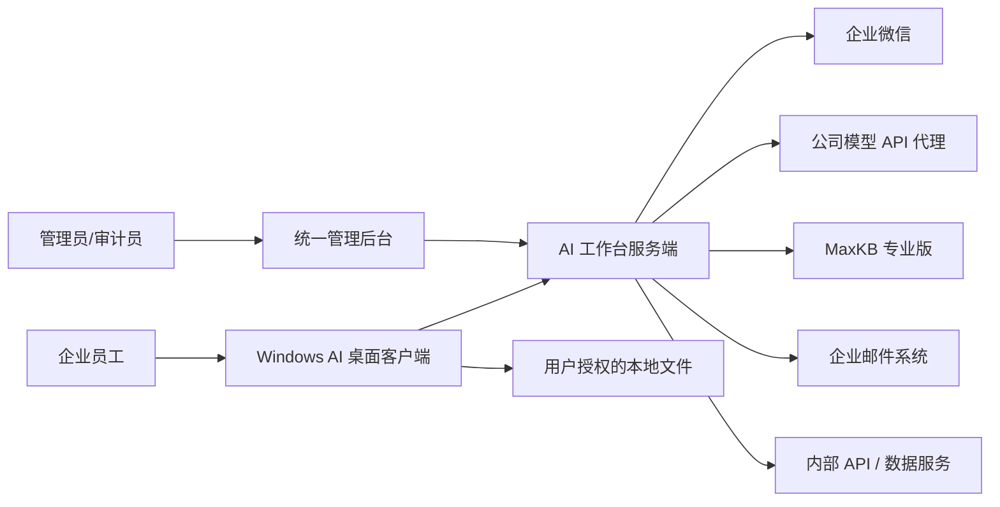

# 企业 AI 工作台设计文档集

> 文档版本：v0.4-draft  
> 生成时间：2026-08-08 01:14（Asia/Shanghai）  
> 适用范围：Windows 桌面客户端、统一管理后台及企业连接器  
> 状态：供立项、架构、产品、设计、安全和研发评审使用，尚未经过公司接口联调与正式评审

## 1. 文档目的

本目录将《企业内部 AI 桌面办公智能体——想法收集与整体架构草案》拆解为可维护、可评审、可追踪的设计文档集。它回答以下问题：

- 产品为什么做、先做什么、不做什么；
- 桌面端与后台分别承担什么职责；
- 企业微信、模型代理、MaxKB、邮件和内部系统如何接入；
- Agent 如何读取本地文件、调用工具，同时保持可控和可审计；
- 模型、用户、权限、额度、插件、客户端版本如何统一管理；
- SQLite 与 MySQL 如何分工，数据如何建模；
- API、事件、错误和幂等如何约定；
- 安全、隐私、审计、发布、升级、回滚和测试如何落地。

## 2. 文档导航

| 编号 | 文档 | 主要读者 | 内容 |
|---|---|---|---|
| 01 | [产品需求规格](01-产品需求规格.md) | 产品、业务、项目经理 | 产品目标、角色、范围、用户故事、功能与非功能需求 |
| 02 | [总体系统架构](02-总体系统架构.md) | 架构师、技术负责人 | 系统上下文、三平面、模块边界、部署与数据流 |
| 03 | [桌面客户端详细设计](03-桌面客户端详细设计.md) | 客户端研发、测试 | PySide6 分层、进程、缓存、任务、文件、更新和恢复 |
| 04 | [管理后台详细设计](04-管理后台详细设计.md) | 后端、管理端前端 | 模块化单体、后台模块、页面、任务和运营能力 |
| 05 | [身份、会话与权限设计](05-身份会话与权限设计.md) | 后端、安全、IT | 企业微信扫码、10 天规则、设备、RBAC + ABAC |
| 06 | [模型接入、计量与配额设计](06-模型接入计量与配额设计.md) | AI 平台、后端、财务 | 模型目录、访问链、Token 记账、预算、限流和降级 |
| 07 | [Agent、MCP、Skill 与插件设计](07-Agent与插件运行时设计.md) | Agent、客户端、安全 | 任务状态机、工具权限、沙箱、OpenCode 适配、插件生命周期 |
| 08 | [企业连接器设计](08-企业连接器设计.md) | 集成、数据、业务系统 | MaxKB、邮件、内部 API、数据库只读连接器和语义层 |
| 09 | [数据架构与数据库设计](09-数据架构与数据库设计.md) | 后端、DBA、客户端 | MySQL/SQLite 职责、核心表、索引、留存、迁移 |
| 10 | [API 与事件协议设计](10-API与事件协议设计.md) | 前后端、客户端、集成 | REST/SSE、接口清单、事件、错误码、幂等和版本 |
| 11 | [安全、隐私与审计设计](11-安全隐私与审计设计.md) | 安全、合规、审计 | 威胁模型、数据分级、密钥、DLP、提示注入、审计 |
| 12 | [桌面端与后台 UI/UX 设计](12-UI与交互设计.md) | 产品设计、前端、客户端 | 信息架构、页面、组件、状态、可访问性和设计令牌 |
| 13 | [部署、升级与运维设计](13-部署升级与运维设计.md) | 运维、SRE、研发 | 环境、拓扑、CI/CD、签名、灰度、回滚、可观测性 |
| 14 | [测试、评测与验收设计](14-测试评测与验收设计.md) | QA、产品、安全、AI 评测 | 测试分层、场景、性能、安全、模型评测和验收门槛 |
| 15 | [实施路线、风险与 ADR](15-实施路线风险与ADR.md) | 项目负责人、架构委员会 | 阶段计划、工作包、风险、决策记录和待确认项 |
| 16 | [邮件模块与 mail_tools 复用设计](16-邮件模块与mail_tools复用设计.md) | 邮件、客户端、后台、安全、QA | 现有 mail_tools 盘点、复用边界、部署模式、发送安全和迁移计划 |

原始输入与当前原型：

- [想法收集与架构草案](../想法+20260808-005304.md)
- [开发启动决策与待确认项](../想法+20260808-021159.md)
- [桌面主界面原型代码](../../ai_desktop/main_window.py)
- [桌面主界面截图](../../artifacts/main-window.png)

## 3. 总体设计结论

### 3.1 产品形态

系统由四部分组成：

1. Windows 桌面客户端；
2. 统一管理后台 Web；
3. 本项目服务端 API、任务与连接器；
4. 外部依赖：公司模型 API 代理、企业微信、MaxKB、邮件系统和内部业务系统。

### 3.2 技术架构

- 客户端：Python + PySide6，UI 主进程与本地 Agent 执行进程分离；
- 后台：Python 服务端，V1 采用模块化单体；
- 管理端：React 或 Vue Web 应用，在技术验证后确定；
- 后台开发数据库可以使用 SQLite 做快速单元验证，但集成环境必须尽早使用 MySQL；
- 正式后台使用公司统一 MySQL；
- 正式客户端仍使用本地 SQLite，但只承担缓存、草稿和任务断点；
- 异步任务使用消息/任务队列；大文件进入对象存储；
- OpenCode 是可替换的本地 Agent 引擎适配器，不是整个平台内核；
- MaxKB 是外部知识能力，由连接器集成，不复制其 RAG 引擎。
- 邮件能力以官方插件交付：首期复用 mail_tools 的本地只读镜像和安全解析能力；统一身份、模型、权限、审计、发送确认与更新由 AI 工作台负责。

### 3.3 安全架构

- 客户端被视为不可信执行环境；
- 所有业务授权以服务端判定为准；
- 客户端不保存模型供应商、MaxKB、邮箱或生产数据库长期密钥；
- 本地文件能力限定在用户明确授权的工作区；
- 读取、上传、创建、覆盖、删除、发送和业务写入分级授权；
- 插件签名、声明权限、隔离运行、灰度发布和紧急撤回；
- 工具输出、网页、邮件、附件和知识库内容一律作为不可信输入处理；
- 登录、模型、文件、工具、数据查询、审批和更新全链路可审计。

## 4. 系统上下文

## 5. 需求编号约定

| 前缀 | 含义 | 示例 |
|---|---|---|
| FR | 功能需求 | FR-CHAT-001 |
| NFR | 非功能需求 | NFR-PERF-001 |
| SEC | 安全要求 | SEC-AUTH-001 |
| DATA | 数据要求 | DATA-RET-001 |
| API | 接口要求 | API-IDEMP-001 |
| UX | 交互要求 | UX-AGENT-001 |
| OPS | 运维要求 | OPS-ROLL-001 |
| TEST | 测试/验收要求 | TEST-E2E-001 |

需求优先级使用：

- P0：MVP 必须具备，缺失则不能试点；
- P1：试点扩展阶段应具备；
- P2：平台化或规模化阶段；
- Pending：依赖公司现场条件，尚待确认。

## 6. 统一术语

| 术语 | 定义 |
|---|---|
| 逻辑模型 | 用户和业务功能看到的稳定模型名称，如“通用快速” |
| 实际模型 | 公司代理最终路由到的具体模型 ID |
| AI 访问服务 | 本项目中负责用户鉴权、策略、额度、追踪和计量的薄层 |
| 模型代理平台 | 公司已存在的、负责上游模型接入与密钥管理的平台 |
| Agent 任务 | 包含多个步骤、工具或制品，可暂停、审批和恢复的工作 |
| Tool | 可被 Agent 调用的单一原子动作 |
| MCP Server | 以 MCP 协议提供工具、资源或提示的服务 |
| Skill | 包含说明、模板、步骤、允许工具和验证规则的能力包 |
| Plugin | 可安装、授权、升级和撤回的软件交付单元 |
| Connector | 服务端与企业系统、MaxKB 或邮件系统的适配模块 |
| Mail Engine | 从 mail_tools 提取的无界面邮件领域与协议能力，可运行于本地插件或服务端连接器 |
| Artifact | 任务生成的文件、报表、图片或其他可下载制品 |
| Entitlement | 后台分配给用户或部门的功能/插件使用权 |
| Data Boundary | 数据将被发送、存储和处理的系统边界 |

## 7. 设计原则

1. **服务端为权威**：身份、权限、额度、插件、模型和版本策略由后台决定。
2. **最小权限**：默认只读、单任务授权、最小目录、最小工具集和最短凭据寿命。
3. **失败可恢复**：任务失败时保留完成进度，提供重试、修改、跳过、人工接管和终止。
4. **可替换适配器**：模型供应商、OpenCode、MaxKB、邮件和业务系统均通过稳定边界接入。
5. **先模块化单体**：先建立清晰模块和数据所有权，避免过早微服务化。
6. **显式数据边界**：用户能看到当前模型、文件、知识库、工具和数据去向。
7. **审计优先**：关键操作从一开始具备事件、追踪 ID 和可检索审计。
8. **制品优先于回答**：复杂办公任务以可验证、可预览、可追踪的制品为结果。
9. **兼容而不最低公分母化**：模型差异通过能力目录暴露，不假装所有模型能力相同。
10. **演进式交付**：先完成三个端到端闭环，再扩展邮件和更多内部系统。

## 8. 当前关键假设

| 编号 | 假设 | 若不成立的影响 |
|---|---|---|
| A-001 | 首发目标平台为公司 Windows 终端 | 需要重新评估跨平台打包和系统凭据库 |
| A-002 | 公司模型代理提供流式 API | 若仅支持非流式，交互与超时设计需调整 |
| A-003 | 公司可提供企业微信内部应用配置 | 登录方案可能需要改为统一身份平台/OIDC |
| A-004 | MaxKB 专业版提供满足建库、上传、状态和问答的 API | 部分知识库管理只能跳转 MaxKB 或延期 |
| A-005 | 公司存在 MySQL、对象存储和日志平台 | 否则本项目要增加基础设施工作包 |
| A-006 | 内部系统至少有一个可用于 MVP 的只读 API/数据集 | 第三个 MVP 闭环需要调整 |

## 9. 外部资料与验证边界

- Qt 官方文档确认 PySide6 是 Qt 6 的官方 Python 绑定，部署可评估 `pyside6-deploy`；正式商用前必须由公司法务确认 Qt/PySide6 许可证和分发方式。
- MaxKB 官方公开项目说明其包含 RAG、工作流、MCP/工具和多模型能力；公司专业版 API、许可、版本和权限以已购环境为准。
- OpenCode 官方文档提供服务端、SDK、Agent 和 MCP 能力；本项目只通过适配层使用，并锁定已验证版本。
- 企业微信登录的接口类型、回调域名、通讯录权限和令牌行为必须以公司企业微信后台及联调结果为准。

参考：

- [Qt for Python 官方文档](https://doc.qt.io/qtforpython-6/)
- [PySide6 部署工具](https://doc.qt.io/qtforpython-6/deployment/deployment-pyside6-deploy.html)
- [MaxKB 官方项目](https://github.com/1Panel-dev/MaxKB)
- [OpenCode Server 文档](https://dev.opencode.ai/docs/server/)
- [OpenCode MCP 文档](https://opencode.ai/v2/docs/mcp-servers)
- [SQLAlchemy 2.0 文档](https://docs.sqlalchemy.org/en/20/)

## 10. 文档维护规则

- 每次需求变更先更新相应 FR/NFR/SEC 编号，再改设计；
- 涉及不可逆架构选择时新增 ADR，不直接覆盖历史理由；
- 第三方接口只记录“已验证版本 + 日期 + 证据”；
- 接口示例中的密钥、邮箱、用户和业务数据必须是虚构值；
- Mermaid 图与正文不一致时，以经过评审的 ADR 和接口契约为准；
- 文档状态依次为 `draft → reviewed → approved → superseded`；
- 重大版本的文档应与客户端、后台和插件发布版本建立关联。
