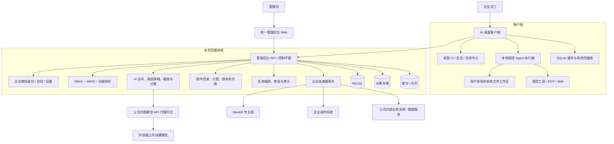
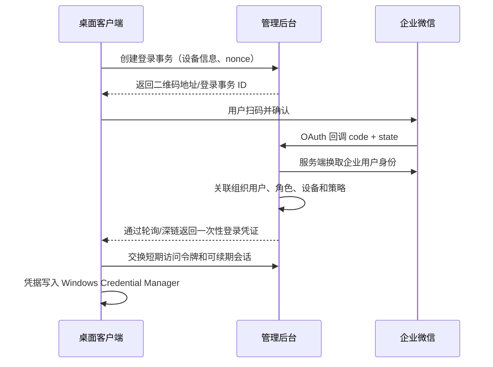

# 企业内部 AI 桌面办公智能体——想法收集与整体架构草案

> 文档状态：想法收集 / 讨论稿 v0.1  
> 记录时间：2026-08-08 00:53:04（Asia/Shanghai）  
> 本轮边界：只做产品与架构讨论，不进入编码、选型落地或接口联调。  
> 暂用项目代号：**AI DeskTop / 企业 AI 工作台**

## 1. 一句话定义

这是一个由公司统一治理、面向员工日常办公的 AI 桌面工作台：员工可以通过对话完成知识检索、文档和数据处理、内部系统查询、邮件辅助和复杂任务执行；公司可以在后台统一管理身份、权限、模型、额度、插件、审计、数据安全和客户端升级。

它不只是“聊天客户端”，而是下面四种产品的组合：

1. 企业统一 AI 入口；
2. 可控的本地办公 Agent；
3. 企业系统和知识库的自然语言操作入口；
4. 由后台治理的模块化桌面平台。

## 2. 本轮核心结论

### 2.1 推荐的总体方向

- 客户端采用“薄壳 UI + 本地受控执行能力”，业务权限和策略以服务端为准。
- 服务端先做**模块化单体**，不要一开始拆成大量微服务；当某一模块出现独立扩缩容或隔离需求时再拆分。
- 客户端不能保存供应商长期 API Key，也不能直接连接生产 MySQL 或各业务系统数据库。
- 公司内部 API 代理平台是上游模型供应层，本项目仍需有一层轻量的 **AI 访问服务**，负责用户鉴权、模型授权、额度预检、请求追踪、用量记账和审计，但不重复建设模型代理平台。
- OpenCode 可作为“本地文件/代码任务执行引擎”的一个可替换适配器，不建议让它直接承担身份、权限、插件分发、办公 UI 和企业数据治理等平台职责。
- MaxKB 应通过服务端连接器接入，复用其知识库、RAG、工作流与开放 API 能力，不在本项目中重复实现一套向量数据库和知识库引擎。
- 插件必须分类型、声明权限、签名发布、版本锁定、隔离运行；不要让任意 Python 包直接导入客户端主进程。
- “10 天不登录需重新扫码”应由服务端执行，而不是只依赖客户端本地时间字段。

### 2.2 Python 桌面方案建议

V1 推荐使用：

- 客户端：Python 3.12+、PySide6、Qt WebEngine（只在必要页面使用）、SQLAlchemy、Alembic、HTTPX；
- 本地安全存储：Windows Credential Manager（通过 `keyring` 等封装）；
- 本地数据库：SQLite，保存缓存、草稿、任务状态、最近使用记录和非敏感配置；
- 本地执行器：独立子进程，通过稳定 IPC 协议与客户端通信；
- 管理后台 API：FastAPI + SQLAlchemy + Alembic；
- 管理后台前端：Vue 或 React，独立 Web 管理端；
- 正式数据库：公司统一 MySQL；
- 异步任务：先使用 Redis + 成熟任务队列，具体库在技术验证时确定；
- 文件/制品：公司对象存储或 MinIO 兼容服务，不把大文件塞进 MySQL。

选择 PySide6 的原因是 Python 生态与 Agent、文件处理、OCR、数据分析能力衔接最直接，也方便 Windows 原生桌面能力集成。它的主要风险是安装包体积、复杂 UI 开发效率、Web 内容嵌入和自动更新，需要从第一天就隔离 UI、领域逻辑和执行引擎。

如果未来 UI 复杂度显著上升，可评估“Tauri/React 桌面壳 + Python 本地执行服务”。不建议 V1 同时引入两套桌面技术栈。

## 3. 产品边界

### 3.1 本项目包含

- 桌面客户端；
- 公司统一管理后台；
- 身份、会话、设备、角色、权限和功能授权；
- AI 对话、模型目录、额度与用量展示；
- Agent 任务、工具、MCP、Skill 和本地文件工作区；
- 邮件、内部系统、MaxKB 等连接器；
- 插件目录、分配、签名、升级与回滚；
- 审计、风险控制、数据分类与敏感操作审批；
- 客户端统一发布、灰度升级和版本治理。

### 3.2 本项目暂不包含

- 公司内部模型 API 代理平台本身；
- 自研基础大模型；
- 重新开发一套与 MaxKB 重复的 RAG 平台；
- V1 即开放任意第三方插件市场；
- 默认允许 Agent 不经确认发送邮件、删除文件、执行任意命令或修改业务系统数据；
- 客户端直接连接生产业务数据库。

## 4. 目标用户与典型场景

| 用户 | 目标 | 典型场景 |
|---|---|---|
| 普通员工 | 快速完成知识和文档工作 | 问答、总结、翻译、写材料、生成 Word/Excel/PPT |
| 数据/业务人员 | 自助获取可信业务数据 | 用自然语言查指标、生成报表、解释异常 |
| 管理人员 | 降低信息汇总成本 | 周报汇总、经营简报、会议材料、跨系统分析 |
| IT/AI 管理员 | 统一治理 AI 能力 | 模型、额度、插件、版本、审计和故障管理 |
| 数据/系统负责人 | 安全开放系统能力 | 发布只读工具、数据语义层、审批型写操作 |
| 安全/审计人员 | 可追溯与合规 | 查询谁在何时通过哪个模型/工具访问了什么数据 |

## 5. 总体架构



### 5.1 三个平面

为了让架构长期可扩展，建议明确划分三个平面：

1. **控制平面**：用户、组织、权限、模块授权、模型目录、策略、配额、插件版本、客户端版本；
2. **执行平面**：云端连接器任务、本地 Agent 任务、工具调用、文件处理和工作流；
3. **数据与审计平面**：会话、任务事件、模型用量、审批、工具调用、制品元数据和审计日志。

控制平面下发“允许做什么”，执行平面完成“实际工作”，审计平面记录“发生了什么”。三者不能只靠客户端自觉执行。

## 6. 客户端架构

### 6.1 客户端内部模块

```text
Desktop Shell
├─ 身份与会话
├─ 导航、窗口、托盘、通知
├─ AI 对话
├─ Agent 任务中心
├─ 文件与制品中心
├─ 知识库
├─ 邮件助手
├─ 应用/插件中心
├─ 本地权限与确认中心
├─ 下载、安装与更新
└─ 本地运行时
   ├─ SQLite Repository
   ├─ Credential Vault
   ├─ Plugin Host
   ├─ Agent Runner
   ├─ MCP Client
   ├─ Skill Runtime
   └─ File Workspace Guard
```

### 6.2 主进程与执行进程隔离

建议至少拆为两个进程：

- **桌面主进程**：只负责 UI、用户交互、状态展示和调用后台；
- **本地执行进程**：负责文件、命令、MCP、Skill 和长时间任务。

两者使用 JSON-RPC、gRPC 或本地受保护 Socket 通信。执行器崩溃或被终止时，UI 不应一起崩溃；已经完成的任务步骤和制品必须保留，用户可以重试、修改、跳过或人工接管。

更高风险的插件可以使用“一插件一进程”或“一任务一沙箱”。

### 6.3 本地 SQLite 的定位

生产客户端仍然需要 SQLite，但它只能是**本地缓存和工作状态库**，不是公司权威数据源。

适合保存：

- 登录用户的非敏感展示信息；
- 会话列表缓存和本地草稿；
- 任务事件、断点、待上传制品；
- 插件清单、策略快照和版本信息；
- 本地文件索引（需用户授权）；
- UI 设置。

不适合明文保存：

- 企业微信长期令牌；
- 模型供应商 API Key；
- 邮箱密码；
- 内部系统数据库密码；
- 可直接重放的高权限凭证。

这类凭据放入操作系统凭据库；SQLite 只保存凭据引用和必要元数据。还应定义缓存保留、退出清理、远程擦除和用户离职后的失效策略。

## 7. 管理后台架构

### 7.1 V1 采用模块化单体

推荐的服务端模块：

```text
backend/
├─ identity       企业微信登录、用户、部门、设备、会话
├─ authorization  RBAC、ABAC、数据范围、功能授权
├─ model_catalog  模型、能力、上下文、价格/计量规则
├─ ai_access      请求预检、路由策略、流式转发、用量记账
├─ conversation   对话、消息、附件和反馈
├─ agent          任务、步骤、审批、事件和制品
├─ plugin         插件目录、签名、分配、版本和发布环
├─ connector      邮件、MaxKB、内部系统连接器
├─ quota          预算、限额、告警和成本中心
├─ audit          审计事件、检索、导出和留存
├─ updater        客户端版本、灰度、强制升级和回滚
└─ notification   站内、邮件或企业微信通知
```

模块间通过明确的应用服务接口和领域事件连接，不允许直接随意跨模块改表。未来需要拆分时，边界已经存在。

### 7.2 后台管理能力

- 组织同步：企业微信成员、部门、状态；
- 账户和设备：启停、登出全部设备、风险设备、会话查看；
- 角色和策略：按人员、部门、岗位、项目、设备、网络和数据等级授权；
- 模型管理：模型能力、可见范围、默认模型、降级模型、上下文上限；
- 配额：按个人/部门/项目/模型/日月周期设置请求、Token 或费用额度；
- 插件管理：发布、审批、灰度、授权、撤回、最低客户端版本；
- 连接器管理：凭据、范围、健康状态、限流、可用部门；
- 审计中心：登录、问答、模型、文件、工具、审批、系统数据访问和更新记录；
- 运营面板：活跃用户、成功率、延迟、模型消耗、任务完成率、热门插件；
- 客户端升级：版本渠道、灰度名单、截止时间、强制升级、回滚。

## 8. 企业微信扫码登录

### 8.1 推荐流程



### 8.2 “10 天不登录”规则

建议定义为：

- 以服务端的 `last_activity_at` 为准；
- 连续 10 天没有成功使用客户端，则刷新会话失效，必须重新扫码；
- 客户端启动、刷新令牌或调用受保护 API 时，服务端检查闲置时长；
- 管理员禁用账户、人员离职、部门策略变化或设备被撤销时立即失效；
- 可额外设置绝对有效期，例如 30 天或公司安全制度要求的期限；
- “记住登录”只保存不可导出的系统凭据，不在 SQLite 保存可复制的明文 Token。

企业微信具体采用哪一种扫码/网页授权模式、回调域名和组织通讯录权限，需要结合公司的企业微信应用类型与管理后台配置做一次正式接口验证，本讨论稿不预设未经验证的接口细节。

## 9. 模型接入、分类、计量和额度

### 9.1 模型能力目录

不要只把模型当作一个字符串。每个模型应登记能力：

- 文本对话；
- 推理；
- 视觉理解；
- OCR；
- Embedding；
- Rerank；
- 语音识别 / 语音合成；
- 图片或视频生成（如公司允许）；
- 工具调用；
- 结构化输出；
- 上下文长度、文件限制、流式响应；
- 数据是否出公司、可用数据等级、供应商地域；
- 单价、计量单位、并发限制和超时策略。

模型显示名和上游 `model_id` 分开。用户看到“通用快速”“深度推理”“图片理解”，管理员维护实际路由，避免供应商或型号变化影响客户端。

### 9.2 调用链建议

```text
客户端
  → 本项目 AI 访问服务（用户鉴权、权限、额度、追踪）
  → 公司内部 API 代理平台（供应商路由、上游密钥、模型接入）
  → 外部或自建模型
```

如果公司代理平台未来原生支持用户级令牌、权限、预算和审计，本项目 AI 访问服务可缩薄，但客户端仍不应持有供应商长期密钥。

### 9.3 Token 与用量记录

每次调用建议记录：

- `request_id` / `trace_id`；
- 用户、部门、设备、功能模块、会话、任务；
- 逻辑模型、实际模型、供应商路由；
- 输入、输出、缓存、推理等 Token；
- 文件页数、OCR 页数、图片张数、音视频时长等非 Token 用量；
- 延迟、首 Token 延迟、状态、错误码、重试次数；
- 预算归属（个人、部门、项目、成本中心）；
- 是否命中安全策略、是否发生降级。

上游返回 `usage` 时以其为主要依据；缺失时可以估算，但必须标注 `estimated=true`。月度费用应与公司代理平台对账，不能只依赖客户端上报。

### 9.4 额度策略

- 软提示：达到 70%/90% 时提醒；
- 硬限制：超过配额拒绝或切换到低成本模型；
- 并发限制：防止单用户或单插件占满容量；
- 场景限制：普通聊天、Agent、OCR、图像等分别计量；
- 例外审批：临时额度、有明确到期时间；
- 防重复记账：用请求幂等键处理流式中断和重试。

## 10. AI 对话功能

### 10.1 基础能力

- 新建、重命名、搜索、收藏、归档和删除会话；
- 流式回复、停止生成、重新生成、分支对话；
- 模型/能力选择和管理员推荐模型；
- 文件、图片、截图、剪贴板和拖拽输入；
- Markdown、表格、代码、引用来源和思考状态展示；
- 对话导出、复制为文档、生成任务；
- 提示词模板和个人常用指令；
- 反馈、纠错和问题上报；
- 明确展示当前数据将发送到哪个服务边界。

### 10.2 对话与任务的边界

- “问一个问题、生成一段内容”属于对话；
- “读取多份文件、执行多个步骤、产生制品、需要审批或可恢复”属于任务；
- 对话可一键升级为任务；
- 任务完成后结果回填对话，但任务日志独立保存。

## 11. Agent 与本地办公能力

### 11.1 Agent 执行模型

建议使用可观察的状态机：

```text
草稿 → 规划 → 等待确认 → 执行 → 等待人工输入/审批
    → 继续执行 → 验证 → 完成
                   ↘ 失败 → 重试/修改/跳过/人工接管
```

每一步都记录输入、输出、工具、权限、耗时和制品。失败不能把整个窗口锁死，也不能丢失已完成进度。

### 11.2 本地文件安全

- 用户先选择一个或多个工作区，默认禁止访问工作区之外的路径；
- 读取、创建、覆盖、移动、删除分别授权；
- 覆盖或删除前展示精确路径和影响；
- 优先生成新版本，使用回收站或可恢复机制；
- 批量操作先显示计划和文件数量；
- 上传本地文件到模型、MaxKB 或其他服务前显示目的地和数据范围；
- 记录文件哈希和制品谱系，知道结果来自哪些输入文件；
- 高敏目录和文件扩展名可以由公司策略禁止。

### 11.3 办公制品能力

建议逐步提供：

- Word：起草、改写、套模板、批注、比较版本；
- Excel：清洗、公式、透视、图表、异常分析；
- PowerPoint：按模板生成、版式检查、内容精简；
- PDF：提取、OCR、合并、拆分、表格识别；
- 图片：截图识别、图表理解、脱敏；
- 批量文件：重命名、分类、归档和元数据整理。

所有制品都应经过“生成 → 本地预览 → 规则验证 → 用户确认保存/提交”的流程。

### 11.4 OpenCode 的合理定位

OpenCode 是开源编码 Agent，并提供服务端/SDK 等集成能力。建议把它封装成 `AgentEngineAdapter` 的一种实现，用于代码、Shell、文件和项目型任务验证，而不是把桌面平台直接建立在它的内部数据结构上。

需要先做技术验证：

- Windows 下的进程管理、路径和编码；
- 服务端/SDK 协议是否满足稳定集成；
- 公司模型代理的协议兼容性；
- 工具权限能否被本项目外层策略强制约束；
- 会话、事件、取消、恢复和附件能力；
- 升级时的兼容性和许可证审查。

同时保留自研轻量任务执行器或其他引擎适配器，避免被单一开源项目锁定。

## 12. MCP、Skill 与工具体系

### 12.1 概念分层

| 类型 | 作用 | 示例 |
|---|---|---|
| Tool | 原子动作 | 读取报表、创建草稿、查询订单 |
| MCP Server | 标准化暴露一组工具/资源 | OA、CRM、财务数据查询 |
| Skill | 带说明、模板和流程约束的能力包 | “生成月度经营分析” |
| Workflow | 多步骤、有条件和审批的业务流程 | 报表生成后提交部门负责人 |
| Plugin | 可安装、可授权、可升级的软件交付单元 | 邮件模块、MaxKB 模块 |

### 12.2 MCP 治理

- 公司维护可信 MCP 注册表；
- 记录发布者、版本、工具清单、输入输出 Schema、数据等级和网络目标；
- 禁止客户端任意添加公网 MCP，除非管理员允许；
- 每个工具有超时、并发、速率、可见范围和审计策略；
- 高风险工具必须二次确认或服务端审批；
- 工具输出视为不可信数据，防止提示注入诱导 Agent 扩权；
- MCP 权限不能超出当前登录用户在源系统的权限。

### 12.3 Skill 治理

- Skill 包含清晰的目的、输入、输出、步骤、允许工具和验证方式；
- Skill 版本不可静默覆盖，任务记录绑定具体版本；
- 个人 Skill 与公司 Skill 分区；
- 公司 Skill 必须审批、签名、灰度和可撤回；
- Prompt 只是 Skill 的一部分，不能替代程序级权限控制。

## 13. 公司内部系统接入

### 13.1 接入优先级

1. 业务系统正式 API；
2. 公司统一数据服务/语义层；
3. 受管 MCP 连接器；
4. 最后才考虑数据库只读连接器。

不建议客户端直接连接数据库。若确实只能从数据库获取数据，应在服务端连接器网关中实现，并满足：

- 独立只读账号；
- 只读视图或语义数据集；
- 表、列、行级权限；
- SQL 解析、只允许 `SELECT`、超时、行数和资源限制；
- 参数化查询和敏感字段脱敏；
- 查询前展示意图，查询后记录实际 SQL、用户和数据范围；
- 写操作必须通过业务 API 和正式审批流程，不能让模型直接执行 SQL 更新。

### 13.2 自然语言数据问答

建议引入“数据语义层”，登记：

- 指标名称、口径、公式和负责人；
- 维度、时间粒度、允许的筛选条件；
- 数据源、刷新时间和质量状态；
- 同义词、示例问题和推荐图表；
- 用户/部门可见范围。

这样模型生成的是受控查询计划，而不是在生产库中自由猜表名。输出报表必须附带数据时间、口径、来源和查询条件。

## 14. MaxKB 专业版接入

### 14.1 建议能力

- 查看本人和被授权的知识库；
- 创建个人知识库；
- 上传、更新、删除文档；
- 查看解析、分段、向量化和失败状态；
- 进行知识库问答并展示引用片段；
- 个人知识库与公司共享知识库分区；
- 将对话结果或本地文件经确认后加入知识库；
- 管理同步策略、文件版本和重复内容；
- 展示 MaxKB 服务健康状态和接口错误。

### 14.2 架构建议

- MaxKB 系统级凭据保存在服务端密钥管理中；
- 客户端只调用本项目的 MaxKB 连接器；
- 建立本项目用户与 MaxKB 用户/工作空间/资源权限的映射；
- 大文件由服务端代理或签发短期上传凭证，避免长期密钥下发；
- 本项目只保存资源 ID、状态、权限和审计元数据，正文与向量仍由 MaxKB 管理；
- 对 MaxKB API 做版本适配层，升级专业版时先做兼容性测试；
- 确认专业版开放 API 对“建库、文件上传、文档状态、问答、权限”的实际覆盖，缺失能力需在原型阶段列为阻塞项。

MaxKB 当前公开项目已经包含 RAG、工作流、MCP/工具和多模型能力，因此本项目应优先集成而非重复建设；专业版具体 API 与授权范围以公司已购版本的文档和现场验证为准。

## 15. 邮件模块的初步边界

邮件模块后续需要单独讨论，当前先确立安全原则：

- 优先企业邮箱 OAuth、Microsoft Graph、EWS 或正式企业接口；IMAP/SMTP 是兼容方案；
- 凭据放服务端或系统凭据库，不保存邮箱明文密码；
- 收件：摘要、分类、搜索、待办提取、附件处理；
- 写件：起草、润色、翻译、根据上下文拟回复；
- 发送默认必须由用户检查收件人、抄送、主题、正文和附件后明确确认；
- 自动发送只能作为审批过的特定工作流能力；
- 防止提示注入：邮件正文与附件是外部不可信输入，不能直接触发高权限工具；
- 明确邮件保留、缓存、附件上传模型和敏感信息策略。

## 16. 插件与模块化架构

### 16.1 插件类型

建议区分五类，而不是用一个“万能插件”概念：

1. **UI 模块**：导航入口、页面、侧边面板；
2. **客户端能力插件**：本地文件或设备能力；
3. **服务端连接器**：邮件、MaxKB、OA、CRM；
4. **Agent 工具/MCP 插件**：向模型暴露受控工具；
5. **Skill/模板包**：工作方法、Prompt、模板、校验规则。

### 16.2 插件清单示例

```yaml
id: com.company.maxkb
name: MaxKB 知识库
version: 1.2.0
type: connector-ui
publisher: company-ai-team
min_client_version: 1.4.0
server_api_version: v1
entrypoints:
  ui: knowledge_page
  server: maxkb_connector
permissions:
  - network:maxkb.internal
  - file:upload:user_selected
  - knowledge:read
  - knowledge:write
capabilities:
  - knowledge.list
  - knowledge.upload
  - knowledge.chat
signature: "..."
```

### 16.3 插件生命周期

```text
开发 → 安全扫描 → 测试 → 审批 → 签名 → 发布
    → 分配给部门/用户 → 灰度启用 → 全量启用
    → 升级/回滚 → 撤销 → 数据清理
```

关键要求：

- 后台分配的是“使用权”，客户端每次启动和定期刷新授权；
- 插件包必须签名并校验哈希；
- 插件声明权限，首次启用和权限升级时明确提示；
- 插件版本与客户端、服务端 API 有兼容矩阵；
- UI 使用预定义扩展槽，不允许任意修改主界面；
- 高风险插件隔离进程，设置 CPU、内存、时间和网络边界；
- 撤销插件时，服务端先禁用能力，客户端随后卸载，不能只依赖本地删除文件。

## 17. 权限模型

只做 RBAC 不够，建议采用 **RBAC + ABAC**：

- RBAC 决定用户大体角色；
- ABAC 根据部门、岗位、项目、设备、网络、数据等级、时间、操作风险和资源归属进一步判断。

建议内置角色：

- 普通员工；
- 部门管理员；
- 模型管理员；
- 插件管理员；
- 数据/连接器管理员；
- 审计员；
- 系统管理员。

典型策略例子：

> 财务部员工可在公司网络、受管设备上使用“财务只读查询”插件；只能访问本人权限内的成本中心；导出超过指定行数需要审批；数据不可发送到标记为“外部处理”的模型。

## 18. 安全与合规底线

### 18.1 需要防范的主要风险

- 客户端密钥被提取；
- Agent 越权读取、覆盖或外传文件；
- Prompt Injection 诱导工具调用；
- 模型把敏感数据发送到不合规上游；
- 内部系统查询绕过原系统权限；
- 恶意或失控插件；
- 自动邮件误发；
- 会话和本地缓存泄漏；
- 模型调用无法准确归属和计费；
- 客户端旧版本长期不升级。

### 18.2 必须从 V1 建立的能力

- 服务端权限判定；
- 短期令牌、设备会话和远程撤销；
- 系统凭据库与服务端密钥管理；
- 全链路 `trace_id`；
- 模型、工具、文件、系统查询和审批审计；
- 模型及连接器的数据等级标签；
- 本地工作区边界和危险操作确认；
- 插件签名、灰度和紧急撤回；
- 日志脱敏和分级留存；
- 依赖与安装包供应链扫描；
- 数据导出、水印和 DLP 接口预留。

审计日志建议采用追加式设计，普通管理员不能修改历史记录。对于极高合规要求，可定期生成哈希链或将关键审计写入独立审计存储。

## 19. 数据设计草案

### 19.1 服务端核心实体

| 领域 | 核心实体 |
|---|---|
| 身份 | User、Department、Role、Policy、Device、Session |
| 模型 | Model、ModelCapability、RoutePolicy、PriceRule |
| 配额 | Quota、Budget、UsageRecord、CostCenter |
| 对话 | Conversation、Message、Attachment、Citation、Feedback |
| Agent | Task、Step、Approval、ToolCall、Artifact、TaskEvent |
| 插件 | Plugin、PluginVersion、Entitlement、Rollout、InstallState |
| 连接器 | Connector、CredentialRef、ResourceGrant、HealthCheck |
| 知识库 | KnowledgeBinding、DocumentRef、IngestJob |
| 审计 | AuditEvent、RiskDecision、ExportJob |
| 更新 | ClientRelease、UpdateChannel、DeviceVersion |

### 19.2 SQLite 与 MySQL 兼容策略

- 使用 Repository/DAO 隔离数据库；
- 使用 Alembic 管理迁移；
- 主键、时间、布尔、JSON、索引长度和排序规则按 MySQL 约束设计；
- CI 中从早期就增加 MySQL 集成测试，不能等上线前才从 SQLite 切换；
- 客户端 SQLite Schema 与后台 Schema 分离，不能假设二者结构相同；
- 所有时间服务端按 UTC 存储，展示时转换为用户时区。

## 20. API 与事件协议原则

- HTTP API 版本化，例如 `/api/v1`；
- 流式对话统一使用 SSE 或 WebSocket，V1 优先选择更容易穿越企业代理的方式；
- 任务采用事件流：`task.created`、`step.started`、`approval.required`、`artifact.created` 等；
- 写请求支持幂等键；
- 错误包含稳定错误码、可读说明和 `trace_id`；
- 客户端能力、插件能力和服务端能力进行启动握手；
- 长任务可取消、可恢复，客户端断线不应自动终止云端任务；
- 本地任务事件先写本地日志，恢复联网后按策略同步摘要。

## 21. 客户端 UI 设计草案

### 21.1 设计原则

- 企业感、简洁、稳定，不做“满屏科技蓝光”；
- 对话是入口，任务和制品是结果；
- 当前模型、数据边界、权限和用量始终可见；
- 风险操作用明确的人类语言说明“将做什么、影响什么、发往哪里”；
- 普通用户看不到无权限模块；功能未授权与系统故障应使用不同提示；
- 长任务不阻塞主界面，统一进入任务中心。

### 21.2 主导航

建议左侧导航：

1. 首页；
2. AI 对话；
3. 任务中心；
4. 文件与制品；
5. 知识库；
6. 邮件助手；
7. 企业应用；
8. 应用/插件中心；
9. 设置与帮助。

后台没有授权的模块不显示；被临时停用的模块显示状态和原因。

### 21.3 主界面线框

```text
┌────────────────────────────────────────────────────────────────────┐
│ AI Workbench            全局搜索     用量 62%   通知   张三 ▾      │
├──────────────┬───────────────────────────────────────┬─────────────┤
│ 首页         │ 对话：7 月经营分析                    │ 上下文       │
│ AI 对话      │                                       │ 当前模型     │
│ 任务中心  2  │  你：读取这三份报表，生成分析……       │ 深度推理     │
│ 文件与制品   │                                       │ 数据边界     │
│ 知识库       │  AI：我准备执行以下 4 步……            │ 公司内部     │
│ 邮件助手     │  [查看计划] [开始执行] [修改要求]     │              │
│ 企业应用     │                                       │ 已授权工具   │
│ 插件中心     │  ───────────────────────────────────  │ 财务只读查询 │
│              │  输入问题、拖入文件或输入 / 使用技能  │ MaxKB        │
│ 设置         │  ＋附件            模型 ▾      发送   │ 本地文件只读 │
└──────────────┴───────────────────────────────────────┴─────────────┘
```

右侧“上下文面板”很重要，用于展示：

- 当前模型及处理位置；
- 本轮使用了哪些文件、知识库、工具和系统；
- 数据是否会离开公司；
- Token/费用估计；
- 本轮临时权限；
- 引用和执行日志。

### 21.4 任务中心线框

```text
┌──────────────────────────────────────────────────────────────────┐
│ 任务中心                 运行中 2  等待确认 1  已完成 18          │
├─────────────────────┬────────────────────────────────────────────┤
│ ● 月度经营分析      │ 步骤 2/5：汇总三个 Excel                   │
│ ! 邮件批量回复草稿  │                                            │
│ ✓ 合同 PDF 摘要     │ ✓ 读取文件 3/3                            │
│                     │ ● 清洗数据  1280/4200 行                   │
│                     │ ○ 生成图表                                │
│                     │ ○ 套用经营分析模板                        │
│                     │ ○ 验证并输出 PPTX                         │
│                     │                                            │
│                     │ [暂停] [查看日志] [调整任务] [终止]       │
└─────────────────────┴────────────────────────────────────────────┘
```

### 21.5 权限确认卡片

不要只显示“是否允许”。应显示：

```text
任务请求读取本地文件

范围：E:\部门月报\2026-07\ 下的 3 个 .xlsx 文件
目的：汇总销售与回款数据并生成内部 PPT
数据将发送到：公司内部模型代理 / 模型“深度推理”
持续时间：仅本任务

[拒绝] [仅允许读取] [允许本任务读取和创建结果]
```

### 21.6 视觉建议

- 主色使用沉稳蓝或蓝灰，强调色只用于主要动作；
- 成功、警告、危险状态不能只靠颜色，配合图标和文字；
- 默认 14–16px 正文字号，支持系统缩放和高 DPI；
- 支持浅色/深色，但先确保浅色企业办公场景完整；
- 表格、任务日志和权限对话框要优先于装饰性动效；
- 键盘快捷键、拖放、系统通知和托盘是桌面端的优势，应充分利用。

## 22. 客户端统一更新

### 22.1 更新流程

1. CI 构建并生成版本清单、哈希和签名；
2. 发布到内部制品库；
3. 后台分配 stable/beta/canary 渠道；
4. 客户端检查签名、最低版本和兼容矩阵；
5. 后台下载，提示用户保存工作；
6. 独立更新器替换程序并保留上一版本；
7. 启动健康检查失败则自动回滚；
8. 后台统计成功率，必要时停止发布。

### 22.2 版本治理

- 客户端、后台 API、插件和本地执行器分别版本化；
- 支持最低安全版本和强制升级截止时间；
- 强制升级前保证任务草稿和本地制品不丢失；
- 数据库迁移要支持前滚和必要的兼容窗口；
- 插件回滚不应要求整个客户端回滚。

## 23. 可观测性和运维

至少需要：

- API 成功率、P50/P95/P99 延迟；
- 流式响应首 Token 时间；
- 上游模型错误、超时、限流和降级；
- Token/费用按用户、部门、模型和模块统计；
- Agent 步骤成功率、平均完成时长、取消率；
- 插件安装、启用、崩溃和回滚；
- MaxKB、邮件和企业连接器健康检查；
- 客户端版本分布、启动失败和更新成功率；
- 端到端 `trace_id`，但日志默认不记录完整 Prompt、邮件正文或文档内容。

## 24. 建议补充的产品功能

### 24.1 高价值基础能力

- 全局快捷键唤起迷你助手；
- 截图提问和选中文本快捷处理；
- 企业模板中心（公文、周报、PPT、邮件）；
- 个人工作区和团队共享工作区；
- 任务定时执行，但高风险步骤仍需审批；
- 会议纪要导入、待办提取和责任人确认；
- 制品版本、来源和一键回到原任务；
- 统一通知中心；
- 离线草稿与断线恢复；
- 无障碍、高 DPI 和多屏支持。

### 24.2 管理与治理能力

- 模型效果和成本对比；
- Prompt/Skill 评测集与上线门禁；
- 插件权限差异审查；
- 模型故障自动降级；
- 敏感词、PII 检测和脱敏；
- 数据保留策略和用户数据导出/删除；
- 工具调用回放和事故调查；
- 业务负责人确认的数据口径目录；
- 用户培训、示例任务和新手引导。

## 25. MVP 建议

### 25.1 第一阶段必须完成

- 企业微信扫码登录、10 天闲置失效、设备与远程撤销；
- 组织、用户、角色、功能授权；
- 公司模型代理接入、统一流式对话；
- 模型能力目录、基础 Token 记录和个人/部门配额；
- 会话、附件、引用和基础审计；
- 本地受控文件工作区；
- 简单 Agent：计划、确认、执行、取消、失败恢复、制品；
- 一个只读内部系统连接器作为样板；
- MaxKB 问答和文件上传的最小闭环；
- 插件清单、签名、按用户/部门授权；
- 客户端灰度更新。

### 25.2 MVP 暂缓

- 全功能邮件自动化；
- 任意数据库自然语言查询；
- 开放第三方插件市场；
- 无人值守高风险工作流；
- 跨公司/多租户 SaaS；
- 复杂多 Agent 自主协作；
- 自研向量数据库和 RAG；
- 同时支持 Windows、macOS、Linux 全平台。

首发建议聚焦 Windows；公司若有明确 macOS 使用比例，再在 UI 和本地能力接口层预留跨平台边界。

## 26. 分阶段路线图

### 阶段 0：技术与安全验证（2–4 周建议值）

- 企业微信扫码闭环与会话策略；
- 公司模型代理的流式、工具调用、用量和错误协议；
- MaxKB 专业版 API 能力清单；
- PySide6 打包、升级、系统凭据库、高 DPI；
- OpenCode 或候选执行器的 Windows 集成；
- 插件进程隔离和 IPC 原型；
- MySQL 兼容迁移和审计模型。

输出不是完整产品，而是一组可验证的架构决策记录（ADR）和风险结论。

### 阶段 1：可用 MVP

- 登录、权限、模型、对话、用量；
- 基础管理后台；
- 文件工作区和简单任务；
- MaxKB 最小接入；
- 升级与审计。

### 阶段 2：办公能力扩展

- Word/Excel/PPT/PDF 制品链；
- Skill/模板中心；
- 内部系统数据问答样板；
- 更完善的任务恢复、审批和通知。

### 阶段 3：企业连接器和邮件

- 邮件助手；
- 多业务系统连接器；
- 数据语义层和可信报表；
- 部门工作流。

### 阶段 4：平台化

- 插件开发套件；
- 评测、发布门禁和更细粒度治理；
- 多执行引擎；
- 按实际负载拆分后台服务。

## 27. 主要风险与对策

| 风险 | 影响 | 建议对策 |
|---|---|---|
| 客户端拥有过多权限 | 数据泄漏或误操作 | 服务端授权、本地工作区、审批、隔离执行 |
| 插件体系过早泛化 | 研发周期失控 | 先支持 2–3 种明确扩展点和官方插件 |
| 直接数据库问答 | 越权、错误口径、性能问题 | API/语义层优先，服务端只读连接器兜底 |
| Token 统计不一致 | 配额和成本失真 | 上游 usage、估算标记、月度对账、幂等记账 |
| SQLite 到 MySQL 差异 | 上线前集中爆雷 | 早期 MySQL CI、迁移规范、类型约束 |
| Agent 失败不可恢复 | 用户不信任 | 事件化任务、断点、制品保留、多种恢复选项 |
| OpenCode 升级或边界变化 | 核心能力受制于外部项目 | 适配器隔离、版本锁定、替代执行器 |
| MaxKB API 覆盖不足 | 个人建库流程受阻 | 阶段 0 建完整 API 能力矩阵 |
| 自动更新失败 | 大面积客户端不可用 | 灰度、签名、健康检查、回滚、最低版本策略 |
| Prompt Injection | 工具越权和数据外传 | 不可信内容隔离、最小权限、操作审批、出站策略 |

## 28. 需要后续逐项确认的问题

### 组织与登录

1. 企业微信应用类型、回调域名和通讯录权限是否已经具备？
2. 10 天是“无客户端活动”还是“无扫码登录”？是否需要绝对有效期？
3. 一名员工允许登录多少台设备？是否只允许公司受管设备？

### 模型平台

4. 公司 API 代理使用 OpenAI 兼容协议还是自定义协议？
5. 是否返回准确 `usage`、实际路由模型和费用？
6. 是否支持流式、工具调用、图片、文件、OCR、Embedding、Rerank？
7. 哪些模型允许处理哪一级数据？

### 数据与部署

8. 管理后台部署在内网、专有云还是混合环境？
9. 公司是否已有 Redis、对象存储、日志、密钥管理和统一监控？
10. MySQL 的版本、字符集、审计和高可用要求是什么？

### Agent 与安全

11. Agent 是否允许执行命令，还是只允许白名单工具？
12. 哪些目录默认可访问？是否需要 DLP/杀毒联动？
13. 删除、覆盖、发邮件、提交业务数据分别需要什么审批？

### MaxKB

14. 专业版确切版本及开放 API 文档在哪里？
15. 是否支持 API 创建知识库、上传、状态查询、权限和个人空间？
16. MaxKB 的用户与公司组织如何映射？

### 邮件和业务系统

17. 使用哪种企业邮箱及认证方式？
18. 首批要接入的 1–2 个内部系统是什么？
19. 系统是否有正式 API，还是只有数据库？
20. 报表指标是否已有统一口径和数据负责人？

### 客户端

21. 首发是否只支持 Windows？最低 Windows 版本？
22. 是否允许 WebView，还是要求完全原生 UI？
23. 是否有公司软件分发/证书签名/终端管理平台？

## 29. 下一轮讨论建议

建议按以下顺序继续，而不是同时深入所有模块：

1. 明确公司安全边界和首批用户；
2. 确认企业微信、模型代理、MaxKB 三个真实接口；
3. 决定客户端技术路线与进程边界；
4. 定义权限、插件、任务和审计四个核心模型；
5. 确定 MVP 的 3 个演示闭环；
6. 再分别展开 UI 原型、邮件模块和内部系统数据问答。

建议的三个 MVP 演示闭环：

- 员工扫码登录 → 使用被授权模型对话 → 管理后台看到准确用量；
- 员工选择三份本地 Excel → Agent 生成分析和 PPT → 每一步可审计、失败可恢复；
- 员工上传文件到个人 MaxKB 知识库 → 等待解析 → 带引用问答。

## 30. 建议形成的架构决策记录（ADR）

后续正式立项时，至少单独确认以下决策：

- ADR-001：PySide6 作为 V1 桌面框架；
- ADR-002：后台采用模块化单体；
- ADR-003：客户端不持有模型供应商长期密钥；
- ADR-004：本地 Agent 独立进程和工作区权限模型；
- ADR-005：OpenCode 仅作为可替换执行引擎适配器；
- ADR-006：RBAC + ABAC；
- ADR-007：插件签名、隔离和兼容矩阵；
- ADR-008：内部系统 API/语义层优先，禁止客户端直连生产库；
- ADR-009：MaxKB 作为外部知识能力，通过连接器集成；
- ADR-010：客户端更新支持灰度、签名和回滚。

## 31. 参考与核对说明

本稿只使用公开资料帮助判断外部项目的定位，不把公开版本信息当作公司现场环境的事实：

- [MaxKB 官方开源项目](https://github.com/1Panel-dev/MaxKB)：公开说明其定位包含企业级智能体、RAG、工作流、MCP/工具与多模型接入；公司专业版 API 能力仍需以已购版本文档验证。
- [OpenCode 官方项目](https://github.com/anomalyco/opencode)：公开定位为开源编码 Agent，采用 MIT License。
- [OpenCode 官方文档](https://opencode.ai/en/docs)：用于后续验证服务端、SDK 和集成方式。
- 企业微信登录的具体接口、授权范围和回调方式，应以公司企业微信后台及官方开发文档的现场验证结果为准。

---

**当前建议的产品主线：**先把“统一身份 + 统一模型 + 统一权限 + 可控 Agent + 插件治理 + 审计更新”做成可靠底座，再向邮件、知识库和内部业务系统扩展。真正的竞争力不是能接多少模型，而是员工能安全地完成工作，同时公司能看得见、管得住、收得回。
